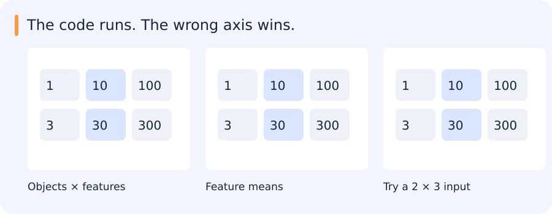

# NumPy, Pandas, data contracts and visual exploration

[All training](index.md) · [Source coverage](sources.md)

Imagine a table with one row per tracked vehicle and three measurements per row. Before computing an average, decide whether you want an average for each vehicle or for each measurement across vehicles. The same array can answer either question. Shapes, axes and row identifiers make that decision explicit.

<details>
<summary>Jump to a concept</summary>

- [Arrays describe both values and layout](#arrays-describe-both-values-and-layout)

- [Indexing, slicing and broadcasting](#indexing-slicing-and-broadcasting)

- [Numerical work needs scale and stability](#numerical-work-needs-scale-and-stability)

- [Pandas is an indexed data model](#pandas-is-an-indexed-data-model)

- [EDA and useful visualizations](#eda-and-useful-visualizations)

- [Retained practice routes](#retained-practice-routes)

</details>

## Arrays describe both values and layout

A NumPy array has shape, dtype, strides and an underlying storage buffer. A three-channel image could be HWC or CHW; the number of dimensions alone does not distinguish them. Define channel order, value range, coordinate units and batch dimension. An unsigned byte subtraction can wrap around; convert to a suitable signed or floating type before computing differences. A reshape reorganizes indexing and may share storage, while a transpose changes axis order. Neither operation by itself converts RGB to BGR.

## Indexing, slicing and broadcasting

### Follow one column through a batch

Three image tiles each have two measurements. Write them as rows (10, 1), (20, 4) and (30, 7). The array has shape (3, 2). Its first axis selects the tile and its second selects the measurement. Taking the mean over axis 0 combines the three tiles and leaves one number for each measurement, (20, 4).

Subtracting (20, 4) from the array subtracts the same two numbers from every row. The result is (−10, −3), (0, 0), (10, 3). NumPy can apply this operation without you explicitly copying the pair three times. This is broadcasting. The rightmost dimensions match here, so each element in the pair lines up with its measurement column.

If you meant to subtract each tile's own mean, you would first compute three numbers instead of two. Keep that result as a (3, 1) array so the single entry per row expands across its columns. A good check is to calculate one row by hand and confirm that its two centered values add to zero.

Basic slices often return views. If `b = a[:, :3]`, editing b may change a. Advanced integer or boolean indexing normally produces a copy, so editing that result may leave a unchanged. Check the intended mutation explicitly rather than guessing from matching printed values. A mask over rows is not a mask over channels. Keep stable sample IDs alongside filtering and reordering.

Broadcasting aligns shapes from the right. Dimensions are compatible if they are equal or one is 1. For an N-by-D feature matrix, a length-D mean can be subtracted per feature. A length-N vector is not automatically a column of sample weights: reshape it to N-by-1. With N equal to D, the wrong operation may run successfully and normalize the wrong axis. Design a non-square counterexample. Vectorized code moves loops into efficient implementations, but materializing N-by-N distances can use far more memory than chunked computation.

## A square array can hide a normalization bug

Consider two objects described by three features: `[[1,10,100],[3,30,300]]`. To centre each feature, subtract its mean across objects. The means are `[2,20,200]`, so the two centred rows should be `[-1,-10,-100]` and `[1,10,100]`.



With three objects and three features, an incorrectly oriented operation may still run because both axes have length three. This two-by-three example makes the roles of the axes visible. The goal is to check what the operation means, not merely whether NumPy accepts it.

```python
import numpy as np

x = np.array([[1, 10, 100], [3, 30, 300]])
feature_means = x.mean(axis=0, keepdims=True)
centered = x - feature_means
print(centered.tolist())
```

This prints:

```text
[[-1.0, -10.0, -100.0], [1.0, 10.0, 100.0]]
```

Keeping the mean as (1, 3) makes the intended feature axis visible.

Shapes, dtypes and indexing become much easier to reason about once every axis has a named role.

### Self-check

X has shape (20, 3), with samples in rows. Which mean removes the average of each feature across samples?

- A. X.mean()

- B. X.mean(axis=1)

- C. X.mean(axis=1, keepdims=True)

- D. X.mean(axis=0, keepdims=True)

<details>
<summary>Show answer and explanation</summary>

**D. X.mean(axis=0, keepdims=True)**

Reducing axis 0 produces one mean per feature. The resulting shape (1, 3) broadcasts across the twenty rows.

</details>

## Numerical work needs scale and stability

Floating-point sums depend on order and precision; compare with tolerances justified by scale, not exact equality by default. Normalize features using statistics fitted only on training data and reuse those values at validation/inference. Protect zero denominators explicitly and report degenerate inputs. If every pixel in a patch is constant, normalized correlation has no defined variance normalization; returning a perfect score would invent evidence.

## Pandas is an indexed data model

A DataFrame pairs columns with row labels. Operations align on index labels, which can silently reorder or introduce missing values. Use `loc` for label-oriented selection and `iloc` for positions. A merge can multiply rows when keys are not unique. Before joining predictions and labels, assert expected key uniqueness and use merge validation; inspect unmatched IDs. Grouping by source video or acquisition session is different from grouping by class and is essential when creating independent evaluation sets.

Missingness carries information. Distinguish absent measurements, failed parsing and a genuine zero. Choose imputation based on the data-generating process; fit its parameters on training data. A date parsed in the wrong timezone can change a cohort or temporal split. Persist schema and units and verify that saving and reloading preserve intended meaning.

### Attach predictions to records by identity

Suppose an inference batch contains frames 101, 102 and 103. A downstream operation sorts predictions by confidence, giving order 103, 101, 102. If you append the ground-truth labels as a plain list in the original order, the row counts still match. The evaluation now compares three predictions with the wrong frames.

A DataFrame can align values by index or join records on an explicit key. Use a stable frame identifier and check the expected relationship before joining. For one prediction per frame, duplicate IDs deserve investigation. For detections, many rows per frame may be normal, so you need the appropriate frame and detection identity for the task. Also check unmatched rows. A join that silently discards frames with no prediction can make a detector appear more complete than it is.

This is a useful companion to the array example. Shape checks catch many mistakes about axes. They cannot tell whether one row still refers to the same real example after sorting or filtering.

### Self-check

Predictions were sorted by confidence. Labels are still in frame order. Which operation preserves the pairing?

- A. Drop the original IDs before comparing

- B. Sort labels by class first

- C. Join on a stable frame ID and inspect unmatched rows

- D. Assign labels in their current order

<details>
<summary>Show answer and explanation</summary>

**C. Join on a stable frame ID and inspect unmatched rows**

Sorting changes row positions. A stable identifier links a prediction to its actual frame, while unmatched rows reveal omissions.

</details>

## EDA and useful visualizations

Start with row counts, duplicate IDs, missingness, ranges and label frequencies. Plot distributions split by class, source, sensor or time, rather than only a global average. Scatterplots reveal relationships and outliers; histograms show distributions and depend on binning; box/violin plots compare groups; a confusion matrix shows directional mistakes. Seaborn gives concise statistical plots, Plotly Express adds hover and selections, and Bokeh offers interactive plots and HoverTools. A library choice does not repair a biased sample.

For an experiment comparison, show effect size and uncertainty alongside the aggregate score. Add representative successful outputs and deliberately selected failure cases, then state how they were chosen. An attractive montage of easy cases is not an unbiased evaluation. Export the plotting data and configuration so another person can regenerate the figure without rerunning training.

## Retained practice routes

The legacy NumPy selection was: 1–31 except 2, 4, 5, 23, 27, 28, 31; then 35, 37–40, 45, 46, 50; then 52–55, 58, 59, 61, 64, 65, 70–72, 74, 75, 83, 89. Use those exercises as remediation if useful, with no requirement to repeat an already understood concept. The Pandas route selected one dataset from sections 1–5 and optionally the Titanic exploration. Boids illustrates interacting agents, vectorized pairwise distances and update-order effects. The current application exercises supply the default practical setting; these historical exercises remain available through the source map.

<details>
<summary>Original source references and provenance</summary>

Original teaching text covering the cited topics, not a verbatim mirror. These references are provenance; no external reading is required to use this chapter.

- [http://cs231n.github.io/python-numpy-tutorial/](http://cs231n.github.io/python-numpy-tutorial/)

- [http://www.numpy.org/](http://www.numpy.org/)

- [https://colab.research.google.com/github/pb111/Data-Analysis-and-Visualization-with-Python/blob/master/Plotly%20basics.ipynb#scrollTo=H6Z5_cV2IEs7](https://colab.research.google.com/github/pb111/Data-Analysis-and-Visualization-with-Python/blob/master/Plotly%20basics.ipynb#scrollTo=H6Z5_cV2IEs7)

- [https://github.com/guipsamora/pandas_exercises](https://github.com/guipsamora/pandas_exercises)

- [https://github.com/guipsamora/pandas_exercises/tree/master/07_Visualization/Titanic_Desaster](https://github.com/guipsamora/pandas_exercises/tree/master/07_Visualization/Titanic_Desaster)

- [https://github.com/rajivramanjani/UdemyPythonDSML/tree/master/06-Data-Visualization-with-Seaborn](https://github.com/rajivramanjani/UdemyPythonDSML/tree/master/06-Data-Visualization-with-Seaborn)

- [https://github.com/rougier/numpy-100](https://github.com/rougier/numpy-100)

- [https://plotly.com/python/plotly-express/](https://plotly.com/python/plotly-express/)

- [https://www.kaggle.com/code/kanncaa1/plotly-tutorial-for-beginners](https://www.kaggle.com/code/kanncaa1/plotly-tutorial-for-beginners)

- [https://www.kaggle.com/learn/overview](https://www.kaggle.com/learn/overview)

- [https://www.kaggle.com/pmarcelino/comprehensive-data-exploration-with-python](https://www.kaggle.com/pmarcelino/comprehensive-data-exploration-with-python)

- [https://www.labri.fr/perso/nrougier/from-python-to-numpy/#id5](https://www.labri.fr/perso/nrougier/from-python-to-numpy/#id5)

- [https://www.tutorialspoint.com/numpy/index.htm](https://www.tutorialspoint.com/numpy/index.htm)

- [https://www.tutorialspoint.com/python_pandas/index.htm](https://www.tutorialspoint.com/python_pandas/index.htm)

- [https://www.tutorialspoint.com/python_pandas/python_pandas_indexing_and_selecting_data.htm](https://www.tutorialspoint.com/python_pandas/python_pandas_indexing_and_selecting_data.htm)

</details>
