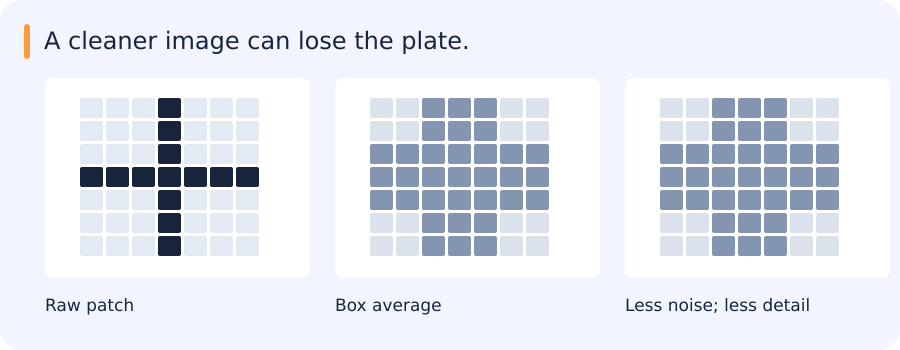

# Signals, filters, edges and Fourier analysis

[All training](index.md) · [Source coverage](sources.md)

A camera turns a scene into a grid of pixel values. A bright spot on a dark patch may come from a real detail or from noise. A filter changes a pixel using other pixels around it, so the rule that combines them determines which details survive.

<details>
<summary>Jump to a concept</summary>

- [An image is a sampled signal](#an-image-is-a-sampled-signal)

- [Smoothing and separability](#smoothing-and-separability)

- [Template matching and edge detection](#template-matching-and-edge-detection)

- [Fourier intuition and implementation](#fourier-intuition-and-implementation)

- [Pyramids and sampling](#pyramids-and-sampling)

- [Choosing a filter for the LPR path](#choosing-a-filter-for-the-lpr-path)

</details>

## An image is a sampled signal

An image samples a scene after optics, sensor response and processing. Resolution, dynamic range and noise affect what can be recovered. Spatial filters combine nearby samples. In one dimension, convolution is `(f*g)[n] = sum_k f[k] g[n-k]`; correlation uses the unflipped relative kernel. They agree for a symmetric real kernel, but derivative signs can differ for an asymmetric one. An impulse kernel reproduces or shifts a signal depending on its location. Linearity follows by distributing the sum over a weighted combination of inputs.

## Smoothing and separability

### One bright pixel, then a bright stripe

Take a row of five grayscale pixels with values 10, 10, 100, 10, 10. The 100 might be sensor noise. Replace the middle pixel with the mean of itself and its two neighbors and it becomes 40. A neighbor also becomes 40 if its window includes the bright pixel. The filter has weakened the spike and spread its effect into nearby pixels.

Now imagine a thin bright stripe across a dark image. A horizontal row across that stripe can have exactly the same five values. An averaging filter sees those values and behaves the same way, even when the stripe belongs to the letter you are trying to read. Changing the window size changes which details survive. That trade-off is visible when you look at a crop of the actual object.

In two dimensions, a square mean gives equal weight to all pixels in a square window. You get the same mean by averaging each row horizontally and then averaging those results vertically, provided the boundary rules agree. Those two passes are what separability buys you. For a 5 × 5 window, each output can use two five-element passes instead of a 25-element sum.

A normalized box filter averages a neighborhood. A Gaussian gives more weight to nearby pixels and controls smoothing with sigma. Increasing sigma reduces fine detail and suppresses high-frequency noise. Kernel support must be large enough to represent the selected Gaussian; truncation and renormalization affect its behavior. Specify boundary padding: zero padding can create a dark edge, reflection synthesizes different neighboring values and valid filtering shrinks the result.

A separable two-dimensional kernel is an outer product of two one-dimensional kernels. Apply a horizontal filter and then a vertical one. A K-by-K filter then needs roughly 2K rather than K squared operations per pixel, ignoring constants and memory costs. Exact separability means rank one; the leading singular vectors give a rank-one approximation when it is not exact. A Gaussian is separable. Normalizing a kernel to sum to one preserves constant regions away from boundaries.

### Calculate one filtered pixel

Take a one-dimensional row of intensities `[0, 0, 9, 0, 0]`. A three-position average gives equal weight to the centre and its two neighbours. The value at the peak becomes `(0 + 9 + 0) / 3 = 3`. Each immediate neighbour also becomes 3 because its window includes the original peak. The intensity is spread out across nearby positions. The code example shows the same operation with extra zero positions on the sides.

Now replace the row by a step, such as `[0, 0, 9, 9, 9]`. At the transition, an averaging window contains both dark and bright samples, so the edge gets less sharp. Inside a constant region the average preserves the original value as long as the weights sum to one and the window stays inside that region. Near the image boundary the padding convention decides what samples the filter sees.

For an LPR crop, evaluate the impact on the recognizer as well as the filtered pixels. Smoothing may make a noisy background more stable and also erase a narrow stroke. An edge detector applied after smoothing inherits both changes.

## Smoothing a plate changes the evidence

A bright pixel in a dark region may be sensor noise. A thin bright stroke may be part of a licence-plate character. A smoothing filter does not know the difference: it combines neighbouring intensities in both cases.



In the illustration, a narrow peak spreads across neighbouring positions and becomes weaker. That may help a noisy image, but the same effect can remove detail needed by OCR. A smoother-looking crop is therefore only an intermediate result; the recognition result still needs checking.

```python
import numpy as np

signal = np.array([0, 0, 0, 9, 0, 0, 0], dtype=float)
kernel = np.ones(3) / 3
smoothed = np.convolve(signal, kernel, mode="same")
print(smoothed.tolist())
```

This prints:

```text
[0.0, 0.0, 3.0, 3.0, 3.0, 0.0, 0.0]
```

The one-dimensional signal makes the averaging visible without image-display settings.

The filter definitions below explain how much information is mixed, where it comes from and what happens near an image boundary.

### Self-check

A three-pixel uniform average sees the window [0, 9, 0]. What does it output at the centre?

- A. 9

- B. 27

- C. 3

- D. 0

<details>
<summary>Show answer and explanation</summary>

**C. 3**

The three equal weights are each 1/3, so the result is (0 + 9 + 0) / 3 = 3.

</details>

Change the blur radius and see which plate strokes survive an edge threshold. [Image filters playground](../playgrounds/image-filters.html)

## Template matching and edge detection

Correlation can search for a known template, but raw intensity similarity changes with illumination. Zero-mean normalized correlation removes additive offsets and positive multiplicative contrast changes when both patches have nonzero variance. It does not create invariance to perspective, scale or occlusion. Large windows collect evidence but may mix multiple surfaces; small windows localize precisely but are noisy and ambiguous.

A derivative estimates local intensity change. Sobel combines differentiation with smoothing in the perpendicular direction. Differentiating a smoothed image reduces noise amplification. Gradient magnitude indicates edge strength; gradient direction indicates the local normal. Canny adds directional nonmaximum suppression and hysteresis: strong responses seed edges and connected weaker responses may survive. The thresholds affect fragmentation and false edges, while smoothing affects localization and sensitivity to noise.

## Fourier intuition and implementation

### Compare stripes that repeat at different rates

Imagine an image made of vertical stripes. In a row of 32 pixels, a dark-to-light-to-dark pattern might repeat twice or eight times. A Fourier representation can describe both rows using repeating waves. The eight-repeat pattern has a higher spatial frequency because the brightness changes more often over the same distance.

A smooth background and fine texture can coexist in one image. Their frequency contributions can differ, so reducing high frequencies often makes the image smoother. A sharp edge also needs higher frequencies. If you remove those components to suppress noise, a sharp boundary spreads across neighboring pixels. Look at the edge itself to see whether the result still serves the task.

The transform stores both the strength and phase of each component. If you shift the stripes sideways, their spacing is the same, but the location of the bright bands changes. The magnitude spectrum can stay the same for a circular shift while the phases change. That is why a picture of spectral magnitudes can tell you which patterns repeat without telling you where the objects are.

The Fourier transform represents a signal as a weighted combination of frequencies. A complex coefficient has magnitude and phase. Low frequencies capture slowly varying structure; high frequencies capture fast changes, including both edges and noise. The DC coefficient represents the sum of samples under the common unnormalized forward transform. A display using fftshift moves DC to the center; the transform itself need not store it there.

Convolution in space corresponds to multiplication in frequency. A discrete FFT directly implements circular convolution; use appropriate padding and cropping for linear convolution. A low-pass mask suppresses high frequencies; a high-pass mask suppresses low ones. A hard frequency cutoff creates ringing because its spatial response is extended and oscillatory. Smooth cutoffs reduce that artifact. Phase often carries strong information about spatial structure, but magnitude also matters: “phase alone contains the image” is an overstatement.

## Pyramids and sampling

Downsampling without limiting frequencies can cause aliasing: different signals become indistinguishable at the lower sampling rate. A Gaussian pyramid smooths and downsamples repeatedly. A Laplacian pyramid stores differences between a level and an expanded coarse estimate; together with the coarse residual it supports reconstruction and multiscale blending. Upsampling creates more samples, not new measured detail. Bilinear interpolation is useful for continuous intensities; nearest-neighbor is often appropriate for categorical segmentation labels.

### Self-check

Thin stripes change into a false coarse pattern after downsampling. Which preprocessing directly addresses that failure?

- A. Low-pass filter before downsampling

- B. Raise contrast after downsampling

- C. Use a smaller crop

- D. Add more edge sharpening

<details>
<summary>Show answer and explanation</summary>

**A. Low-pass filter before downsampling**

Reducing high-frequency detail before sampling lowers aliasing. Sharpening afterwards cannot recover the original frequency information.

</details>

## Choosing a filter for the LPR path

For LPR preprocessing, edge quality matters through its effect on geometry and recognition. An impulse image makes the kernel’s behaviour easy to see; a constant image exposes boundary effects. On real plate crops, a fixed display scale then helps distinguish actual changes from a plotting adjustment. The final comparison belongs at the recognizer output, with examples of characters that improved or became harder to read.

<details>
<summary>Original source references and provenance</summary>

Original teaching text covering the cited topics, not a verbatim mirror. These references are provenance; no external reading is required to use this chapter.

- [https://docs.opencv.org/3.0-beta/doc/py_tutorials/py_tutorials.html](https://docs.opencv.org/3.0-beta/doc/py_tutorials/py_tutorials.html)

</details>
