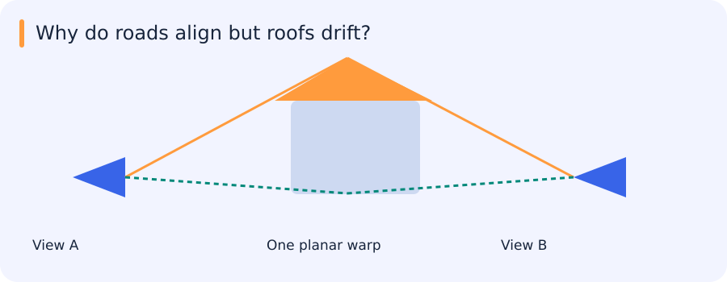

# Hough voting, cameras, stereo and projective geometry

[All training](index.md) · [Source coverage](sources.md)

Two photographs of the same street do not put every landmark at the same pixel. Before aligning them, we need a way to describe where a point moves and when a single mapping is plausible. Line fitting gives one simple geometric model. Camera projection then explains why some image pairs require more than a planar warp.

Jump to a concept

- [Voting for a geometric explanation](#voting-for-a-geometric-explanation)

- [Homogeneous coordinates and transformations](#homogeneous-coordinates-and-transformations)

- [Camera projection](#camera-projection)

- [Stereo and epipolar geometry](#stereo-and-epipolar-geometry)

- [Reading an airborne alignment](#reading-an-airborne-alignment)

## Voting for a geometric explanation

Hough transforms convert local evidence into votes for model parameters. A point (x,y) lies on every line satisfying $\rho=x\cos\theta+y\sin\theta$. It therefore traces a sinusoid in parameter space. Collinear points vote at a common parameter pair. Unlike slope/intercept coordinates, polar parameters include vertical lines without infinite slopes. Choose consistent ranges for signed rho and angle so equivalent lines are not mistakenly counted twice.

An accumulator discretizes parameter space. Coarse bins merge nearby lines; very fine bins fragment noisy evidence. Nonmaximum suppression finds separated peaks, and fitting around a peak or refitting supporting pixels improves localization. Gradient orientation can restrict plausible votes. A large vote count does not prove a line is the desired plate edge: text, background fences and shadows can all vote strongly.

A known-radius circle has two center parameters. A boundary point votes for possible centers at that radius. Unknown radius adds a third parameter and increases computation and ambiguity. Concentric circles share centers but differ in radius; suppressing peaks across too wide a radius range can remove a real second circle. Accumulator neighborhoods should reflect the geometry and desired object separation.

## Homogeneous coordinates and transformations

### Where did this corner move?

Pick the corner of a painted parking bay in two photographs. In the first it is at pixel (100, 50). In the second it is at (120, 45). A translation by (20, −5) accounts for that one corner. If every other corner moves by the same amount, you can use that same translation for the image.

If a second corner moves by a different amount, one translation cannot align both. A rotation or change of scale could account for it. Looking down from a tilted camera introduces another effect. A rectangular bay can look like a trapezoid, so a model that preserves parallel lines cannot account for everything you see. A homography is a mapping that can represent that kind of perspective change for points on one plane.

To keep translations and perspective mappings in the same matrix notation, write an image point as (x, y, 1). After applying the matrix, you may get three coordinates (u, v, w). If w is nonzero, the image location is (u/w, v/w). The division matters. When w changes with the input point, the apparent scale changes across the image.

Represent a 2D point as (x,y,1), with any nonzero scalar multiple representing the same projective point. Translation becomes matrix multiplication. A rigid planar transform rotates and translates; a similarity also scales uniformly. An affine transform allows shear and independent linear scaling while preserving parallel lines. A projective homography has eight degrees of freedom up to scale and maps lines to lines, but need not preserve parallelism or angles.

For generic nondegenerate point correspondences, a similarity can be determined from two points, an affine transform from three noncollinear points and a homography from four with no problematic collinear configuration. More correspondences allow a noisy fit and validation. Parameter count is necessary but not sufficient: repeated, collinear or poorly spread points can make the estimate unstable. Normalize coordinates, inspect conditioning and measure residuals in meaningful units.

### What changes when an image is tilted?

Imagine four detected corners of a licence plate. You want to map them onto the four corners of a rectangle that an OCR model expects. Translation moves every point by the same offset. An affine mapping can also rotate, scale and shear the shape while keeping parallel lines parallel. A perspective view can make originally parallel sides converge, so a projective mapping gives more flexibility.

Four point correspondences in general position can determine a planar homography. Points all lying along one edge do not constrain how the rest of the plate moves. In real data, localization errors can also make the estimated mapping unstable. Check whether the points span the intended surface, and inspect the reprojection errors of extra correspondences if available.

When rendering the output crop, an inverse warp asks where each destination pixel came from in the original image. Interpolation supplies a value when that source location falls between pixel centres. This separates the geometric mapping from the sampling step. A correct transformation can still produce a degraded crop if the source plate covers very few pixels.

### Self-check

Which set can constrain a general planar homography from exact point pairs?

- A. Four points on a single edge

- B. One point and its destination

- C. Four correspondences in general position

- D. Three points on a single line

Show answer and explanation

**C. Four correspondences in general position**

Four corresponding points in general position provide independent constraints. Collinear points leave motion away from the line underdetermined.

## Camera projection

A pinhole camera maps a 3D homogeneous point through `p ~ K [R | t] X`. K describes intrinsics such as focal length in pixels and principal point; R and t describe the world-to-camera pose under a declared convention. Perspective division converts homogeneous coordinates to image coordinates. Lens distortion is a separate model and can break a simple projective fit at wide fields of view. A planar scene or pure camera rotation supports a global inter-image homography. A scene with depth variation and camera translation usually produces parallax that one homography cannot remove.

## When one warp aligns the road but misses the roof

Two airborne images show the same street from different viewpoints. After fitting a homography, road markings overlap neatly while building roofs remain doubled. This can look like a poor fit even when the estimated road alignment is correct.

A homography can describe the relationship between views of one plane. An elevated roof lies on a different surface; camera translation can shift it differently through parallax. More iterations cannot make that single planar model describe arbitrary scene depth.

This is why transformation families and camera geometry matter when choosing what to fit, before worrying about the optimizer.

## Stereo and epipolar geometry

Two cameras observe the same 3D point along two rays. The plane through that point and both camera centers intersects each image in an epipolar line. Thus a point in one image constrains its match to a line in the other, expressed by $x_2^\top F x_1=0$. The fundamental matrix applies to pixel coordinates; the essential matrix applies after intrinsic normalization. Rectification warps the pair so corresponding epipolar lines align, often horizontally. Parallel image planes alone should not be treated as a complete calibration specification.

In a rectified ideal pair, disparity is inversely proportional to depth: $Z=\frac{fB}{d}$ for compatible units and conventions. Small disparity errors at long distance create large depth errors. Occlusion, repeated textures and non-Lambertian surfaces make matching difficult. A larger matching window reduces noise but crosses depth boundaries; a smaller window preserves detail but lacks evidence.

### Reduce a search from an area to a line

Pick a corner in the left image. Every physical point along the camera ray through that corner would project to the same left pixel. Project that ray into the right image and it traces a line, except in degenerate configurations. The matching corner therefore has to lie on the corresponding epipolar line in the ideal geometry. This is why geometric calibration can reduce the search space even before depth is known.

Rectification transforms both images so these searches can be made along corresponding rows. If multiple similar corners appear on a row, geometry alone may not identify the correct one. Texture, consistency with nearby matches and visibility matter too. One camera may see a point that the other camera cannot see at all. A forced correspondence there can produce a plausible disparity with no physical match.

### Self-check

For the same rectified stereo rig, disparity changes from 10 pixels to 5. What happens to estimated depth?

- A. It doubles

- B. It increases by 5 metres

- C. It stays fixed

- D. It halves

Show answer and explanation

**A. It doubles**

Depth is fB/d. Holding focal length and baseline fixed while halving disparity doubles the estimated depth.

## Reading an airborne alignment

An unblended overlay can be more informative than a finished panorama. In the two-image stitching assignment, residuals distributed across the overlap help distinguish a local matching failure from a global model mismatch. Roads and roofs behaving differently suggest parallax; a uniformly reversed displacement suggests checking the transform direction. The same visual symptom can therefore lead to very different repairs.
