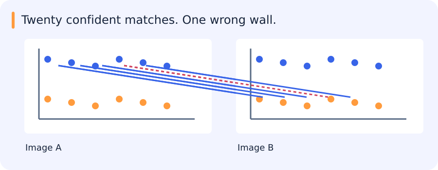

# Features, RANSAC, warping, optical flow and tracking

[All training](index.md) · [Source coverage](sources.md)

## Matching a building with repeated windows

A facade contains many nearly identical windows. A descriptor can match the appearance of one window very well while choosing the neighbouring window in the second image. If several matches make the same mistake, they can support a coherent but shifted alignment.

Geometric agreement is useful evidence, but it is agreement with a chosen model. It helps to inspect where the supporting matches lie and whether they include distinctive parts of the scene. A single unusual corner can expose an ambiguity that many repeated windows cannot.

Feature selection, descriptor matching and robust estimation address different parts of this problem; none replaces the others.

Jump to a concept

- [Choose points that constrain motion](#choose-points-that-constrain-motion)

- [Ambiguity before geometry](#ambiguity-before-geometry)

- [RANSAC and model validity](#ransac-and-model-validity)

- [Warping and blending](#warping-and-blending)

- [Optical flow from local evidence](#optical-flow-from-local-evidence)

- [From flow to tracks and scene understanding](#from-flow-to-tracks-and-scene-understanding)

## Choose points that constrain motion

A flat patch changes little under motion in any direction. An edge constrains motion across the edge but poorly along it. A corner or textured patch changes in both directions. The structure tensor sums local outer products of image gradients. Two large eigenvalues indicate two constrained directions, one large eigenvalue suggests an edge, and two small ones suggest a flat region. Harris uses a scalar response such as `det(M) - k trace(M)^2` to select corners.

Adding a constant to intensity leaves derivatives unchanged; multiplying intensity scales derivative responses and can move points across a fixed threshold. Rotation changes gradient orientation but ideally preserves structure-tensor eigenvalues. Sampling and implementation mean practical invariance is approximate. Harris alone is not scale invariant. SIFT detects extrema in a scale-space approximation, selects an orientation and describes a local distribution of gradients. Its normalization improves robustness to illumination and contrast, while substantial viewpoint or nonrigid changes can still break matching.

## Ambiguity before geometry

Nearest-descriptor matching compares local appearances. A small absolute distance is insufficient if many candidates are equally similar. A nearest/second-nearest distance ratio rejects ambiguous matches; mutual matching checks agreement in both directions. Neither proves geometric correctness. Repeated windows on a building may produce numerous internally consistent but wrong matches.

## RANSAC and model validity

RANSAC repeatedly samples a minimal set, fits a model and counts geometrically consistent observations. If each sample independently has probability w of being an inlier, a minimal set has size s and the desired success probability is p, an idealized iteration count is `log(1-p) / log(1-w^s)`. Unknown inlier ratios and degeneracy complicate this estimate. The residual threshold sets what “consistent” means; too loose accepts wrong matches and too tight rejects noisy true matches. Refit on inliers and assess their spatial coverage.

RANSAC rejects outliers relative to a model, not errors in the model family itself. A global homography cannot explain arbitrary depth parallax. Compare a simpler model when possible, and avoid reporting a successful fit based only on the number of inliers without examining where they lie.

## Warping and blending

Forward warping pushes source pixels to destinations and may create holes or collisions. Inverse warping visits each destination and samples its preimage, using interpolation for fractional coordinates. Verify the matrix direction: swapping image-to-image and inverse maps can produce plausible but incorrect output. Bilinear interpolation weights four neighbors; nearest-neighbor preserves discrete labels. Explicitly distinguish pixels outside the image from valid dark pixels using a validity mask.

For stitching, transform image bounds to determine canvas extent, handle negative coordinates through an offset, and blend only valid overlap. Exposure differences and parallax produce seams and ghosting. Multiband/Laplacian blending can reduce seams, but cannot repair wrong geometry. Preserve an unblended overlay for diagnosis.

## Optical flow from local evidence

Brightness constancy assumes a moving point has approximately unchanged intensity. Linearizing small motion gives `Ix u + Iy v + It = 0`, one equation for two motion components. The aperture problem leaves motion along an edge ambiguous. Lucas–Kanade assumes approximately common motion in a local window and solves a least-squares system. Its normal matrix is the same gradient structure that explains corner quality. Use a stable solver rather than explicitly inverting a nearly singular matrix.

Large motion violates the linearization. Coarse-to-fine pyramids turn it into smaller displacements at coarse scales and refine upward. They can still fail on tiny objects, occlusion, illumination changes or motion boundaries. Motion estimates require confidence and visibility checks, not merely a dense output at every pixel.

## From flow to tracks and scene understanding

A tracker associates observations over time. Keep timestamps, frame gaps, association identity and missing detections explicit. Detector errors and identity switches can dominate a downstream motion classifier. A Kalman filter predicts a state and corrects it with a measurement under uncertainty assumptions; association is a separate decision. Evaluate trajectories by source video and inspect occlusion and camera-motion cases. Adjacent frames are correlated examples and must not be randomly divided across train and test.
