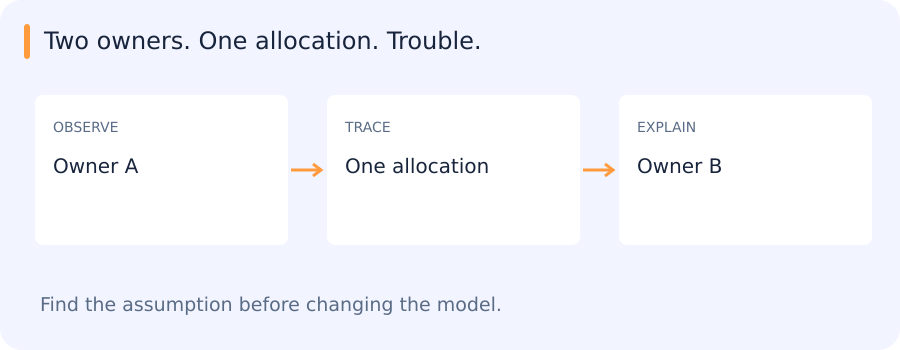

# Archived edge route: C/C++, ownership, builds and binary networks

[All training](index.md) · [Source coverage](sources.md)

## Copying an address does not copy ownership

Two objects hold the same raw pointer to one allocation. If both believe they own it and both destructors delete it, the second deletion is invalid. Copying the address was easy; deciding what the copy means was the important design question.

C++ ownership tools make that decision more explicit. Exclusive ownership, shared ownership and a borrowed view carry different lifetime expectations. A view can remain a valid address value after the object it referred to has already been destroyed.

This archived edge-computing route uses those ideas to connect program behaviour with resource management, builds and runtime efficiency.

Jump to a concept

- [Why retain this route](#why-retain-this-route)

- [Compilation and memory](#compilation-and-memory)

- [Ownership in C++](#ownership-in-c)

- [Modern language features](#modern-language-features)

- [Make, CMake and linker maps](#make-cmake-and-linker-maps)

- [Binary neural networks](#binary-neural-networks)

- [Following a small C++ build](#following-a-small-c-build)

## Why retain this route

The archived Vortex route covered C/C++, compilation, Make/CMake and edge models. It is a role-specific reference, not a new requirement for the Python researcher track. It remains visible so old reading subjects are not silently deleted. Internal exercise repositories and organization-specific tool walkthroughs still require their owners' access and exact materials.

## Compilation and memory

A C/C++ build preprocesses source, compiles translation units, assembles object code and links definitions into a program or library. A declaration tells the compiler an interface; a definition provides storage or implementation. Missing symbols are often link-time problems, while incompatible declarations can create subtler errors. Header dependencies and compiler flags form part of a reproducible build.

An array is a contiguous sequence; a pointer stores an address. An array can decay to a pointer in many expression contexts, but the array object and a pointer object are not interchangeable. A pointer alone does not carry the allocation length or ownership. Stack lifetime, heap allocation and object lifetime differ. A dangling pointer can appear to work before later memory reuse reveals the bug. Buffer bounds and correct allocation/deallocation pairs are essential.

## Ownership in C++

RAII binds resource lifetime to object lifetime, so destruction releases the resource even during exceptions. A unique pointer represents exclusive ownership; a shared pointer uses shared ownership and reference counting; a weak pointer observes shared ownership without extending it. Cycles of strong shared pointers can retain objects indefinitely. Raw pointers and references can be useful nonowning views when lifetime is clear.

Copying an owning raw pointer without a policy can lead to double deletion. The historical “Big Two” rule discussed designing copying and destruction together; modern code also considers move operations and usually favors the rule of zero by delegating resources to standard types. Move transfers or reuses resources under a type's defined semantics; it is not a promise that every moved-from object is empty. Standard containers and smart pointers reduce bespoke ownership code.

## Modern language features

C++11 introduced broad support for move semantics, lambdas, type inference and standard concurrency facilities. Later standards add tools such as structured bindings, optional/variant, concepts and ranges. Exact compiler and standard-library support must be checked for a chosen toolchain. The learning goal is to write explicit ownership and clear interfaces, not memorize a feature release list. A fast matrix-multiplication exercise illustrates cache blocking, layout, vectorization and the need to verify numerical results before claiming speed.

## Make, CMake and linker maps

Make rebuilds targets based on dependency relationships and freshness rules. Automatic header dependency generation prevents a changed header from leaving stale object files. Separate build directories/configurations for different architectures avoid mixing incompatible objects. CMake generates a build system from higher-level target/dependency definitions; it is not the compiler. Record toolchain, build type, flags and linked libraries.

A linker map shows placement and contributions of symbols/sections, useful for diagnosing code/data size on constrained systems. Dead-code elimination, alignment and template instantiations affect binary size. Measure both build reproducibility and execution behavior, including a clean rebuild rather than only an incremental one.

## Binary neural networks

Binarized-network methods constrain some weights and activations to binary values, enabling compact storage and potentially efficient bitwise operations. Training commonly keeps higher-precision latent weights and uses surrogate gradients around non-differentiable quantization. The benefit depends on supported operations, packing and hardware; a binary model is not automatically faster on every GPU. First/last layers may use different precision. Compare accuracy, memory and actual end-to-end latency under the chosen implementation.

## Following a small C++ build

For an edge-role extension, a small multi-file program is enough to expose ownership and build dependencies. Changing a header should rebuild the affected targets; a clean rebuild checks whether the incremental build was hiding stale objects. Compiler or precision changes then need output comparisons as well as timing. The historical Snake, QR-reader and GEMM exercises remain options for that route.

Original source references and provenance

Original teaching text covering the cited topics, not a verbatim mirror. These references are provenance; no external reading is required to use this chapter.

- [http://c-faq.com/](http://c-faq.com/)

- [http://make.mad-scientist.net/papers/advanced-auto-dependency-generation/](http://make.mad-scientist.net/papers/advanced-auto-dependency-generation/)

- [http://make.mad-scientist.net/papers/multi-architecture-builds/](http://make.mad-scientist.net/papers/multi-architecture-builds/)

- [http://www.cplusplus.com/doc/tutorial/](http://www.cplusplus.com/doc/tutorial/)

- [http://www.ericbrasseur.org/cppcen.html](http://www.ericbrasseur.org/cppcen.html)

- [https://arxiv.org/abs/1602.02830](https://arxiv.org/abs/1602.02830)

- [https://berthub.eu/articles/posts/cpp-intro/](https://berthub.eu/articles/posts/cpp-intro/)

- [https://docs.google.com/presentation/d/1XTYlX8d0c-5N5RRqymkGA0HoNu9oQmgcORKBZ5_61Uc/edit](https://docs.google.com/presentation/d/1XTYlX8d0c-5N5RRqymkGA0HoNu9oQmgcORKBZ5_61Uc/edit)

- [https://github.com/CVBranch/Fast-GEMM](https://github.com/CVBranch/Fast-GEMM)

- [https://github.com/CVBranch/QR-Reader](https://github.com/CVBranch/QR-Reader)

- [https://github.com/planetchili/snek](https://github.com/planetchili/snek)

- [https://hackaday.com/2019/07/30/c20-is-feature-complete-heres-what-changes-are-coming/](https://hackaday.com/2019/07/30/c20-is-feature-complete-heres-what-changes-are-coming/)

- [https://interrupt.memfault.com/blog/get-the-most-out-of-the-linker-map-file](https://interrupt.memfault.com/blog/get-the-most-out-of-the-linker-map-file)

- [https://medium.com/@__r/installing-clion-on-windows-for-c-c-newbies-like-me-4a346aaf9557](https://medium.com/@__r/installing-clion-on-windows-for-c-c-newbies-like-me-4a346aaf9557)

- [https://smartbear.com/blog/develop/the-biggest-changes-in-c11-and-why-you-should-care/](https://smartbear.com/blog/develop/the-biggest-changes-in-c11-and-why-you-should-care/)

- [https://www.artima.com/cppsource/bigtwo.html](https://www.artima.com/cppsource/bigtwo.html)

- [https://www.codingame.com/playgrounds/2205/7-features-of-c17-that-will-simplify-your-code/introduction](https://www.codingame.com/playgrounds/2205/7-features-of-c17-that-will-simplify-your-code/introduction)

- [https://www.cprogramming.com/challenge.html?inl=nv](https://www.cprogramming.com/challenge.html?inl=nv)

- [https://www.geeksforgeeks.org/difference-pointer-array-c/](https://www.geeksforgeeks.org/difference-pointer-array-c/)

- [https://www.gnu.org/software/make/manual/make.html](https://www.gnu.org/software/make/manual/make.html)

- [https://www.learn-c.org/](https://www.learn-c.org/)

- [https://www.tutorialspoint.com/makefile/why_makefile.htm](https://www.tutorialspoint.com/makefile/why_makefile.htm)

