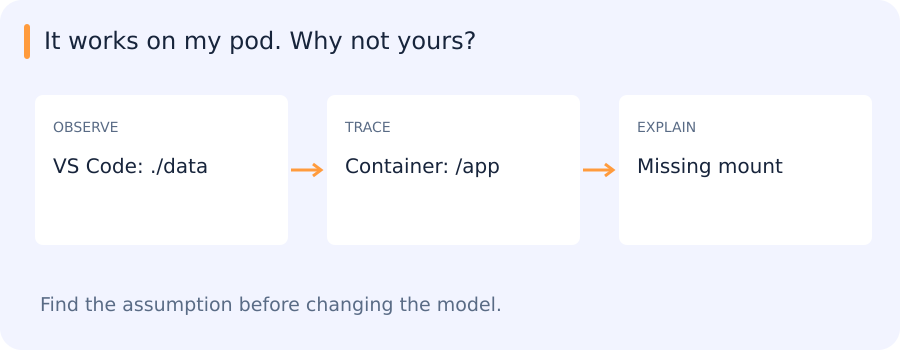

# Linux, Git, containers and Python foundations

[All training](index.md) · [Source coverage](sources.md)

## It works on my pod. Why not yours?

Your polygon parser works in VS Code and fails inside a container. The code is identical. Before changing Python, follow the paths.

| Notice | Interpret | Check |
| --- | --- | --- |
| Same file name | Different working directory | Different file |

Reveal the catch

The environment is an input too. A Git commit alone does not include your data or interpreter.

**Try it in 60 seconds:** Run the same input from a different working directory. Which assumption breaks?

Read for understanding, not page completion. Skip what you can already explain.

Jump to a concept

- [From an experiment to a reproducible program](#from-an-experiment-to-a-reproducible-program)

- [Linux and process boundaries](#linux-and-process-boundaries)

- [Git as an experiment record](#git-as-an-experiment-record)

- [Python execution and program design](#python-execution-and-program-design)

- [Environments, Docker and deployment](#environments-docker-and-deployment)

- [Connect this to your work](#connect-this-to-your-work)

## From an experiment to a reproducible program

A research result depends on code, inputs, configuration and execution environment. A notebook output without these cannot establish which experiment produced it. Begin by locating the working directory, interpreter, imported package and input path. Relative paths resolve from the process working directory, not necessarily from the script's directory. A script that works only because an IDE silently changes that directory has an undeclared dependency.

## Linux and process boundaries

A filesystem contains directories and files addressed by absolute or relative paths. Learn to inspect and navigate with `pwd`, `ls`, `cd`, `cat` and a text search tool. Standard input, standard output and standard error are distinct streams. A pipe connects output to the next process's input; redirection writes a stream to a file. Check exit status as well as printed text: a program can print a warning and exit successfully or print nothing and fail. Permissions control reading, writing and execution. Environment variables are inherited by child processes and are strings, so configuration needs parsing and validation.

A process has its own address space; a terminal is just one way to interact with it. A tmux or screen session lets a long-running terminal task survive a disconnected client, but does not make the task restart after a machine failure. Know how to inspect processes, interrupt a job, read logs and distinguish a running process from a completed result. Avoid treating missing output as evidence of success.

## Git as an experiment record

A commit records a tree of tracked files plus metadata and parent history. The working tree contains your current files; the staging area selects the next commit. A branch is a movable reference to a commit; HEAD identifies the current checkout. Inspect `git status` and `git diff` before staging, and inspect the staged diff before committing. A local commit is not yet a remote backup. Fetch updates your view of the remote; merging combines histories and may require resolving conflicting edits. Resolve a conflict by understanding the intended behavior on both sides, then rerun the relevant example.

Use small feature branches and reviewable merge requests for exercises. Keep datasets, checkpoints, generated environments and credentials out of source history. Record their locations and checksums separately. To reproduce a result, check out the commit and load the matching configuration and model artifact, rather than assuming the current branch is equivalent.

## Python execution and program design

Python executes code through an interpreter and normally compiles source to bytecode internally. Dynamic typing means names refer to objects whose types are known at runtime. Assignment binds a name; it does not copy an object. If two variables refer to one list, mutation through either is visible through both. Prefer explicit inputs and return values to hidden mutable global state. Functions isolate behavior; modules organize related behavior; classes combine state with operations when an object's lifecycle matters.

Use exceptions for failed operations with useful context. A broad exception handler that returns an empty list can turn a failed image read into an apparently valid negative prediction. Validate file formats, coordinate systems and required fields at the boundary. Context managers close files even on exceptions. Iterators and generators support streaming, avoiding a full in-memory list when handling large data. Write docstrings for assumptions that types cannot express, such as units, array layout or whether a box endpoint is inclusive.

## Environments, Docker and deployment

A virtual environment isolates Python packages. Pip installs packages; uv manages environments and resolved dependencies. Conda is another environment/package system that appeared in the legacy material; this project's supported route is uv. Select the actual pod interpreter in VS Code and inspect where imports come from. A lockfile makes dependency selection repeatable; it does not include datasets or pretrained weights.

A Docker image is a layered filesystem and execution specification. A container is an instance with its own running processes and writable layer. Mount persistent data explicitly: deleting a container can remove unmounted results.

Build context determines what a Dockerfile can copy. A published port and a process listening on the expected interface are both needed for access. Compose describes connected services for local work; an OpenShift Deployment manages replicas, a Service provides an internal address and a Route exposes the chosen service. Check readiness, requests, logs and a real response instead of equating an accepted manifest with a working deployment.

## Connect this to your work

In the manual shape-rendering capstone, trace one input through parsing, validation, geometry and rendering. Make a new input yourself and predict its output before running it. Later, build the first SAM2 service manually as specified in its assignment. Use agent explanations after the manual boundaries allow them, but personally demonstrate the execution path and explain the change.

Original source references and provenance

Original teaching text covering the cited topics, not a verbatim mirror. These references are provenance; no external reading is required to use this chapter.

- [http://python-3-patterns-idioms-test.readthedocs.io/en/latest/Factory.html](http://python-3-patterns-idioms-test.readthedocs.io/en/latest/Factory.html)

- [https://docs.python-guide.org/writing/style/](https://docs.python-guide.org/writing/style/)

- [https://docs.python.org/3/library/xml.etree.elementtree.html](https://docs.python.org/3/library/xml.etree.elementtree.html)

- [https://docs.python.org/3/tutorial/](https://docs.python.org/3/tutorial/)

- [https://www.atlassian.com/git/tutorials/learn-git-with-bitbucket-cloud](https://www.atlassian.com/git/tutorials/learn-git-with-bitbucket-cloud)

- [https://www.katacoda.com/courses/docker](https://www.katacoda.com/courses/docker)

- [https://www.tutorialspoint.com/python/index.htm](https://www.tutorialspoint.com/python/index.htm)

- [https://www.tutorialspoint.com/unix/index.htm](https://www.tutorialspoint.com/unix/index.htm)

