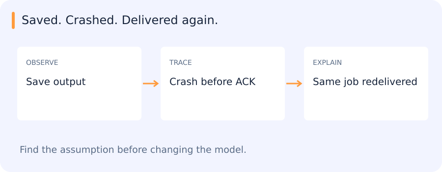

# HTTP, SQL, services and application boundaries

[All training](index.md) · [Source coverage](sources.md)

A labeling request crosses several boundaries. A client sends an image reference, a worker runs the model and a store saves the result. The user needs to retrieve the correct annotation even if a worker restarts partway through. Each boundary has its own success condition, which becomes easier to understand if we follow one job all the way through.

<details>
<summary>Jump to a concept</summary>

- [Requests are explicit interfaces](#requests-are-explicit-interfaces)

- [SQL and persistent data](#sql-and-persistent-data)

- [Services, queues and state](#services-queues-and-state)

- [Research interfaces](#research-interfaces)

- [Connecting the service boundaries](#connecting-the-service-boundaries)

</details>

## Requests are explicit interfaces

HTTP connects clients and services through methods, paths, headers and bodies. A request to an inference endpoint needs a defined payload schema, encoding, maximum size and response/error schema. A connection timeout and a read timeout answer different questions. A successful TCP connection does not prove model readiness, and a 200 response does not prove the returned prediction belongs to the submitted image. Validate IDs, shapes and required fields at both ends.

A requests-style client sends data, checks status and parses the body. Do not retry every exception blindly: a timeout can occur after the service already committed work. Retrying then duplicates side effects unless a stable request identity supports idempotency. Authentication, serialization and schema evolution are separate from model quality. Logs should carry request/task IDs without exposing credentials or large sensitive inputs.

### Self-check

A client times out after sending a create-job request and retries. What helps the server recognize that both requests refer to one intended job?

- A. A different server port for each retry

- B. A longer display title

- C. A stable request key reused across retries

- D. A new random job ID on every retry

<details>
<summary>Show answer and explanation</summary>

**C. A stable request key reused across retries**

A stable key gives the server an identity it can look up when a request may already have succeeded.

</details>

## SQL and persistent data

A relational table stores rows with declared columns and constraints. A primary key identifies a row; a foreign key expresses a relationship to another table. SELECT filters and projects rows; JOIN combines related tables; GROUP BY aggregates. A many-to-many join can multiply counts, so check cardinality before interpreting a metric. NULL represents missing/unknown information and has different comparison semantics from a normal value. Use parameterized queries rather than building SQL by concatenating untrusted input.

An index can accelerate selected access patterns but costs storage and write work. Query plans reveal what is actually scanned. A transaction groups operations that must succeed or fail together; isolation defines interactions with concurrent changes. Saving a prediction and marking a task complete in separate unprotected operations can leave contradictory state after a crash. Files and a broker may not share a single database transaction, so design recovery using stable IDs and explicit states.

### Trace one annotation through a retry

A request for frame 7 creates job J and returns a response. A network timeout leaves the client unsure whether the request reached the server. When the client retries, a stable request key gives the server a way to look up the existing job. Reusing that identity also makes it possible to trace a later worker result back to the original request.

Now suppose the worker saves the result, then crashes before acknowledging the job. On redelivery the worker may run inference again. If the persistent result store enforces one result per job and the write is atomic, the committed result remains unambiguous. A plain read followed by an insert can race with another worker, which is why the database constraint and transaction matter.

Keep status and result separate when inspecting failures. An HTTP response accepting work establishes that the request reached the application. A saved result establishes that work reached the store. A consumer successfully loading the result establishes the next boundary.

## Services, queues and state

A service boundary should expose a meaningful operation with versioned inputs/outputs. Separate pure model prediction from transport and persistence so the same computation can be checked locally and through the actual consumer. A queue buffers jobs; a worker converts jobs into durable outputs. Define retryable errors, terminal errors and how partial results are recognized. A completed job is supported by a saved/reloaded artifact and a consumer check, not simply an in-memory flag.

## Handling a job that arrives a second time

A worker saves a prediction, then crashes before acknowledging its job. The broker later delivers that job again. Saving first protected the result, but it also left a window in which the same work can be repeated.



A stable job ID lets the system recognize that repeat. The tiny example below stores one result under that identity. A real implementation also needs durable storage, atomic operations and a policy for conflicting outputs; an in-memory dictionary does not provide those guarantees.

```python
outputs = {}

def save_once(job_id, prediction):
    return outputs.setdefault(job_id, prediction)

save_once("frame-7", {"cars": 1})
save_once("frame-7", {"cars": 1})  # Redelivery, same identity.
print(len(outputs))
```

This prints:

```text
1
```

HTTP, database transactions and queue acknowledgements each cover a different boundary. Recovery depends on how the application connects them.

### Self-check

A worker saves its output, then crashes before acknowledging the message. What can happen?

- A. The saved result proves the broker acknowledged it

- B. The message can never be delivered again

- C. The message may be redelivered and must be safe to replay

- D. The broker automatically deletes the saved result

<details>
<summary>Show answer and explanation</summary>

**C. The message may be redelivered and must be safe to replay**

Saving and acknowledgement are different operations. Durable, idempotent writes handle replay after the gap between them.

</details>

## Research interfaces

A component contract includes data formats, units, label order, supported shapes and relevant numerical behavior. Keep experiment changes within authorized components and compare alternatives on the same held-out population. Preserve checkpoints/configurations and visual evidence for multiple runs so tradeoffs remain inspectable. A single “best” score can conceal better recall at a slightly larger compute cost or a severe failure on one camera.

## Connecting the service boundaries

The SAM2 and RabbitMQ assignments give these interfaces a concrete setting: a request becomes model work, an output is persisted and another component consumes it. The archived HTTP/SQL outline did not specify separate exercises. In the active projects, following one result across these boundaries reveals what has actually completed and what could still be repeated after a failure.
