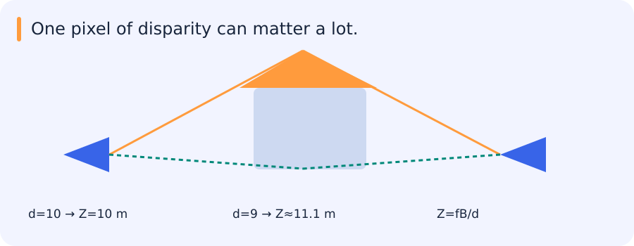

# 3D vision, depth, reconstruction and learned scene representations

[All training](index.md) · [Source coverage](sources.md)

A camera records where a point appears in its image, and several points at different distances can appear in the same place. A second viewpoint can supply information about distance. To understand when it helps, start with the geometry of projecting a 3D point into each camera.

Jump to a concept

- [Geometry before architecture](#geometry-before-architecture)

- [Depth and ambiguity](#depth-and-ambiguity)

- [3D representations](#3d-representations)

- [Differentiable rendering and neural fields](#differentiable-rendering-and-neural-fields)

- [Data and evaluation](#data-and-evaluation)

- [Connection to airborne imagery](#connection-to-airborne-imagery)

## Geometry before architecture

A 2D image collapses depth through projection, so reconstructing a 3D scene requires extra observations or assumptions. Calibrated stereo provides two rays; structure from motion estimates camera poses and sparse points from multiple views; multiview stereo densifies geometry given sufficient overlap and reliable appearance. Bundle adjustment jointly refines camera/point parameters by minimizing reprojection error. Its gauge freedoms, outliers and initialization need explicit handling.

### Why two camera positions can reveal distance

Hold up a finger and look at it with one eye, then the other. The finger shifts against the background. The two viewpoints see the same 3D point at different image positions, and nearby points usually shift more. Stereo depth uses that difference after accounting for camera geometry.

A camera model gives the relationship between image positions and viewing rays. Once the relative camera poses are known, matching a point in both views gives two rays that ideally intersect at the point. Noise and imperfect calibration mean they may not meet exactly. Triangulation estimates a 3D position consistent with the observations. With nearly parallel rays, small matching errors can move that estimate a long way.

In a rectified stereo pair, matching points share a row under the ideal model. Disparity is their horizontal coordinate difference. Rectification and known focal length and baseline make the later depth calculation possible. A visually plausible match across repeated windows still needs to correspond to the same physical point.

### Self-check

A calibrated single image supplies the pixel location of a point. What does that location determine in the ideal camera model?

- A. Its unique distance from the camera

- B. Its depth without additional assumptions

- C. Its complete world coordinates

- D. A viewing ray along which the point could lie

Show answer and explanation

**D. A viewing ray along which the point could lie**

Several 3D points along the same ray project to the same pixel. Another observation or assumption is needed to determine distance.

## Depth and ambiguity

A monocular network can learn depth-related priors from data, but the image alone does not uniquely determine metric depth in every scene. A model may infer typical object size or camera height and fail when those priors change. Relative depth ordering and metric depth are different targets. Aligning predictions to ground truth with a fitted scale/shift changes what the metric claims; declare that protocol. Evaluate boundaries, reflective surfaces, occlusions and depth ranges rather than one global mean.

## How a small disparity error changes depth

In an ideal rectified stereo pair, depth follows `Z = fB/d`. With a focal length of 100 pixels and a one-metre baseline, a disparity of ten pixels corresponds to ten metres. A disparity of nine pixels corresponds to about 11.1 metres.

The same one-pixel change matters much more at smaller disparities: changing two pixels to one changes the inferred depth from 50 to 100 metres. A visually small matching error can therefore become a large error in world coordinates.

Calibration, viewpoint and the chosen scene representation determine what can be inferred from the images and how reliable that inference is.

### Self-check

For a rectified rig with fB = 100 metre-pixels, what depth corresponds to a disparity of 4 pixels?

- A. 4 metres

- B. 40 metres

- C. 10 metres

- D. 25 metres

Show answer and explanation

**D. 25 metres**

The depth is fB/d = 100/4 = 25 metres.

## 3D representations

A point cloud stores sampled locations, optionally colors, features and uncertainty. A voxel grid discretizes space and becomes costly as resolution increases in three dimensions. A mesh represents surfaces using vertices and faces; its connectivity can express shape compactly but requires topology decisions. Implicit fields represent quantities such as occupancy or signed distance as a function of position. Each representation supports different rendering, editing and loss calculations.

Distances between point sets, such as Chamfer-like objectives, depend on sampling density and can hide topological problems. A dense point cloud can be systematically offset. Metric units, coordinate axes and world-to-camera conventions need the same care as array layouts in 2D. A left-handed/right-handed mismatch can yield a recognizable but reflected reconstruction.

## Differentiable rendering and neural fields

Differentiable rendering connects a scene representation to predicted images and propagates image losses toward scene parameters. A neural radiance field models viewing-dependent radiance and volume density and renders by integrating along camera rays. It can synthesize novel views when trained with suitable images/poses, but visual agreement does not automatically give an accurate physical surface or generalize to unseen lighting. Gaussian-splat-style scene representations use explicit spatial primitives with learned appearance for efficient rendering; visibility and geometry assumptions still matter.

## Data and evaluation

Learned reconstruction may memorize scene identity or infer hidden surfaces from a prior. Test novel viewpoints separately from novel scenes. Record camera calibration, exposure, motion blur and rolling-shutter considerations when relevant. Check geometric consistency, held-out image rendering and metric measurements according to the application. A good rendered view can coexist with poor depth behind an observed surface.

## Connection to airborne imagery

Buildings and elevated structures produce viewpoint-dependent displacement. A planar warp that aligns roads may misalign roofs, which can mimic construction change. Use multiview geometry and metadata to reason about parallax before labeling a difference as semantic. For a bounded exercise, project a few known 3D points into two synthetic cameras, triangulate them and perturb image locations to inspect depth uncertainty.

The old 3D lecture remains in the course map. No separate reconstruction project is required by this syllabus. Ask the agent to explain the geometric ambiguity of one image and then demonstrate it using two different 3D configurations that produce similar projections. Bring that example to the mentor instead of only listing model names.

Original source references and provenance

Original teaching text covering the cited topics, not a verbatim mirror. These references are provenance; no external reading is required to use this chapter.

- [https://cs231n.stanford.edu/slides/2025/lecture_15.pdf](https://cs231n.stanford.edu/slides/2025/lecture_15.pdf)

