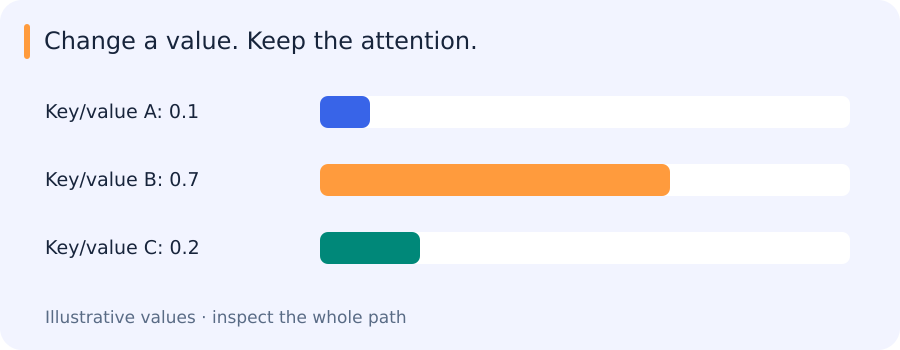

# Tokens, attention, Transformers and vision Transformers

[All training](index.md) · [Source coverage](sources.md)

## Separating where attention looks from what it reads

Suppose attention has assigned three input positions weights of 0.1, 0.7 and 0.2. Their scalar values are 1, 5 and 0. The weighted sum is 3.6.



Now change only the middle value from 5 to 2. With those weights unchanged, the result becomes 1.5. The example separates two jobs inside attention: queries and keys determine the weights, while values supply the content being combined.

```python
import numpy as np

weights = np.array([0.1, 0.7, 0.2])
values = np.array([1.0, 5.0, 0.0])
print(round(float(weights @ values), 2))
values[1] = 2.0
print(round(float(weights @ values), 2))
```

This prints:

```text
3.6
1.5
```

This small weighted sum is the last step of attention. The rest of the layer explains how the model learns the projections and produces the weights.

<details>
<summary>Jump to a concept</summary>

- [Tokens and embeddings](#tokens-and-embeddings)

- [Attention from shapes](#attention-from-shapes)

- [Order, heads and architecture](#order-heads-and-architecture)

- [Vision Transformers](#vision-transformers)

- [What attention does not prove](#what-attention-does-not-prove)

- [Seeing a mask change the computation](#seeing-a-mask-change-the-computation)

</details>

## Tokens and embeddings

Before the model can compare positions, it needs a representation for each input unit. A text tokenizer assigns IDs to units that may be subwords or byte-based pieces rather than whole words. A learned embedding table turns those IDs into vectors. This also explains why text length in characters is not the same as sequence length: unusual strings and different languages may produce different token counts. Word2vec provides an earlier example of learning vectors through context prediction or discrimination; its training objective determines which similarities are useful, and its static word vectors do not resolve every context-dependent meaning.

## Attention from shapes

In a full attention layer, the weights in the opening example are computed from the input. For N token vectors collected in X, learned projections produce queries Q, keys K and values V. The operation is `softmax(Q K^T / sqrt(d_k) + mask) V`. The Q–K comparison produces a weight for each available position; multiplying by V combines the content at those positions. Self-attention creates all three projections from the same sequence, but they are generally different tensors. Cross-attention uses a separate memory for keys and values: a translation decoder, for example, queries the encoder’s representation.

The division by sqrt(d_k) happens before softmax. Under common initialization assumptions it moderates the growth in score variance as key dimension increases, helping avoid an excessively sharp distribution. Multiplying the result after softmax would change its magnitude rather than serve the same purpose. Masks change which positions are available: a causal mask excludes future positions, while a padding mask excludes absent tokens. A mask broadcast along the wrong axis can leave the output shape unchanged while letting forbidden information through.

## Order, heads and architecture

The comparisons alone do not tell the model where a token appeared. Ordinary self-attention without positional information is permutation equivariant: rearranging the inputs rearranges the corresponding outputs. Pooling can then produce an invariant summary. Absolute or relative positions, including rotary schemes, introduce order or geometry in different ways. Multiple heads allow different learned projections and interaction maps, although that does not guarantee a distinct interpretable role for every head.

A Transformer block also includes feedforward layers, residual connections and normalization. An encoder typically permits bidirectional context. An autoregressive decoder uses causal attention, and an encoder-decoder architecture additionally connects decoder queries to encoder memory. “Decoder” names an architectural role and does not mean every decoder performs text generation. A DETR decoder produces object representations through a related but task-specific design.

## Vision Transformers

For an image, patches can play the role of tokens. A Vision Transformer projects each patch into a vector and applies attention to the resulting sequence. A class token or pooling can summarize the image; a dense task can instead use the spatial tokens. Patch size therefore affects both sequence length and the detail directly represented by each input token. Doubling image height and width at fixed patch size gives roughly four times as many tokens, and the pairwise score work in full attention can grow by about sixteen times. Actual memory and latency also depend on the implementation.

Changing resolution changes the spatial token grid and may require positional adaptation. Padding, interpolation and windowing rules must match the implementation. Swin uses local windows, shifted interaction patterns and hierarchical feature scales to reduce cost and build multiscale representations. CNNs encode stronger local weight-sharing structure; ViTs offer flexible long-range interaction. Data, pretraining and compute determine the actual tradeoff.

## What attention does not prove

An attention heatmap is a pattern of aggregation, not an automatic causal explanation or a segmentation mask. Global receptive access does not guarantee a tiny object remains detectable after patchification and preprocessing. Model output can attend to context shortcuts. Evaluate controlled occlusions and example-level behavior if making interpretability claims.

## Seeing a mask change the computation

To inspect attention beyond the weighted sum, use one query and three short key vectors. Compute their dot products, scale them and apply softmax, then compare the weighted values. Masking one key should remove its contribution and redistribute the remaining weights. This small calculation is also a practical way to detect an axis error that a larger model’s output shape would not reveal.

<details>
<summary>Original source references and provenance</summary>

Original teaching text covering the cited topics, not a verbatim mirror. These references are provenance; no external reading is required to use this chapter.

- [https://cs231n.stanford.edu/slides/2025/lecture_8.pdf](https://cs231n.stanford.edu/slides/2025/lecture_8.pdf)

- [https://jalammar.github.io/illustrated-transformer/](https://jalammar.github.io/illustrated-transformer/)

- [https://jalammar.github.io/illustrated-word2vec/](https://jalammar.github.io/illustrated-word2vec/)

- [https://lilianweng.github.io/posts/2018-06-24-attention/](https://lilianweng.github.io/posts/2018-06-24-attention/)

</details>
