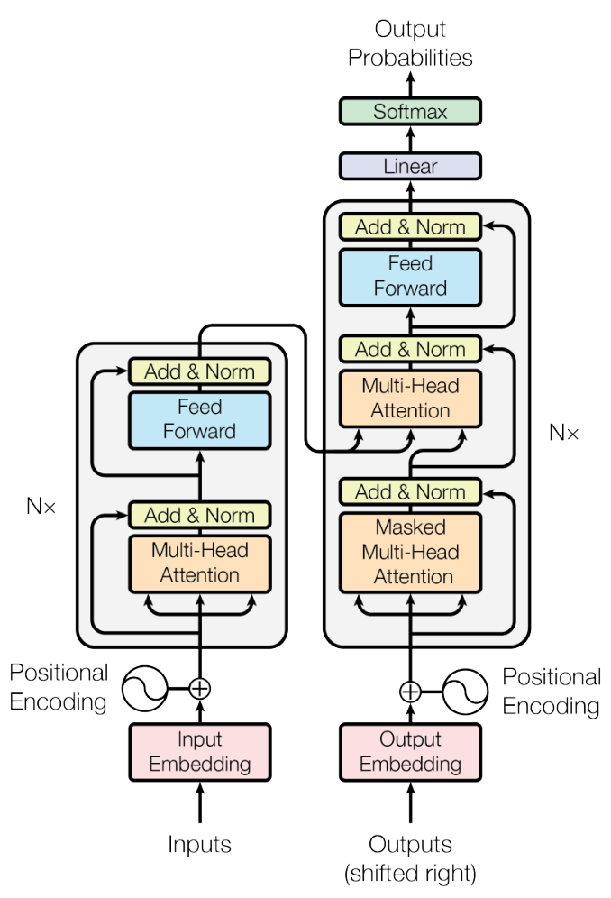

# The Transformer: from translation to self-attention

[All training](index.md) · [Source coverage](sources.md)

A model reading a sentence or a picture receives a collection of input units. A word may depend on another word far away, and one image patch may need context from another part of the scene. Attention computes a different weighted combination of available information for each position.

<details>
<summary>Jump to a concept</summary>

- [Why translation led to the Transformer](#why-transformers)

- [Tokens and embeddings](#tokens-and-embeddings)

- [Attention from shapes](#attention-from-shapes)

- [Order, heads and architecture](#order-heads-and-architecture)

- [Walk through the original encoder and decoder](#original-transformer)

- [Which part would you use?](#transformer-families)

- [Vision Transformers](#vision-transformers)

- [What attention does not prove](#what-attention-does-not-prove)

- [Seeing a mask change the computation](#seeing-a-mask-change-the-computation)

</details>

## Why translation led to the Transformer

Translate “The truck that passed the two cars *was* red.” To choose the verb form, a model needs the singular subject *truck*, even though the nearest noun, *cars*, is plural. To place words correctly in the output language, it also needs a way to look back at the source while it is writing the translation.

One early encoder–decoder approach read the source from left to right with a recurrent network and handed the decoder a summary. In an RNN, the state at position 8 depends on the state at position 7, which depends on position 6. Information from the beginning travels through those intermediate updates. An attention-equipped recurrent decoder could already look back at all the encoder states instead of relying on a single summary. The 2017 Transformer took the next step. It used attention to exchange information across positions inside the encoder and decoder too, replacing recurrence in the architecture.

In a self-attention layer the representation for *was* can get a contribution directly from *truck*. A learned comparison decides how much to read from each position. During training the source tokens are known, so the encoder can calculate all those comparisons in parallel within a layer. The trade-off is a matrix with one entry for every query–key pair. Doubling a sequence length quadruples the number of entries in ordinary full self-attention.

## Tokens and embeddings

Before the model can compare positions, it needs a representation for each input unit. A text tokenizer assigns IDs to units that may be subwords or byte-based pieces rather than whole words. A learned embedding table turns those IDs into vectors. This also explains why text length in characters is not the same as sequence length: unusual strings and different languages may produce different token counts. Word2vec provides an earlier example of learning vectors through context prediction or discrimination; its training objective determines which similarities are useful, and its static word vectors do not resolve every context-dependent meaning.

## Attention from shapes

### Calculate one attention row by hand

Imagine three image tokens, one for a vehicle-sized patch and two for its surroundings. For the vehicle query, suppose the three compatibility scores after scaling are (0, 1, 0). Softmax exponentiates each entry and divides by the total. The resulting weights are about (0.21, 0.58, 0.21). This is one row of an attention map.

Now give those same tokens scalar values (2, 10, 4). The query's output is the weighted sum, about 7.03. If the middle value becomes 0, the output drops to about 1.27 even though the heatmap stays exactly the same. The heatmap shows the weights used to combine the values. You also need the values to know what information was combined.

In a model the compatibility scores come from comparing one query vector with each key vector. Each value can be a vector too, so the weighted sum combines vectors coordinate by coordinate. Repeat for each query and stack the rows. This is the computation that the matrix notation below performs at once.

In a full attention layer, the weights in the numerical example are computed from the input. For N token vectors collected in X, learned projections produce queries Q, keys K and values V. Let M be the additive mask and let softmax act across the keys of each query. The output is

$$
\operatorname{Attention}(Q,K,V)=\operatorname{softmax}\left(\frac{QK^\top}{\sqrt{d_k}}+M\right)V
$$

The Q–K comparison produces a weight for each available position; multiplying by V combines the content at those positions. Self-attention creates all three projections from the same sequence, but they are generally different tensors. Cross-attention uses a separate memory for keys and values: a translation decoder, for example, queries the encoder’s representation.

The division by $\sqrt{d_k}$ happens before softmax. Under common initialization assumptions it moderates the growth in score variance as key dimension increases, helping avoid an excessively sharp distribution. Multiplying the result after softmax would change its magnitude rather than serve the same purpose. Masks change which positions are available: a causal mask excludes future positions, while a padding mask excludes absent tokens. A mask broadcast along the wrong axis can leave the output shape unchanged while letting forbidden information through.

### Build the weights before multiplying the values

Start with one two-dimensional query `[1, 0]` and keys `[1, 0]`, `[0, 1]` and `[−1, 0]`. The dot products are 1, 0 and −1. After division by the square root of 2, softmax exponentiates the three scaled scores and divides each by their sum. This gives positive weights that add to one. The first position receives the most weight because its key aligns best with the query.

Give the three positions scalar values of 10, 20 and 30. The output is the weighted sum of those numbers. Now mask the third position. Its weight becomes zero and the remaining weights are renormalized. The output can change even if the first two scores and all the values stay fixed, because the set competing for weight changed.

| Change one part | What can change in the result |
| --- | --- |
| Change a key while keeping the query fixed | That position's score and the distribution across positions |
| Change a value while keeping scores and masks fixed | The content of the sum, with the same weights |
| Mask a position | Which positions contribute and how the remaining weights are normalized |

In a real layer there are many queries, and the values are vectors. The same calculation runs for each query. Tracking the score matrix as query positions by key positions is especially helpful when constructing masks.

## Separating where attention looks from what it reads

Suppose attention has assigned three input positions weights of 0.1, 0.7 and 0.2. Their scalar values are 1, 5 and 0. The weighted sum is 3.6.


Now change only the middle value from 5 to 2. With those weights unchanged, the result becomes 1.5. The example separates two jobs inside attention: queries and keys determine the weights, while values supply the content being combined.

```python
import numpy as np

weights = np.array([0.1, 0.7, 0.2])
values = np.array([1.0, 5.0, 0.0])
print(round(float(weights @ values), 2))
values[1] = 2.0
print(round(float(weights @ values), 2))
```

This prints:

```text
3.6
1.5
```

This small weighted sum is the last step of attention. The rest of the layer explains how the model learns the projections and produces the weights.

### Self-check

Keep Q, K and the mask fixed, and change only V. What can change in that attention operation?

- A. The weighted output, with the same weights

- B. The weights, with the same output guaranteed

- C. The mask only

- D. The QK scores only

<details>
<summary>Show answer and explanation</summary>

**A. The weighted output, with the same weights**

Q, K and the mask determine the weights. V supplies the content of the weighted sum.

</details>

Change a key or a value and compare the attention weights with the weighted output. [Attention map playground](../playgrounds/attention-map.html)

## Order, heads and architecture

### When moving a token changes the meaning

Read “truck follows car” and “car follows truck.” The tokens are the same, but the two statements reverse the relationship. Plain self-attention with no position information treats a reordering of input tokens as a corresponding reordering of its outputs. For a given query it can compare content, but the calculation has no direct clue which token came first.

Position information can enter through learned position vectors or through the way query and key vectors interact. For image patches, two-dimensional position can tell the model which patches are neighbors. A causal mask has a different job. It prevents a query from reading future positions, which matters when training a model to predict the next token. It changes which entries a row can use before softmax.

A multihead layer learns several sets of query, key and value projections. Each head gets to form its own attention rows, and the results are combined. A head might weigh nearby patches strongly, but its map only shows where its weights went for that input. To see how much a head mattered for a prediction, compare outputs with a controlled intervention and check several examples.

The comparisons alone do not tell the model where a token appeared. Ordinary self-attention without positional information is permutation equivariant: rearranging the inputs rearranges the corresponding outputs. Pooling can then produce an invariant summary. Absolute or relative positions, including rotary schemes, introduce order or geometry in different ways. Multiple heads allow different learned projections and interaction maps, although that does not guarantee a distinct interpretable role for every head.

A Transformer block also includes feedforward layers, residual connections and normalization. An encoder typically permits bidirectional context. An autoregressive decoder uses causal attention, and an encoder-decoder architecture additionally connects decoder queries to encoder memory. “Decoder” names an architectural role and does not mean every decoder performs text generation. A DETR decoder produces object representations through a related but task-specific design.

## Walk through the original encoder and decoder

Think of the encoder as preparing a searchable version of the source. The decoder maintains a representation of the answer so far. It consults the source at each decoder layer and eventually produces a score for every token that could come next.

- **Prepare the input.** Token IDs index a learned embedding table. A vector is added for each position, so two copies of a word can carry different positions. The original paper used sinusoidal position vectors in its reported architecture.

- **Encode the source.** Every encoder layer first runs multi-head self-attention over the source. Source positions can read each other in both directions, with padding excluded. A feed-forward network then transforms each position independently using the same weights at each position.

- **Read the target prefix.** The decoder starts with embeddings of the target tokens available so far. Masked self-attention lets each position read itself and earlier positions. The input is shifted during training so reading its own input position cannot reveal the token it is asked to predict.

- **Look back at the source.** Decoder cross-attention forms its queries from the decoder states. Its keys and values come from the final encoder states. A decoder position preparing a color word can therefore combine evidence from source positions describing the color and the vehicle.

- **Predict the next token.** A linear projection maps each final decoder vector to one raw score (logit) per vocabulary entry. During training, token-level cross-entropy rewards the correct next token. At inference, a decoding rule chooses an output token from the logits, appends it and repeats until the end token or a length limit.

The original base model stacked six encoder layers and six decoder layers. The decoder has three sublayers in each layer: masked self-attention, source cross-attention and a position-wise feed-forward network. Each sublayer in the original used a residual addition followed by layer normalization. The addition gives the incoming representation a direct path, while normalization operates across the features of each token. Many later Transformers move the normalization before the sublayer.

[](assets/paper-figures/transformer-fig1.webp)

Original figure from [Vaswani et al., Attention Is All You Need (2017), Fig. 1](https://arxiv.org/html/1706.03762#S3.F1). Open the image for full size.

<details>
<summary>Read the figure</summary>

Read from the bottom up. Find the arrow crossing from the encoder to the decoder. In the attention block it enters, where do the queries come from?

<details>
<summary>Show answer</summary>

The decoder states provide the queries. The incoming encoder output provides the keys and values. The masked self-attention block below it reads the target prefix.

</details>

</details>

### What each piece contributes

| Piece | What it changes | What to track |
| --- | --- | --- |
| Position encoding | Gives the model information about order | Token positions, or relative positions in some variants |
| Attention | Moves information between token positions | Which sequence supplies queries, keys and values |
| Multiple heads | Learns several projections and weighted combinations in parallel | Concatenate the head outputs and project back to the model width |
| Feed-forward network | Mixes features nonlinearly within each token | Usually widens the vector internally and projects it back |
| Residual path and LayerNorm | Preserve an additive path and regulate feature scales | Which representation reaches the next layer |
| Output projection | Turns features into task scores | Vocabulary logits for translation, class logits or other outputs for downstream tasks |

### Why training can predict a whole sentence at once

Suppose the target tokens are `camion rouge <end>`. Feed the decoder `<start> camion rouge`. At the first position it predicts `camion`, at the second it predicts `rouge`, and at the third it predicts `<end>`. The causal mask stops the first position from seeing the second input. This use of the true prefix during training is called teacher forcing. At inference the model must use its own earlier choices, so token generation still proceeds step by step even though training can score all target positions together.

With three target positions and five source positions, one decoder self-attention head has a 3 × 3 score matrix and one cross-attention head has a 3 × 5 matrix. The output has three rows in both cases because there are three queries. If you remember only one shape rule, count the queries to know how many output vectors come back.

### Self-check

Why does the training decoder need both shifted inputs and a causal mask?

<details>
<summary>Show answer and explanation</summary>

Shifting makes the current input token the previous output token. The mask prevents a position from looking at later inputs, where the answer it is supposed to predict is already present. Together they let the model train on a whole sequence while respecting the same information boundary as generation.

</details>

## Which part would you use?

For translation, the original encoder–decoder arrangement gives each output token access to an entire source sentence and the generated prefix. An encoder-only model gives all input tokens bidirectional context and is a useful backbone for classifying a document or producing a vector for each patch. A decoder-only language model uses a stack of causally masked self-attention layers, typically without a separate source encoder. The prompt and generated answer form one sequence. The Transformer block is a reusable design. The objective, attention mask and output head determine what task it performs.

## Vision Transformers

Now replace the text input with a grid of patches and keep the encoder. Follow the input shapes, position embeddings, class token and transfer recipe in [the Vision Transformer chapter](dl-vit.md).

Primary source: [Vaswani et al., Attention Is All You Need](https://arxiv.org/abs/1706.03762), sections 1–4 and Figure 1.

## What attention does not prove

An attention heatmap is a pattern of aggregation, not an automatic causal explanation or a segmentation mask. Global receptive access does not guarantee a tiny object remains detectable after patchification and preprocessing. Model output can attend to context shortcuts. Evaluate controlled occlusions and example-level behavior if making interpretability claims.

## Seeing a mask change the computation

To inspect attention beyond the weighted sum, use one query and three short key vectors. Compute their dot products, scale them and apply softmax, then compare the weighted values. Masking one key should remove its contribution and redistribute the remaining weights. This small calculation is also a practical way to detect an axis error that a larger model’s output shape would not reveal.

<details>
<summary>Original source references and provenance</summary>

Original teaching text covering the cited topics, not a verbatim mirror. These references are provenance; no external reading is required to use this chapter.

- [https://cs231n.stanford.edu/slides/2025/lecture_8.pdf](https://cs231n.stanford.edu/slides/2025/lecture_8.pdf)

- [https://jalammar.github.io/illustrated-transformer/](https://jalammar.github.io/illustrated-transformer/)

- [https://jalammar.github.io/illustrated-word2vec/](https://jalammar.github.io/illustrated-word2vec/)

- [https://lilianweng.github.io/posts/2018-06-24-attention/](https://lilianweng.github.io/posts/2018-06-24-attention/)

</details>
