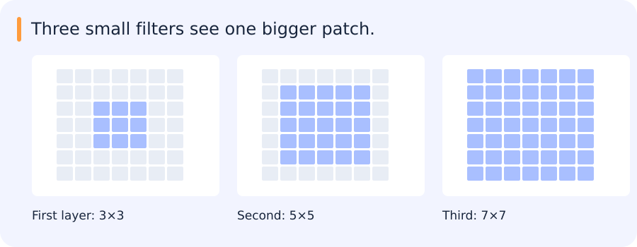

# CNNs, receptive fields and efficient architecture families

[All training](index.md) · [Source coverage](sources.md)

An image is a grid of numbers. A useful pattern, such as a bright edge or a wheel-shaped region, can occur at many positions in that grid. A convolution applies the same learned local calculation at different positions. Stacking those calculations changes how far each output can see and how densely outputs are sampled.

Jump to a concept

- [Convolution as a learned local operator](#convolution-as-a-learned-local-operator)

- [Receptive field](#receptive-field)

- [Fully connected and fully convolutional](#fully-connected-and-fully-convolutional)

- [Architecture ideas worth retaining](#architecture-ideas-worth-retaining)

- [Dense outputs and multiscale features](#dense-outputs-and-multiscale-features)

- [What visual evidence establishes](#what-visual-evidence-establishes)

## Convolution as a learned local operator

A convolutional layer shares local weights across positions, giving an inductive preference for local, translation-related patterns. Many software layers compute cross-correlation under the name convolution. With input height H, padding P, dilation D, kernel K and stride S, output height is `floor((H+2P-D(K-1)-1)/S)+1`. Compute width similarly. For groups=1, the parameter count is K_h K_w C_in C_out plus optional biases. Activation storage and memory traffic can dominate cost even when parameter count is modest.

### One edge detector applied across a row

Take the row `[1, 1, 4, 4]` and a two-position filter with weights `[-1, 1]`, applied in the order commonly used by neural network layers. With stride one and no padding, it computes differences on the three adjacent pairs. The outputs are 0, 3 and 0. The same weights detect a rise wherever it occurs, which is the basic idea behind sharing a filter across positions.

In two dimensions, the local calculation covers a patch of rows and columns and can combine information across channels. A learned filter can respond to a pattern more complicated than a simple difference. The output remains a grid. Padding changes which values the filter sees at the border, and stride changes how far the filter moves between outputs. With stride two, the toy row would use the first and third adjacent pairs and skip the rise between the middle two values.

Stacking layers extends the set of input positions that can influence a final output. It also changes how often those outputs are sampled, especially when a layer increases stride. These are the two quantities tracked in the receptive-field calculation.

## Receptive field

Track the effective sampling jump j and receptive field r: start j=1,r=1, then update `r_new = r + (K-1) D j` and `j_new = j S`. Three stride-one 3-by-3 layers give a 7-by-7 theoretical receptive field. With equal channel counts, their convolution weights total 27C squared versus 49C squared for one 7-by-7 layer, plus more nonlinearities and intermediate activations. The theoretical field says which input could influence a feature, not how much each pixel actually influences it.

For VGG-16, apply the recurrence separately to every convolution and pool, rather than assuming pooling adds no receptive field. With 3-by-3 stride-one padded convolutions and 2-by-2 stride-two pools, the receptive field after pool5 is 212 pixels with a jump of 32. Counting after conv5_3 gives 196 instead. State exactly which output is measured. For L identical stride-S, dilation-one convolutions, r is `1+(K-1) sum_{i=0}^{L-1} S^i`; when S=1 this becomes 1+L(K-1).

## How three small convolutions see a larger region

Three stride-one 3×3 convolutions give a final output a theoretical 7×7 receptive field. The last layer reads nearby features, but those features already contain information from their own neighbours.

This matters for small objects. A deep feature may have access to a large input region while being sampled on a coarse grid. Access to the object does not guarantee that its detail survives resizing, downsampling or the learned computation.

Kernel size, stride and feature scale describe different aspects of this process. Keeping them separate helps explain both localization behaviour and compute cost.

## Fully connected and fully convolutional

A dense layer over flattened H-by-W-by-C features can be expressed as an H-by-W convolution with output channels matching the dense outputs, using a consistent weight reshape. A dense operation applied separately at each spatial position corresponds to a 1-by-1 convolution. These are different cases; converting every dense layer to 1-by-1 convolution is not generally correct. The conversion can slide the learned computation over larger inputs but does not guarantee unchanged semantics at different resolutions.

## Architecture ideas worth retaining

LeNet/AlexNet illustrate learned hierarchical features and larger-scale training. VGG organizes depth with small filters. Inception combines branches at multiple effective scales. ResNet adds residual paths, easing optimization of deep networks; residual addition requires compatible shapes and may use a projection. DenseNet concatenates features from earlier blocks, changing channel growth and memory. These are design choices about information and gradients, not just year-by-year names.

MobileNet uses depthwise spatial filtering followed by pointwise channel mixing to reduce arithmetic. An ordinary K-by-K layer costs roughly K squared C_in C_out per location, while a depthwise/pointwise pair costs K squared C_in plus C_in C_out. Actual latency depends on kernels, tensor sizes and hardware. EfficientNet coordinates depth, width and resolution scaling instead of independently increasing one dimension. EfficientDet adds a multiscale feature-fusion/detection design; backbone efficiency does not alone determine detection performance.

## Dense outputs and multiscale features

FCN turns classification-style computation into spatial predictions with learned or fixed upsampling. U-Net combines a downsampling path with upsampling and skip features to recover localization. FPN combines semantic deep features with higher-resolution maps for multiple scales. Interpolation creates a denser grid but does not restore measurements already discarded by a coarse feature extractor. For tiny objects, examine input resolution, stride, receptive field, feature fusion and target assignment together.

## What visual evidence establishes

Activation maps show where a model responds; saliency/gradient maps show sensitivity under a chosen calculation. Neither is automatically a causal explanation. Compare changed inputs, occluded regions and known failure cases. In the cloud-segmentation proposal, specify spectral bands, cloud/shadow definitions and cross-scene evaluation. A pretty mask on a handpicked scene is useful for understanding, while held-out measurements establish generalization.

Original source references and provenance

Original teaching text covering the cited topics, not a verbatim mirror. These references are provenance; no external reading is required to use this chapter.

- [https://cs231n.github.io/assignments2025/assignment2/](https://cs231n.github.io/assignments2025/assignment2/)

- [https://cs231n.github.io/convolutional-networks/](https://cs231n.github.io/convolutional-networks/)

- [https://cs231n.stanford.edu/slides/2025/lecture_5.pdf](https://cs231n.stanford.edu/slides/2025/lecture_5.pdf)

- [https://cs231n.stanford.edu/slides/2025/lecture_6.pdf](https://cs231n.stanford.edu/slides/2025/lecture_6.pdf)

- [https://distill.pub/2019/computing-receptive-fields/](https://distill.pub/2019/computing-receptive-fields/)

