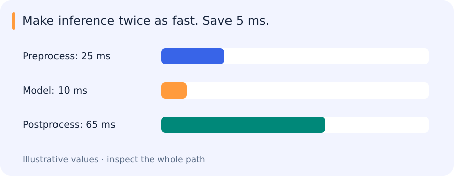

# Transfer learning, LoRA, quantization, compilation and parallel execution

[All training](index.md) · [Source coverage](sources.md)

## Where an inference request spends its time

Consider a request with illustrative timings of 25 ms for preprocessing, 10 ms in the model and 65 ms for postprocessing. Halving model time reduces the total from 100 to 95 ms.

The model did become twice as fast, but the user sees only a five-millisecond improvement. Reducing the 65 ms stage has more room to help this workload. Batching, data transfer and queueing can change the picture again, which is why the whole request needs measuring.

Quantization, compilation and adaptation techniques are useful tools once we know which constraint we need to change.

Jump to a concept

- [Adapt only what the task needs](#adapt-only-what-the-task-needs)

- [Latency, throughput and memory](#latency-throughput-and-memory)

- [Quantization, pruning and distillation](#quantization-pruning-and-distillation)

- [Compilation](#compilation)

- [Distributed execution](#distributed-execution)

- [Production handover](#production-handover)

## Adapt only what the task needs

Transfer learning reuses a pretrained representation. A frozen encoder plus a trained head is cheap and isolates adaptation; partial or full fine-tuning changes the representation and may improve domain fit while increasing compute and forgetting risk. Freeze requires checking both which parameters receive gradients and whether stateful layers update buffers. Keep preprocessing and label mapping coupled to the checkpoint.

LoRA parameterizes a weight update as a low-rank product, often `Delta W = scale * B A`, training the smaller matrices while keeping the base weight fixed. Rank limits the update family. Adapter location, scaling and initialization matter. Fewer trainable weights can reduce optimizer state without eliminating the base model's inference memory or forward cost. If merging an adapter into weights, verify that the resulting predictions match under the intended precision.

## Latency, throughput and memory

Latency measures time for a request; throughput measures completed work per unit time. Batching may improve throughput while increasing the time an individual request waits. Measure preprocessing, transfer, model forward, decoding and output merging separately and end to end. Synchronize asynchronous GPU work correctly for timing. Record warm-up, batch/shape distribution, hardware, precision and memory peaks. A FLOP estimate is not a latency measurement.

## Quantization, pruning and distillation

Quantization maps values to a lower-precision representation with scales and clipping ranges. Weight-only quantization, weight-and-activation quantization and mixed precision have different hardware paths. Outlier channels can dominate error; calibration data must represent deployment. Smaller storage does not guarantee faster execution if kernels or conversions dominate. Re-evaluate rare classes, small objects and calibration, not just aggregate accuracy.

Pruning removes weights, channels or structures; unstructured zeros need suitable sparse execution to become a speedup. Structured pruning changes tensor dimensions and may require retraining. Distillation trains a student using a teacher's outputs or features alongside available labels. It transfers the teacher's useful behavior and some errors; independent labels and held-out evaluation remain necessary. Compare the whole student path to the teacher rather than only parameter count.

## Compilation

A model compiler captures or traces computation, transforms a graph and generates/selects kernels. Operator fusion can reduce memory traffic and launch overhead. Dynamic shapes, unsupported operations and data-dependent control flow can cause graph breaks or multiple compiled variants. Compilation is a transformation of execution, not proof of equivalent results. Compare outputs, task metrics and error cases across representative shapes and record compile time separately from steady-state latency.

## Distributed execution

Data parallelism replicates a model and partitions examples; gradients are synchronized for training. Model parallelism places different model pieces on different devices. Tensor parallelism divides operations, while pipeline parallelism divides layers/stages. Communication, synchronization and idle bubbles can limit speedup. A larger global batch changes the training experiment unless learning-rate/schedule choices are reconsidered. Mixed model/data strategies require a clear accounting of replicas, batch and state.

A distributed sampler must avoid unintentionally duplicating or omitting examples when evaluating. Aggregate metric numerators and denominators correctly rather than averaging unequal-batch averages. Persist a checkpoint with enough metadata to load it outside the training topology. A distributed job reporting completion is not evidence that the single-device inference consumer reads the same weights.

## Production handover

The final deliverable is an inference-only notebook that loads inputs, preprocesses, constructs/loads the model, predicts, postprocesses and writes outputs using declared packages. Demonstrate it from a fresh process and compare to the verified research path on representative and edge cases. Keep a separate validation entry point for output comparisons and dataset checks. Document observed limitations and missing assets explicitly; do not hide a model download inside inference.

An optimization is useful when the complete inference path becomes cheaper while retaining the agreed behaviour on representative inputs and edge cases. Reloading the saved artifact in a fresh process checks that the delivered system includes the change. The comparison needs both the measured savings and any remaining limits.

Original source references and provenance

Original teaching text covering the cited topics, not a verbatim mirror. These references are provenance; no external reading is required to use this chapter.

- [https://cs231n.stanford.edu/slides/2025/lecture_11.pdf](https://cs231n.stanford.edu/slides/2025/lecture_11.pdf)

- [https://docs.pytorch.org/tutorials/beginner/saving_loading_models.html](https://docs.pytorch.org/tutorials/beginner/saving_loading_models.html)

- [https://huggingface.co/blog/hf-bitsandbytes-integration](https://huggingface.co/blog/hf-bitsandbytes-integration)

- [https://huggingface.co/docs/peft/main/en/conceptual_guides/lora](https://huggingface.co/docs/peft/main/en/conceptual_guides/lora)

- [https://huggingface.co/docs/transformers/en/training](https://huggingface.co/docs/transformers/en/training)

- [https://huggingface.co/docs/transformers/perf_train_gpu_many](https://huggingface.co/docs/transformers/perf_train_gpu_many)

- [https://medium.com/geekculture/ai-compilers-ae28afbc4907](https://medium.com/geekculture/ai-compilers-ae28afbc4907)

- [https://www.ultralytics.com/glossary/inference-latency](https://www.ultralytics.com/glossary/inference-latency)

