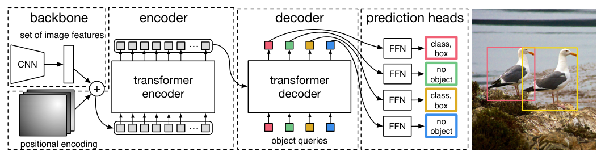

# Detection heads: dense CNNs and DETR-style decoders

[Chapter index](index.md) · [Source coverage](sources.md)

Two trucks sit on a road. A classification head can answer “truck present.” A detector must return two separate boxes with scores. The head needs features that retain where things are, plus a training rule that decides which predictions should learn from which objects.

For worked anchor-assignment and query-ceiling diagnostics, see [Deep learning intuition: find the bottleneck](dl-intuition.md).

Jump to a concept

- [CNN detection: let many locations propose boxes](#dense-detection)

- [DETR: let queries ask for objects](#set-detection)

- [Where did the small truck disappear?](#trace-a-small-object)

## CNN detection: let many locations propose boxes

Start with a CNN map of shape B × D × H × W. Each location represents a neighborhood in the image. A dense head applies small convolutional branches across that map to predict class scores and box geometry at each location. In a simplified anchor-free design, each location predicts left, top, right and bottom distances from a reference point. For a reference point at image coordinates (40, 32), distances (8, 4, 12, 6) decode to corners (32, 28) and (52, 38). Real implementations define whether distances are in grid units or image pixels.

Anchor-based heads instead predict offsets from predefined boxes. A feature pyramid gives the head grids at several strides, so small objects have more possible prediction sites on finer maps. During training a rule assigns locations or anchors to targets. Several locations can legitimately learn about the same object, so typical dense inference filters overlapping detections with non-maximum suppression (NMS). A two-stage CNN detector such as Faster R-CNN first makes proposals, then pools features in each proposal and predicts its class and box refinement.

## DETR: let queries ask for objects

Original DETR starts with a CNN feature map, projects and flattens it into spatial tokens, and supplies position information. A Transformer encoder contextualizes those image features. The decoder keeps a fixed number of object slots. Learned object-query embeddings distinguish those slots, and cross-attention lets each slot read spatial image features. Decoder self-attention lets slots exchange information. The resulting vector for each slot goes through two small heads, one for raw class scores (logits), including a no-object class for slots that represent no detection, and one for normalized box coordinates.

Take three prediction slots for two trucks. The training matcher considers the class and box costs for each slot–truck pair, and chooses a one-to-one assignment with the lowest total cost. Two slots receive object targets and the remaining slot learns no-object. When predicting on a new image there are no target boxes to match against. The model outputs its slot predictions and you read their class scores and boxes. The one-to-one training objective is what lets the original DETR omit NMS in its standard inference path.

Original figure from [Carion et al., End-to-End Object Detection with Transformers (2020), Fig. 2](https://arxiv.org/abs/2005.12872). Open the image for full size.

Read the figure

Follow one colored object query from the bottom of the decoder to its prediction head. Where does the image enter, and what happens to an unused slot?

Show answer

The image enters through the CNN and encoder on the left. The decoder reads that spatial memory. A slot can predict no object, as shown for two of the slots in the diagram.

### What changes across DETR variants?

| Family | How image features reach the queries | Why the change matters |
| --- | --- | --- |
| Original DETR | Full attention over flattened spatial CNN features | Introduces set prediction and learned query slots; fine grids are expensive |
| Deformable DETR | Samples a small set of learned offsets around reference points across feature levels | Makes multi-scale access practical and improves convergence and small-object performance in the paper |
| Detection DINO | Builds on deformable detection with box-related queries and refinement | Denoising training and improved query initialization strengthen the detector; this is a different model family from the self-supervised DINO encoder |

A DETR-style decoder can also read spatial ViT features. Remove special tokens before rebuilding a spatial grid, keep its dimensions and positional information, and project the channel width if the decoder expects another width. A dense convolutional head can also read a map built from ViT patch tokens. Backbone choice and head choice are separate decisions.

## Where did the small truck disappear?

Start with the input resize and the ground-truth coordinates. A tiny truck may be represented by only a fraction of a patch or a few cells after resizing. Compare fine and coarse features. Then inspect candidate boxes or query predictions *before* thresholding, and map them back to the input image to check the coordinate transform. This separates failures in features, prediction, score filtering and post-processing. For rotated boxes, also track the angle convention and the geometry used in matching and evaluation.

### Self-check

Do you need a ViT backbone to use a DETR-style head? Where is the Transformer in the original DETR?

Show answer and explanation

Original DETR extracts image features with a CNN and then uses a Transformer encoder and decoder to process those features and produce object-slot representations. The class and box predictions are small heads on the slot vectors.

Primary sources: [DETR](https://arxiv.org/abs/2005.12872), [Deformable DETR](https://arxiv.org/abs/2010.04159) and [Detection DINO](https://arxiv.org/abs/2203.03605). See the [detection and segmentation survey](dl-detection.md) for the wider architecture families.
