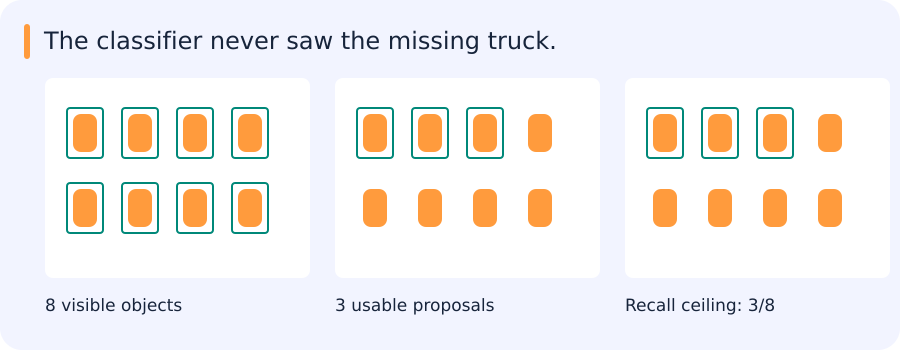

# Detection, segmentation, OCR and the retained paper families

[All training](index.md) · [Source coverage](sources.md)

A classifier can report that an image contains a car. A detector also reports where individual cars are. That extra requirement introduces candidate locations, box coordinates, training assignments and decisions about repeated predictions. Following one image through those stages makes it possible to compare architectures and diagnose misses.

Jump to a concept

- [Outputs determine the formulation](#outputs-determine-the-formulation)

- [From R-CNN to shared features](#from-r-cnn-to-shared-features)

- [Single-stage and multiscale detection](#single-stage-and-multiscale-detection)

- [Set prediction with DETR](#set-prediction-with-detr)

- [Dense masks and OCR](#dense-masks-and-ocr)

- [Faces and embeddings](#faces-and-embeddings)

- [Comparing detectors through the same scene](#comparing-detectors-through-the-same-scene)

- [Angular-margin detail](#angular-margin-detail)

- [Missing labels and fair paper comparisons](#missing-labels-and-fair-paper-comparisons)

## Outputs determine the formulation

Classification predicts labels for an image or crop. Detection predicts a variable set of localized objects. Semantic segmentation predicts a category per pixel; instance segmentation separates individual objects. Panoptic segmentation combines semantic coverage with instance identity for appropriate classes. A detector's class vocabulary, box parameterization and maximum output count are operational constraints. Record whether geometry is horizontal, oriented or mask-based.

### Follow two neighbouring cars through the output

An image-level classifier might answer that cars are present. A semantic segmentation model could mark car pixels, including pixels belonging to both cars. An instance segmentation model would also distinguish which pixels belong to each car. A bounding-box detector represents the cars by separate boxes, which can be enough for counting or for cropping candidates for another model.

Now suppose one car is partly occluded and two predicted boxes overlap its neighbour. The task needs a definition of what counts as one instance, a geometry for representing it and a rule for matching predictions to labels. These choices affect both training and evaluation. For remote-sensing scenes, an oriented box may describe a tilted long vehicle more tightly than an axis-aligned box. The overlap calculation and labels should use the geometry the evaluation declares.

When a detector misses one car, inspect the earliest stage at which its evidence disappears. A model can have enough capacity to classify a crop accurately and still never propose a usable crop in a dense scene.

## Finding the stage that lost an object

Eight objects are visible in an image, but only three usable proposals reach the classifier. Even a perfect classifier at that point can recover at most three of the eight objects in this toy example.

The missed detections need to be traced through the pipeline: resizing may erase detail, proposal generation may miss the object, classification may reject it, or postprocessing may suppress it. These causes call for different changes. Increasing classifier capacity addresses only some of them.

The detection architectures below distribute those responsibilities differently, which is more useful to understand than their names alone.

## From R-CNN to shared features

R-CNN classifies proposed crops using CNN features and separates stages for classification and localization. Its repeated crop computation is expensive. Fast R-CNN shares image feature computation and pools region features for classification and box regression. Faster R-CNN introduces a learned region-proposal network over shared features. Explain the proposal stage's recall separately from the final head: no later classifier can recover an object that never receives a usable proposal.

ROI pooling discretizes region locations; ROIAlign samples continuously to reduce alignment errors. Background/negative sampling, class assignment, box coding and loss balance all affect behavior. Dense unlabeled objects can become harmful negatives if annotation completeness is assumed incorrectly. A successful detector training run does not prove that the intended class definition matches operational users.

## Single-stage and multiscale detection

SSD predicts classes and box offsets from several feature scales using default boxes. YOLO families use dense prediction designs with implementation-specific assignment, heads and postprocessing; do not infer a particular anchor or loss design solely from the family name. FPN combines semantic information across feature resolutions. EfficientDet combines an efficient backbone, bidirectional feature fusion and a scaled detection design. Small objects benefit from appropriate resolution and assignment, but increasing resolution also increases memory, duplicates at tile boundaries and merging costs.

NMS suppresses overlapping lower-scored predictions under a specified overlap rule. It may remove duplicate predictions, but also true neighboring objects. Class-wise versus class-agnostic NMS and oriented versus horizontal overlap differ. Record threshold order and whether confidence filtering or a maximum-detections cap removes candidates first.

## Set prediction with DETR

DETR uses learned object queries, attention over image features and a matching-based training objective for a fixed set of output slots. Bipartite matching associates predictions with ground-truth objects; unmatched predictions learn a no-object outcome. Query count limits simultaneous outputs and feature stride affects small objects. Deformable attention samples selected feature locations across scales to improve efficiency and learning. The DINO detector line and the DINO self-supervised encoder line share a name but solve different problems.

### Two objects and three predictions

Suppose a training image has two labelled cars. A DETR-style head returns three candidate slots. The training assignment compares candidates with labels using costs that can include class and box terms. It chooses a one-to-one assignment, so two slots can be matched to the two objects and the remaining slot can be trained as no object. This assignment is made from all candidate–label pairs together. A slot that is individually a good match for both objects can only take one of them.

Contrast this with a detector trained on dense locations. Several neighbouring locations may receive positive supervision for one object, with duplicate removal later during inference. The training assignment and the inference duplicate policy are therefore connected design choices. Inspect both before attributing a difference in crowded scenes to the backbone or class head.

Candidate or query limits can also matter. If the model can emit at most three distinct objects, an image with four valid instances cannot have perfect recall under one-to-one evaluation. In tiled images, record this limit per tile and inspect whether the misses occur before or after merging across tiles.

## Dense masks and OCR

FCN replaces fixed classification outputs with spatial predictions. U-Net adds skip connections that carry fine detail into a decoder. Pix2pix learns conditional image translation with a paired reconstruction term and an adversarial objective, often using a U-Net generator. Segmentation confidence and boundary quality require separate checks. DB text detection uses differentiable binarization-related training to form text regions. TRBA summarizes a recognition pipeline with Transformation, ResNet feature extraction, BiLSTM sequence modeling and Attention prediction. A text crop needs orientation, character mapping and preprocessing consistent with recognition training.

## Faces and embeddings

RetinaFace is a face-localization/landmark-oriented detector. SphereFace and ArcFace train identity embeddings with angular-margin objectives on normalized feature/weight geometry, using different margin formulations. Their scores do not by themselves establish a universal verification threshold across populations and cameras. Evaluate genuine/impostor pairs or retrieval under independent identities and acquisition conditions. ArcFace's training classes and the identities evaluated at deployment play different roles.

## Comparing detectors through the same scene

A small, crowded scene is a useful common reference for detector papers. It makes proposal limits, feature resolution, matching and suppression visible in the same setting. An architecture comparison becomes more informative when it explains where one particular object is lost and what extra computation would be needed to preserve it.

## Angular-margin detail

For normalized geometry, SphereFace introduces a multiplicative angular margin, CosFace subtracts an additive margin in cosine space, and ArcFace adds a margin to the target angle before taking cosine. A scale factor sets logit magnitude. The training classifier encourages identity separation, then verification/retrieval uses the learned embeddings. Assess open-set identities separately from closed-set training accuracy and use consistent normalization.

## Missing labels and fair paper comparisons

Background Recalibration Loss and positive-unlabeled detection investigate training when unannotated objects would otherwise be treated as negatives. Their motivation is to reduce harmful background supervision; applying either requires its stated assumptions and implementation. A Metric Learning Reality Check highlights how training/evaluation protocol differences can distort comparisons. When comparing losses, control backbone, preprocessing, split, tuning budget and retrieval convention before attributing a gain to the loss.

Original source references and provenance

Original teaching text covering the cited topics, not a verbatim mirror. These references are provenance; no external reading is required to use this chapter.

- [https://arxiv.org/abs/1411.4038](https://arxiv.org/abs/1411.4038)

- [https://arxiv.org/abs/2002.04672](https://arxiv.org/abs/2002.04672)

- [https://arxiv.org/pdf/2002.05274.pdf](https://arxiv.org/pdf/2002.05274.pdf)

- [https://cs231n.stanford.edu/slides/2025/lecture_9.pdf](https://cs231n.stanford.edu/slides/2025/lecture_9.pdf)

- [https://medium.com/analytics-vidhya/image-classification-vs-object-detection-vs-image-segmentation-f36db85fe81](https://medium.com/analytics-vidhya/image-classification-vs-object-detection-vs-image-segmentation-f36db85fe81)

