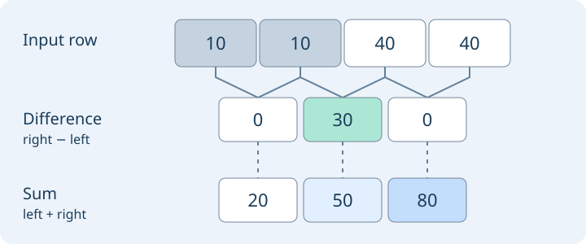

# Feature maps: what the backbone keeps

[Chapter index](index.md) · [Source coverage](sources.md)

Two aerial tiles contain the same number of cars. In one tile all the cars sit on the left, and in the other they sit on the right. A classifier can give both images the same answer. A detector needs its representation to preserve the difference. A **feature map** gives the model a grid of places to store evidence about what it sees.

<details>
<summary>Jump to a concept</summary>

- [What one entry means](#read-a-feature-map)

- [Make a map by sliding one filter](#how-the-map-is-made)

- [Where is a cell looking?](#stride-and-receptive-field)

- [Design backward from the answer you need](#maps-in-network-design)

- [Transfer learning: borrow the representation that fits the job](#transfer-learning)

- [Look at what the representation keeps](#inspect-before-interpreting)

- [Further reading](#sources)

</details>

## What one entry means

Start with the input image. At each position it stores three numbers for red, green and blue. After a CNN layer, each output position can store 64 numbers instead. They are activations computed from the input. A single **channel** is one sheet in that stack of 64. A single **spatial embedding** is the stack of 64 numbers at one location.

| Read along | Example in a 64 × 32 × 32 map | Question it can help answer |
| --- | --- | --- |
| One channel across all positions | 32 × 32 numbers | Where does this particular learned response light up? |
| All channels at one position | 64 numbers | What evidence does the network store around here? |
| All channels and all positions | 64 × 32 × 32 numbers | What spatial evidence is available to the next layer? |
| Average each channel over the grid | 64 numbers | What evidence is present overall? |

People use “feature map” for both one activation sheet and the whole stack. Here we call the stack a map and specify its shape. In PyTorch a batch of maps commonly has axes B × C × H × W. The numbers can be signed or unbounded depending on the layer. A value of 4.2 is an activation. To call it a probability or a score for “truck,” you need a prediction head and a definition of its output.

## Make a map by sliding one filter

Suppose we look at a row of four grayscale values, (10, 10, 40, 40). A two-entry filter with weights (−1, 1) compares neighbors. Move it one place at a time. It produces (0, 30, 0). The middle response is high because the row gets brighter there. Apply a second filter with weights (1, 1) to the same row and you get (20, 50, 80). Both maps describe the same three positions, with a different measurement at each position.



A 2D CNN does this over rectangular windows and across all input channels. Each output channel uses a different set of learned weights. The same set is reused across the spatial grid. The filter weights are shared parameters, and the feature map is the result of applying them to *this image*. During training, gradients from the task loss adjust those weights. After convolution, operations such as normalization and a nonlinearity can change the activation values before another layer reads them.

Stack layers and a location in the second map can combine nearby responses from the first. Edges can become evidence of a corner; corners, texture and other context can jointly help the head identify a vehicle. That is an intuition about composition. In a real model, features often span many channels, and a channel can respond to different patterns on different inputs.

```python
import numpy as np

row = np.array([10, 10, 40, 40])
windows = np.lib.stride_tricks.sliding_window_view(row, 2)
filters = np.array([[-1, 1], [1, 1]])
print(filters @ windows.T)  # channels × positions
```

## Where is a cell looking?

Stride is spacing in the original input between neighboring map positions. For a chain of strides 2, 2 and 2, neighboring positions on the final grid are eight input pixels apart. On a 256 × 256 model input with the usual shape-preserving padding before downsampling, the resulting grid is 32 × 32. Padding and crop offsets also affect where those positions land. If a head predicts offsets from the grid, it must use the same coordinate convention when decoding.

The **receptive field** is the input region that can influence a particular activation. It is a different quantity. Three 3 × 3 convolutions with stride 2 have output stride 8 and a theoretical receptive field 15 pixels wide along each axis. Neighboring receptive fields therefore overlap. With additional stride-1 layers the cells can see a wider area while staying eight pixels apart. The regions that strongly influence a particular prediction may occupy less than the theoretical support.

Consider an eight-pixel car after resizing. At stride 8 it spans about one grid interval. At stride 32 it spans a quarter of an interval. This is a clue about how finely a head can sample evidence, and it leaves room for sub-cell box offsets and overlapping receptive fields. To see whether useful information survived, check objects of that size on fine and coarse levels. An upsampled coarse map gives you more output locations but has no new image measurements. A skip connection from an earlier fine map can supply evidence that was absent from the coarse map.

## Design backward from the answer you need

| Task | What to keep | What the head does |
| --- | --- | --- |
| Classify a crop | One pooled or class-token vector | Produce scores per class |
| Detect objects | Spatial features, often several grid strides | Predict boxes at cells or let object queries read the grid |
| Segment a boundary | Spatial features and a route back to fine detail | Decode class scores per location or generate a mask per region query |
| Search by a proposed object | One vector per crop or pooled region | Rank by similarity and inspect what the chosen crop contains |

A ViT exposes a similar contract. The spatial rows are patch tokens. Remove the special tokens according to the model's interface, then restore the patch grid in the same order used for patchification. In a global-attention encoder, each patch token still has a grid address even though it may contain evidence from distant patches. If the only output you saved was the class token, you have a global vector and have discarded the explicit spatial rows.

## Transfer learning: borrow the representation that fits the job

Say a pretrained encoder retrieves similar trucks, but your new task is to outline each one. The global embedding can be a good starting point for crop classification, while segmentation needs a spatial output and may benefit from several levels. Choose the tensor before choosing the head. Inspect its stage, stride, number of channels, preprocessing, and token or pixel ordering. Two backbones can both emit 768 numbers per position while using entirely different feature coordinates.

- **Start with a frozen probe.** Train a small head on a fixed representation. Compare pooled vectors for classification, or compare a dense head on a fine versus coarse map for localization. Use the same split, crop size and evaluation rule. A good result shows that the head can read useful information from the fixed representation.

- **Change one input to the head.** If background dominates truck retrieval, compare tighter crops with the same encoder. If the mask boundary disappears on the final grid, compare an intermediate map or a skip connection. Look at the same hard cases on both variants.

- **Adapt the backbone when you need to change the representation.** Compare a frozen backbone with partial fine-tuning or adapters. A gain suggests the new training signal helps adapt the representation or its interaction with the head. Keep a separate validation scene set and measure the cost of training and inference.

If you cache frozen features, record the checkpoint, layer, resize and normalization, feature shape and sample ID. Changing the crop or unfreezing the encoder makes that cache stale. In PyTorch, freezing parameters and selecting evaluation mode solve different problems. Evaluation mode controls behavior such as dropout and running BatchNorm statistics. Make both choices explicit when testing a frozen extractor.

## Look at what the representation keeps

Take three crops of the same kind of truck: one clear, one tiny and one beside a bright road marking. For each crop, display a few channels on the same numeric scale and mark the grid cells over the object. Compare activations with those from matched background crops. This tells you how the feature responds on those examples. To test whether the head uses that evidence, intervene on the input or feature and check the prediction. A heatmap and a dependence test answer different questions.

### Self-check

You have a 32 × 32 feature grid and a global mean of that grid. Which output can you still use to check whether the car was on the left or the right? Would bilinear upsampling of the global vector recover that evidence?

<details>
<summary>Show answer and explanation</summary>

Use the 32 × 32 grid. It has separate spatial entries. The global mean mixes the positions and does not preserve an explicit grid, so upsampling cannot reconstruct it.

</details>

## Further reading

- [Dive into Deep Learning: input and output channels](https://d2l.ai/chapter_convolutional-neural-networks/channels.html)

- [Distill: computing receptive fields](https://distill.pub/2019/computing-receptive-fields/)

- [Distill: feature visualization](https://distill.pub/2017/feature-visualization/) and [the building blocks of interpretability](https://distill.pub/2018/building-blocks/)

- [CS231n: transfer learning](https://cs231n.github.io/transfer-learning/) and [visualizing CNN activations](https://cs231n.github.io/understanding-cnn/)

- [Yosinski et al.: how transferable are features?](https://yosinski.com/transfer) and [Keras: transfer learning and fine-tuning](https://keras.io/guides/transfer_learning/)
