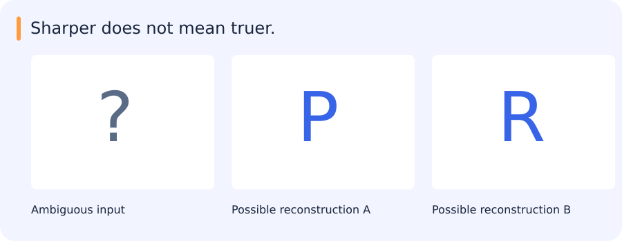

# Autoencoders, VAEs, ELBO, GANs and diffusion

[All training](index.md) · [Source coverage](sources.md)

A classifier can choose a label for an image. A generative model can produce or assign probability to possible observations, sometimes conditioned on an input. Think of an old photograph with a blurry region. There may be several plausible clear images behind the same observed pixels. That ambiguity makes it important to ask what the model learned to produce.

Jump to a concept

- [Learning to model observations](#learning-to-model-observations)

- [Autoencoders](#autoencoders)

- [Variational autoencoders and ELBO](#variational-autoencoders-and-elbo)

- [Generative adversarial networks](#generative-adversarial-networks)

- [Autoregressive and diffusion models](#autoregressive-and-diffusion-models)

- [Where this material fits](#where-this-material-fits)

## Learning to model observations

A generative model describes or samples an observation distribution. Useful applications include conditional image synthesis, restoration, simulation and representation learning. Realistic images alone do not establish that the model learned the target distribution or preserved an input's identity. A generated detail is a model hypothesis, not a measurement recovered from the sensor.

## A plausible reconstruction may still invent a letter

A blurred crop might be consistent with either a P or an R. A generative model can produce a crisp version of one letter, but the visual improvement does not establish which letter the sensor originally observed.

The output reflects both the input and the model’s learned assumptions about plausible images. That is useful in synthesis and some restoration settings. In OCR, identification or remote-sensing measurement, the distinction between inferred detail and observed evidence may be essential.

Autoencoders, VAEs, GANs and diffusion models make different choices about how to learn and use such image distributions.

## Autoencoders

An autoencoder maps x to a latent code z and reconstructs x from it. A bottleneck, noise or other constraints encourage the code to preserve selected structure rather than copy input trivially. Pixel reconstruction loss favors some information differently from a semantic objective. A low reconstruction error need not produce a useful classification embedding, and a high error can arise from a new camera rather than an anomalous object.

## Variational autoencoders and ELBO

A VAE uses a prior p(z), a decoder distribution p_theta(x|z) and an approximate posterior q_phi(z|x). Its evidence lower bound is `E_q[log p_theta(x|z)] - KL(q_phi(z|x) || p(z))`. The difference between log p_theta(x) and this bound is a nonnegative KL divergence to the true posterior. The first term rewards reconstruction likelihood; the second regularizes the latent distribution. A deterministic reconstruction penalty is not automatically the same as a specified likelihood without assumptions about output noise.

For a Gaussian approximate posterior, the reparameterization `z = mu + sigma*epsilon` with epsilon sampled from a standard Gaussian allows gradients through mu and sigma. A strong decoder may ignore latent variables, and changing the balance of reconstruction and KL changes the model's behavior. Show both generated samples and reconstruction/latent diagnostics.

### Distinguish a code for one image from a source of new images

An ordinary autoencoder can turn an image into a short vector and reconstruct it from that vector. You can inspect the reconstruction of a specific input. If you pick a random vector, however, you have no guarantee that the decoder has seen anything near it during training. The learned codes may occupy separated regions of the space.

A variational autoencoder gives each input a distribution of latent codes and learns a decoder that can reconstruct samples from it. Its objective includes a term that encourages the code distribution to stay close to a chosen prior. This helps make sampling from the prior useful. The reconstruction term still matters because a code that ignores the input can lose the detail needed to reconstruct it.

The ELBO expresses this balance using an expected reconstruction log likelihood and a divergence from the prior. Read the two terms as answers to different questions: how well can the code explain the image, and how much does its distribution depart from the sampling distribution we planned to use? The weighting and decoder capacity influence what the model retains.

## Generative adversarial networks

A GAN trains a generator to produce samples and a discriminator to distinguish generated from real examples. In the original minimax form, discriminator training and generator training optimize opposing objectives. The original saturating generator loss can provide weak gradients when the discriminator confidently rejects poor samples. A common nonsaturating alternative maximizes the discriminator's log probability of generated samples being real. Other losses change the game and its stability.

Generator loss decreasing does not prove sample quality improves: the discriminator may simply be weak. Mode collapse produces a narrow variety of convincing outputs. Training can oscillate because both objectives change as the opponent changes. Evaluate diversity, conditional consistency and downstream use, not one loss trace. Pix2pix uses paired conditional data; CycleGAN uses unpaired domains with cycle-consistency and adversarial terms. Cycle consistency does not guarantee truthful recovery of medically or geographically meaningful details.

## Autoregressive and diffusion models

An autoregressive model factors a joint distribution into ordered conditional predictions. It can optimize likelihood but generation may require a sequence of steps. A diffusion model adds noise through a defined forward process and learns a reverse denoising/score-related process. Training often predicts noise, clean signal or a parameterized combination. Sampling choices trade compute and quality and must match the model's assumptions.

Conditioning with text, masks or images changes which distribution is modeled. Guidance can strengthen conditioning while reducing diversity or increasing artifacts. Evaluate on held-out conditions and check whether identity, geometry or small objects are preserved. A sharpened image can look more detailed while inventing structure.

### Follow the generation order

For an autoregressive image model, choose an ordering of the values to be generated. Generate the first value, then condition the second on the first, and continue. A language model predicting one next token at a time is a familiar version of the same factorization. The model can often learn from known prefixes during training, while generation has to continue from its own earlier outputs.

Diffusion uses a different path. Imagine adding increasing amounts of noise to a clean training image. The model learns a prediction that helps undo corruption at different noise levels, such as estimating the added noise. At generation time, a sampler starts from a noisy state and uses a sequence of learned updates to reach a sample. A condition, such as text, can guide those updates. The exact training objective and sampling procedure depend on the model.

Both methods can produce one of several plausible images. When the input leaves a region ambiguous, agreement with the observed pixels can coexist with disagreement about the hidden details. In an image analysis task, keep generated content identifiable as an inference and evaluate its effect on the downstream decision.

## Where this material fits

The generative-model lectures and optional ELBO explanation remain part of the reading route; the historical diffusion implementation remains optional. For the current tasks, the important distinction is what a reconstruction preserves and what it infers. That provides a concrete reason to understand the model objectives even without training a generator.

Original source references and provenance

Original teaching text covering the cited topics, not a verbatim mirror. These references are provenance; no external reading is required to use this chapter.

- [https://cs231n.stanford.edu/slides/2025/lecture_13.pdf](https://cs231n.stanford.edu/slides/2025/lecture_13.pdf)

- [https://cs231n.stanford.edu/slides/2025/lecture_14.pdf](https://cs231n.stanford.edu/slides/2025/lecture_14.pdf)

- [https://yunfanj.com/blog/2021/01/11/ELBO.html](https://yunfanj.com/blog/2021/01/11/ELBO.html)

