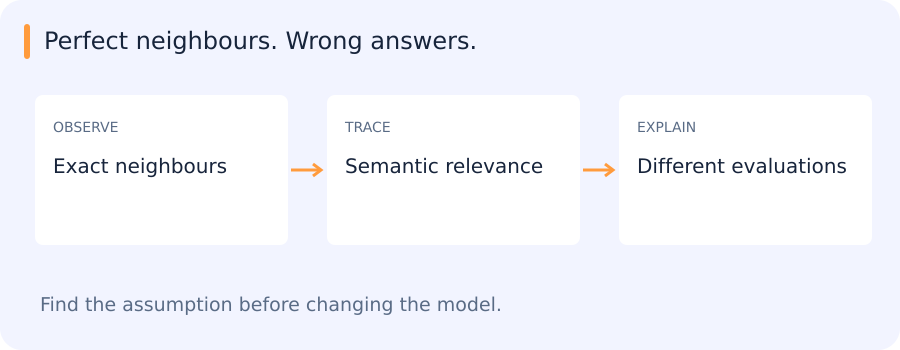

# Vector search, quantization, RAG and retrieval evaluation

[All training](index.md) · [Source coverage](sources.md)

## A correct nearest-neighbour search can return irrelevant images

Suppose the embedding places snowy scenes close together. An exact index returns those neighbours perfectly, but the user wanted other images of the same vehicle type. The search calculation is correct; the representation is emphasizing a different relationship.

There are consequently two evaluations to keep apart. Index recall measures whether an approximate index recovers the exact neighbours. Task relevance measures whether those neighbours answer the user’s query. Improving one does not automatically improve the other.

A retrieval system also depends on ingestion, filters, model versions and downstream consumers, so those boundaries belong in the diagnosis.

Jump to a concept

- [Retrieval is a system of interfaces](#retrieval-is-a-system-of-interfaces)

- [Exact and approximate search](#exact-and-approximate-search)

- [Vector quantization](#vector-quantization)

- [RAG](#rag)

- [Ranking metrics and operational checks](#ranking-metrics-and-operational-checks)

- [Learning from feedback](#learning-from-feedback)

- [Locating the source of a retrieval error](#locating-the-source-of-a-retrieval-error)

## Retrieval is a system of interfaces

A query is encoded into the same space as indexed items, neighbors are found, metadata and filters select candidates, and the result is consumed by a user or another model. Encoder identity, normalization, distance and item ID are persistent contracts. Re-encoding queries with a new checkpoint while retaining old indexed vectors silently changes the meaning of distance. Version both sides and make reindexing explicit.

## Exact and approximate search

Exact search computes all relevant distances and ranks them. Approximate nearest-neighbor structures reduce work or memory while allowing some true neighbors to be missed. Graph indices route through connected candidate neighborhoods; inverted-file indices partition coarse regions and search a selected subset. Faiss supplies several implementations; it is not a single approximation method. More search effort commonly improves recall at additional latency.

Measure index recall against exact search on a bounded sample, separately from semantic relevance against task labels. An exact neighbor can be semantically wrong because the embedding is poor; an approximate miss can hide an otherwise useful match. Metadata filters can interact with index search and return too few results. Evaluate filtered queries, index updates and deletion consistency, not just an unfiltered static benchmark.

## Vector quantization

Scalar quantization represents each coordinate using fewer numerical levels with declared scales and possibly zero points. Product quantization divides vectors into subspaces and stores a codebook index for each subvector. Approximate distances can be computed efficiently from tables. Compression changes ranking; reranking candidates using higher-precision vectors can recover some accuracy at extra storage and I/O cost. Quantizing stored embeddings is distinct from quantizing a neural model's weights or activations.

## RAG

Retrieval-augmented generation retrieves external context and conditions a language model's answer on it. Typical stages include document ingestion, chunking, embedding/indexing, retrieval, reranking, prompt construction and answer generation. Chunk boundaries, overlap, source metadata and content freshness affect evidence quality. A perfect retriever cannot make a generator follow evidence reliably; a fluent generator cannot recover evidence that ingestion omitted.

Evaluate answer correctness and source support separately from retrieval recall. Preserve citation-to-source alignment and avoid allowing retrieved text to change system instructions. Access control needs to apply to both retrieval and returned content. For internal research, use approved endpoints and data boundaries. A synthetic example can demonstrate mechanics without transmitting internal documents.

## Ranking metrics and operational checks

Use the metrics chapter for precision/recall@K, mAP, MRR, NDCG and hit rate. Define relevance and query population first. Some tasks care about finding one valid support; others care about retrieving all objects of a category. Include hard negatives and no-answer queries. Report latency percentiles, throughput, memory and index build/update cost. A batch of warm cached queries is not the same workload as cold interactive use.

## Learning from feedback

A user accepting or rejecting results gives sparse, biased feedback: they see only what was retrieved. Train a small classifier or reranker if appropriate, but keep random audits and independent query evaluation so missed groups remain visible. Preserve old and new experiment results to compare recall, alert burden and compute simultaneously. Repeatedly optimizing on the same clicked examples can overfit user behavior rather than improve the underlying retrieval task.

## Locating the source of a retrieval error

Exact search over a small approved vector set provides a reference for an approximate or compressed index. A changed rank can then be attributed to the search approximation, while irrelevant exact neighbours point back toward the representation or task definition. Displaying the underlying images or text makes that distinction visible.

Original source references and provenance

Original teaching text covering the cited topics, not a verbatim mirror. These references are provenance; no external reading is required to use this chapter.

- [https://qdrant.tech/articles/what-is-vector-quantization/](https://qdrant.tech/articles/what-is-vector-quantization/)

- [https://www.pinecone.io/learn/retrieval-augmented-generation/](https://www.pinecone.io/learn/retrieval-augmented-generation/)

- [https://www.pinecone.io/learn/series/faiss/faiss-tutorial/](https://www.pinecone.io/learn/series/faiss/faiss-tutorial/)

- [https://www.pinecone.io/learn/series/faiss/vector-indexes/](https://www.pinecone.io/learn/series/faiss/vector-indexes/)

