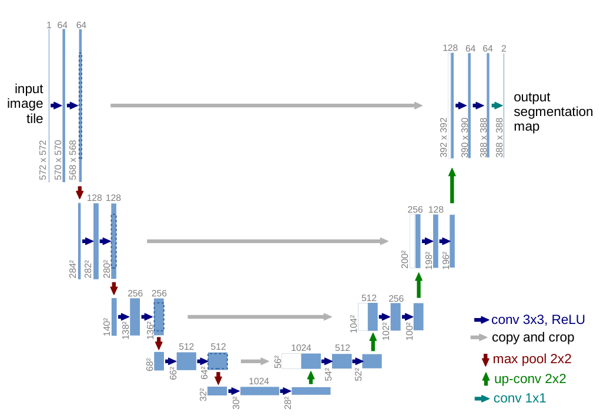
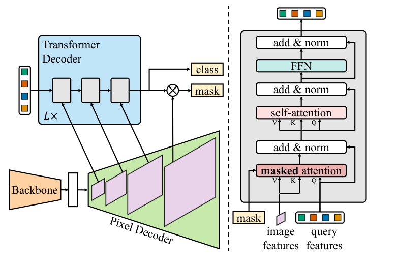

# Segmentation heads: feature grids, skip connections and mask queries

[All training](index.md) · [Source coverage](sources.md)

A cloud mask should follow the boundary of a cloud. A scene-level embedding can say clouds are present. To draw the boundary, the head needs a feature grid that preserves which parts of the image contributed the evidence. Segmentation architectures differ in how they recover spatial detail and in what they predict at each location.

For the distinction between grid stride and receptive field, see [Feature maps: what the backbone keeps](dl-feature-maps.md).

Jump to a concept

- [Decide what a mask means](#choose-the-output)

- [CNNs: bring fine detail back to the prediction grid](#cnn-segmentation)

- [ViT: keep the patch grid](#vit-segmentation)

- [Mask queries: one vector per candidate mask](#query-segmentation)

## Decide what a mask means

In semantic segmentation, every pixel gets a category such as cloud, road or vehicle. Two adjacent vehicles can share one category region. In instance segmentation, the output must also separate those vehicles into two masks. Panoptic segmentation combines an image-wide semantic partition with separate identities for countable objects.

## CNNs: bring fine detail back to the prediction grid

A CNN encoder trades spatial resolution for increasingly contextual features. A 256 × 256 image can produce a 16 × 16 deep map. The map might tell you which broad area is cloudy, but upsampling its predictions alone makes a smooth boundary from coarse evidence. A U-Net-style decoder upsamples the deep map and combines it with earlier, finer encoder features at matching resolutions. These skip connections let high-level context decide what to look for while finer features help locate edges.

A final 1 × 1 convolution can produce one raw class score (logit) per class at each decoded location. For mutually exclusive labels, train with pixelwise cross-entropy on valid pixels and read the strongest class at each pixel. For a binary cloud mask, a single logit per pixel can be trained with binary cross-entropy and then thresholded. When mask labels are resized, use an operation that preserves class IDs. Interpolation is appropriate for continuous logits, while interpolating integer class IDs can invent labels.

Original figure from [Ronneberger et al., U-Net (2015), Fig. 1](https://arxiv.org/abs/1505.04597). Open the image for full size.

Read the figure

Follow a long gray arrow and then follow the route through the bottom of the U. What does the gray route let the decoder recover?

Show answer

The horizontal skip brings finer spatial features to the decoder. The long route contributes the deeper representation. This original U-Net crops the skip feature maps to align them with the decoder maps.

## ViT: keep the patch grid

A ViT-B/16 at 256 × 256 returns 256 patch vectors, plus any model-specific special tokens. Strip the special tokens, then reshape the remaining vectors to a 16 × 16 feature grid in patch order. A simple semantic head predicts class logits for each patch and upsamples them. More capable heads fuse features across layers or scales and decode at finer resolution. If all you cached was the class token, reshaping it cannot recover a patch map. If your map is too coarse, inspect whether finer features survive earlier in the model or in an additional image branch.

## Mask queries: one vector per candidate mask

In a Mask2Former-style design, a pixel decoder makes a feature vector at each spatial location. A Transformer decoder produces a vector for each candidate region. A projection maps the region vector to a mask embedding. Compare it with each pixel feature using a dot product to obtain a mask logit at each location. A separate class head says what the mask represents. With mask embedding *q* and pixel embedding *p* at location (i, j), the logit is

$$
\ell_{ij}=q^\top p_{ij}
$$

For example, a mask embedding (2, −1) gives a logit of 1.8 against a pixel feature (1, 0.2) and −0.8 against (0.1, 1). The two locations receive different mask scores from the same query. Real models use more dimensions and many queries. During training, predictions are matched to labeled regions. Mask2Former also uses the current mask prediction to restrict where a query can read image features in later masked cross-attention. The class and mask predictions can be assembled differently for semantic, instance and panoptic output.

The masks are spatial even though the query is one vector, because the calculation still has a different pixel embedding at every location. As with DETR, a CNN backbone and a Transformer decoder can belong to the same model.

Original figure from [Cheng et al., Masked-attention Mask Transformer (2022), Fig. 2](https://arxiv.org/abs/2112.01527). Open the image for full size.

Read the figure

Find the class and mask branches at left. Now find the mask feeding back into masked attention at right. What does the feedback control?

Show answer

A predicted foreground mask restricts which image positions the query can read in a subsequent cross-attention operation. The pixel decoder still supplies spatial features used to build the masks.

### Self-check

Why can a single mask-query embedding produce a detailed boundary, while the class token alone gives a poor basis for a dense mask?

Show answer and explanation

The mask query is compared with a spatial grid of distinct pixel features. Its scores can change at each location. A class token alone has no explicit spatial feature grid to compare against.

Primary sources: [U-Net](https://arxiv.org/abs/1505.04597) and [Mask2Former](https://arxiv.org/abs/2112.01527).
