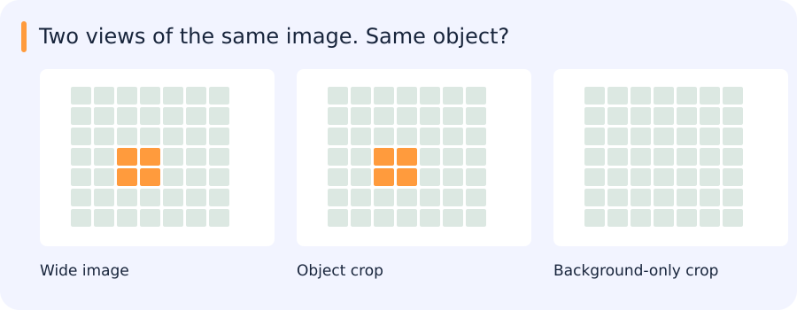

# Self-supervision, contrastive learning, DINO and transferable embeddings

[All training](index.md) · [Source coverage](sources.md)

## What two augmented views have in common

A wide image contains a tiny truck. One augmented crop includes it; another contains only the surrounding background. The training process still treats these as related views of the same source image.

That supervision can be useful, but it does not explicitly say that the truck must survive in both views. The transformations help define which differences the representation learns to ignore. At small object scales, inspecting actual crop pairs can reveal a mismatch between the pretraining task and the downstream task.

Contrastive and teacher–student objectives build on such relationships, with additional mechanisms needed to avoid trivial representations.

Jump to a concept

- [The training signal defines useful invariance](#the-training-signal-defines-useful-invariance)

- [Contrastive and triplet objectives](#contrastive-and-triplet-objectives)

- [Collapse and teacher/student learning](#collapse-and-teacher-student-learning)

- [Evaluate a frozen representation](#evaluate-a-frozen-representation)

- [Few-shot and feedback](#few-shot-and-feedback)

- [Inspecting an embedding at object scale](#inspecting-an-embedding-at-object-scale)

## The training signal defines useful invariance

Self-supervision creates a learning target from the observations. Two transformed views of one image may be a positive pair, a masked patch may be a reconstruction target, or one model's output may supervise another view. The chosen transformations define what the representation should ignore. Cropping can remove the object of interest, and color invariance can be harmful if color is the operational attribute. Pretraining is not automatically neutral with respect to the downstream task.

## Contrastive and triplet objectives

Contrastive learning encourages related views to have similar representations and distinguishes them from negatives. An InfoNCE-style objective classifies a positive among candidates using similarity divided by temperature. Temperature affects how sharply differences are weighted. Batch size, a memory queue and negative sampling change the comparison set. False negatives arise when two distinct samples depict the same semantic class, so instance discrimination need not align perfectly with category labels.

A triplet loss such as `max(0, d(a,p)-d(a,n)+margin)` asks a positive to be closer to an anchor than a negative by a margin. Sampling easy triplets can produce zero loss without learning much; overly hard or mislabeled negatives can destabilize training. Normalization and distance choice determine scale. Compare random, semi-hard and hard mining on actual errors instead of assuming the hardest pair is always useful.

## Collapse and teacher/student learning

If every input maps to the same vector, matching views becomes trivial but the representation is useless. Negative comparisons, normalization, stop-gradient, target transformations and architectural asymmetry are among the tools used to avoid collapse. Each method needs its own explanation; “it has a teacher” is not sufficient.

The self-supervised DINO family trains a student to match a teacher across views, with a teacher commonly updated from the student over time and output transformations controlling training. DINOv2 and DINOv3 extend the representation-learning line through different data, objectives and training refinements. Treat each checkpoint as a specific encoder with a defined patch size, output-token convention, normalization and license. Do not assume that a pooled classification vector and a dense patch feature map are interchangeable.

## Evaluate a frozen representation

Linear probing trains a small classifier on frozen features. KNN tests neighborhood structure. Fine-tuning changes the encoder as well as the head and has a different compute and overfitting profile. Report the number of labeled examples, class split and whether novel test categories were used in model selection. Strong image-level transfer does not establish precise instance localization. Crop context, object scale and resize strategy affect proposal embeddings.

For vector comparison, cosine similarity normalizes direction while Euclidean distance also reflects norms unless vectors are normalized. On unit vectors, squared Euclidean distance is 2−2 cosine similarity. Verify that stored and queried vectors use the same encoder, preprocessing and normalization. An index of mixed versions can return mathematically valid but semantically meaningless neighbors.

## Few-shot and feedback

A prototype averages support embeddings for a class. A linear/SVM head can learn a boundary from positive and negative feedback. A Mahalanobis score accounts for covariance, but few supports make a full covariance unstable; shrinkage or shared covariance assumptions can help. Tune such choices without leaking query labels. Report uncertainty and inspect confusing negatives rather than treating a high similarity as a verified semantic label.

## Inspecting an embedding at object scale

With a frozen encoder, changing only the crop context or resize policy isolates a small but important part of the retrieval system. The nearest images show whether the representation follows the object, the background or an attribute such as colour. Proposal recall remains a separate limit: a good embedding cannot retrieve a crop the detector never produced.

Original source references and provenance

Original teaching text covering the cited topics, not a verbatim mirror. These references are provenance; no external reading is required to use this chapter.

- [https://arxiv.org/abs/2003.08505](https://arxiv.org/abs/2003.08505)

- [https://cs231n.stanford.edu/slides/2025/lecture_12.pdf](https://cs231n.stanford.edu/slides/2025/lecture_12.pdf)

- [https://kevinmusgrave.github.io/powerful-benchmarker/papers/mlrc/#examples-of-unfair-comparisons-in-metric-learning-papers](https://kevinmusgrave.github.io/powerful-benchmarker/papers/mlrc/#examples-of-unfair-comparisons-in-metric-learning-papers)

- [https://lilianweng.github.io/posts/2019-11-10-self-supervised/](https://lilianweng.github.io/posts/2019-11-10-self-supervised/)

- [https://lilianweng.github.io/posts/2021-05-31-contrastive/#moco--moco-v2](https://lilianweng.github.io/posts/2021-05-31-contrastive/#moco--moco-v2)

