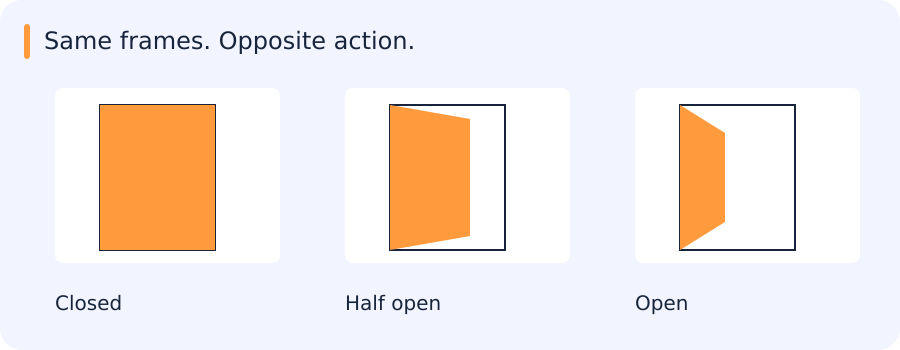

# RNNs, LSTMs, temporal models and video understanding

[All training](index.md) · [Source coverage](sources.md)

A video is a sequence of frames. A frame classifier can answer a question about one picture. A clip model also has to decide what information to preserve across time. Average appearance is enough for some questions, while direction, duration and order are essential for others.

Jump to a concept

- [Time changes the task](#time-changes-the-task)

- [Recurrent state](#recurrent-state)

- [Video representations](#video-representations)

- [Sampling and realistic evaluation](#sampling-and-realistic-evaluation)

- [Pseudo-labels and teacher models](#pseudo-labels-and-teacher-models)

- [From clip classification to a working video path](#from-clip-classification-to-a-working-video-path)

## Time changes the task

A frame model sees appearance at one time. A video model may need action order, duration, motion and interactions. A sequence has timestamps, sampling rate and possibly gaps. Uniformly taking every tenth frame means a different temporal interval at different frame rates. Define whether the output is per clip, per frame, per track or an event with start/end boundaries.

## The same frames can describe opening or closing

A clip shows a door moving from closed to open. Reverse the frames and it shows the opposite action. The individual appearances are unchanged; only their order differs.

A baseline that averages independent frame embeddings loses that order. It may recognize the door or the scene very well while lacking the information needed to distinguish these two actions. Temporal models provide ways to preserve or combine evidence across time, each with its own assumptions.

The useful starting point is therefore the temporal information the output requires: order, motion, duration or context.

## Recurrent state

### Count a crossing with a little memory

Consider a video of a gate. A detector says where a vehicle is in each frame. If the current frame shows a vehicle on the right of the gate, you still need earlier frames to tell whether it crossed from the left or was already on the right when recording began.

A hand-written solution keeps the last confident side for each track. On a new frame it reads the old side and the latest observation, optionally emits a crossing, and updates the stored side. The stored value is state. It carries information forward even though the next step only receives one new frame.

A recurrent neural network learns a state update from examples. Its state is a vector of numbers rather than the explicit last-side variable. The state can summarize useful history, but long gaps, new camera views and recording boundaries change what should carry over. When evaluating, reset state at genuine sequence boundaries and check tracks with occlusions or broken identities separately.

A basic recurrent network updates $h_t=\phi(W_xx_t+W_hh_{t-1}+b)$. The hidden state summarizes earlier inputs. Backpropagation through time multiplies derivatives along temporal paths; repeated contraction can make gradients vanish and expansion can make them explode. Clipping limits excessive gradient norms but does not create missing long-term information.

An LSTM maintains a cell state and gates controlling forgetting, new information and output. A common update is $c_t=f_t\odot c_{t-1}+i_t\odot g_t$, then $h_t=o_t\odot\tanh(c_t)$, with sigmoid gates and elementwise products. The additive path can support longer-term gradients but does not guarantee perfect memory. A GRU combines state/gating more compactly, commonly using update and reset gates. Different formulas and gate conventions exist; inspect the implementation before mapping named gates.

A bidirectional network uses past and future context. It is appropriate for a complete recorded clip but introduces future dependence in a live setting. Truncated backpropagation limits the training horizon. Resetting or carrying state across clip boundaries changes the task and can leak information between examples. Padding and masks must prevent variable-length batches from treating padding as observed content.

## Video representations

A frame encoder with temporal pooling is a simple baseline. It can recognize static context but may discard order: opening and closing a door can have similar pooled features. A 3D convolution filters across space and time, while factorized spatial/temporal layers trade capacity and cost. Two-stream approaches combine appearance and motion representations such as optical flow, whose preprocessing has its own failure modes and compute. Temporal attention can connect distant frames but requires explicit timing/position and can be expensive with many spatial tokens.

### What information does the clip representation keep?

Consider two three-frame clips with a tracked position sequence `[0, 1, 2]` and `[2, 1, 0]`. Both have mean position 1. If the task asks whether an object appears near the centre on average, that feature can be useful. If it asks which way the object moves, the first-to-last difference distinguishes the clips immediately. A model cannot recover order from an average that discarded it.

Frame sampling can remove evidence even before the model combines it. If an object is visible for only one of ten frames, a sampler taking every fifth frame may miss it. Increasing the sampling rate can improve coverage and increase compute. Preserve timestamps so that the same number of frames is not silently treated as the same duration when clips have different frame rates.

In an evaluation, compare clips on which order matters with clips on which appearance alone suffices. A strong average-frame baseline on a road-presence question does not tell you whether it can recognize an action. Split by source video before sampling clips to keep related frames together.

### Self-check

A model averages frame embeddings. What happens to that average if the exact same frames are reversed?

- A. It becomes the last frame embedding

- B. It stays the same

- C. It gives twice the original value

- D. It changes sign

Show answer and explanation

**B. It stays the same**

A mean depends on which vectors are included, and reversing their order leaves it unchanged. A direction-sensitive task needs order information.

## Sampling and realistic evaluation

Short clips can miss rare events; long clips increase context but mix irrelevant content. Sample using the deployment event duration, preserve actual timestamps and evaluate sensitivity to speed and gaps. Split by source video/session/camera as appropriate. Random frame splits reward memorizing backgrounds. Report latency from observed input to a decision, not just the model forward time. A clip-level score does not establish accurate event boundaries or stable online alerts.

For tracklets, consider identity switches, missing detections and camera motion. For event systems, define when repeated detections become one event and how cooldown periods affect precision and recall. A person appearing in many adjacent frames should not count as dozens of independent successes. Include empty scenes, partial actions and camera transitions among qualitative cases.

### Self-check

You generate overlapping clips from long recordings. Which split best tests performance on unseen recordings?

- A. Split by recording before extracting clips

- B. Assign every other clip to validation

- C. Split individual frames independently

- D. Select clips with the highest model confidence

Show answer and explanation

**A. Split by recording before extracting clips**

Grouping by recording prevents nearby or shared frames from appearing on both sides of the evaluation.

## Pseudo-labels and teacher models

A strong teacher can generate candidate annotations at scale, but its errors become training data. Audit randomly selected frames as well as high-confidence proposals so missed objects become visible. Keep teacher identity, prompt, confidence filters and export geometry with the dataset version. Do not evaluate on the same unverified pseudo-labels used for training. Measure the student on independently checked frames from held-out videos.

## From clip classification to a working video path

The ordinary-camera project introduces temporal decisions separately from the satellite and airborne tasks. Its baseline gives a concrete place to examine sampling and event definitions. The RabbitMQ/SAM3 exercise adds batch processing and pseudo-labels, where durable outputs and independently checked, source-separated evaluation frames matter as much as model training.

Original source references and provenance

Original teaching text covering the cited topics, not a verbatim mirror. These references are provenance; no external reading is required to use this chapter.

- [https://colah.github.io/posts/2015-08-Understanding-LSTMs/](https://colah.github.io/posts/2015-08-Understanding-LSTMs/)

- [https://cs231n.stanford.edu/slides/2025/lecture_10.pdf](https://cs231n.stanford.edu/slides/2025/lecture_10.pdf)

- [https://cs231n.stanford.edu/slides/2025/lecture_7.pdf](https://cs231n.stanford.edu/slides/2025/lecture_7.pdf)

