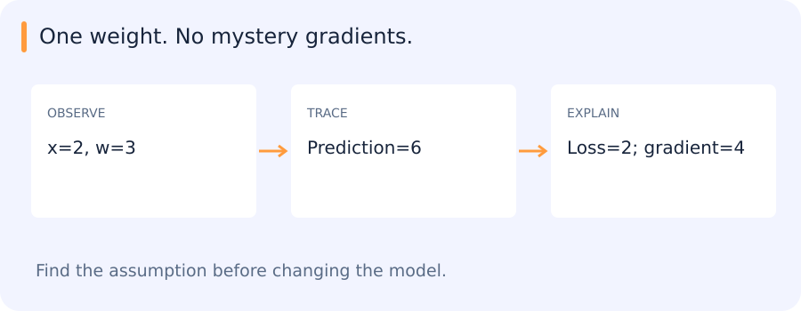

# Neural networks, backpropagation, optimization and reliable training

[All training](index.md) · [Source coverage](sources.md)

A trainable model turns input values into a prediction. To change its predictions, we need adjustable numbers called weights, a way to measure error and a rule for updating the weights. The chapter builds this path from a single computation to a training loop that can be checked after a restart.

To turn a bad learning curve or a missed object into a focused experiment, see [Deep learning intuition: find the bottleneck](dl-intuition.md).

<details>
<summary>Jump to a concept</summary>

- [Layers and representational capacity](#layers-and-representational-capacity)

- [Loss and backpropagation](#loss-and-backpropagation)

- [Optimization and regularization](#optimization-and-regularization)

- [Initialization, activations and normalization](#initialization-activations-and-normalization)

- [A training loop you can defend](#a-training-loop-you-can-defend)

- [Checkpoint and operational evidence](#checkpoint-and-operational-evidence)

- [Turning a training failure into a specific question](#turning-a-training-failure-into-a-specific-question)

- [Softmax derivatives and label conventions](#softmax-derivatives-and-label-conventions)

</details>

## Layers and representational capacity

A linear layer applies an affine transformation $h=Wx+b$. Composing affine layers without nonlinearities is still an affine transformation, regardless of depth. Activations such as ReLU, sigmoid and tanh change the function family and gradient behavior. A network with sufficient capacity can approximate broad function classes under a theorem's assumptions, but that theorem does not promise a useful optimizer, a small dataset or good extrapolation.

## Loss and backpropagation

### One prediction, one update

Say a single input has value 2 and its target is 6. A model with one weight w predicts 2w. At w=1 the prediction is 2 and the squared error is 16. Increasing w a little moves the prediction toward 6 and makes that error smaller.

The derivative tells us how the loss changes near the current weight. Here the loss is (2w − 6)². Its derivative is 2 × (2w − 6) × 2, which is −16 at w=1. The last factor comes from how much the prediction changes for a small change in the weight. With learning rate 0.1, subtracting 0.1 times the derivative moves w to 2.6. The prediction becomes 5.2.

In a larger model, each weight affects a sequence of intermediate values. Backpropagation applies the same rule for multiplying derivatives along that sequence, and adds contributions when multiple paths lead to the loss. The optimizer then uses those gradients to update the weights. In a training loop you can inspect whether the two operations happened separately.

A loss compares predictions to targets and defines the optimization objective. Classification cross entropy, regression squared/absolute loss and metric-learning losses express different goals. Backpropagation uses the chain rule to propagate derivatives through a computational graph. At a node with multiple consumers, contributions to its derivative add. For y=wx and squared error L=(y-t)^2/2, the derivative with respect to w is (wx-t)x. Derive this tiny example and check it with finite differences before treating autograd as a black box.

A gradient check perturbs a parameter and compares the numerical change to the analytic derivative, using a small deterministic double-precision example where possible. Kinks, random dropout, state updates and a poor step size can invalidate a naive comparison. A detached tensor or non-differentiable path can quietly stop learning even though the loss still prints.

### Follow the gradient across two operations

Take one scalar input x = 2. First compute $z=w\,x$ with w = 3, then let the prediction be `z + b` with b = 0. A target of 4 gives an error of 2. Using half the squared error makes the derivative with respect to the prediction equal to that error. The derivative with respect to b is therefore 2, because a unit change in b changes the prediction by one unit. The derivative with respect to w is 4, because a unit change in w changes the prediction by two units.

Backpropagation applies the chain rule from the loss back through these operations. It tells each parameter how a small change would affect the loss with other values fixed. A gradient does not specify how far to move. The optimizer applies its own update rule and learning rate. In the single-weight code example below, b is held fixed so one step is easy to calculate.

## Following one weight through a training step

A small network is easier to inspect than a large one, so start with a single weight: prediction `w × x`. With x=2, w=3 and target=4, it predicts 6. The squared-error loss divided by two is 2.



The derivative with respect to w is `(prediction − target) × x`, which is 4 here. A learning rate of 0.1 changes w to 2.6, giving a prediction of 5.2 and a loss of 0.72. Every part of this update can be checked by hand.

```python
x, target, w = 2.0, 4.0, 3.0
prediction = w * x
gradient = (prediction - target) * x
w -= 0.1 * gradient
new_loss = 0.5 * (w * x - target) ** 2
print(round(w, 2), round(new_loss, 2))
```

This prints:

```text
2.6 0.72
```

A larger network applies the same chain rule through many operations. The practical difficulty is tracking the right values, shapes and state.

### Self-check

The prediction is 2w, the target is 4, and the loss is half the squared error. At w = 3, what is the derivative with respect to w?

- A. 4

- B. 0

- C. −4

- D. 2

<details>
<summary>Show answer and explanation</summary>

**A. 4**

The prediction error is 6 − 4 = 2. The prediction changes by 2 for each unit of w, so the chain rule gives 2 × 2 = 4.

</details>

## Optimization and regularization

Minibatch SGD estimates gradients from subsets. Learning rate controls update size; momentum accumulates directional history; adaptive methods such as Adam scale updates using moment estimates. A schedule changes the rate over training. Batch size affects optimization noise, memory, iteration count and hardware efficiency, so “same epochs” does not necessarily mean the same experiment.

L2 regularization adds a weight-dependent term to the loss. Decoupled weight decay applies a direct shrinkage step; AdamW separates that from adaptive gradient scaling. L2 and decay are equivalent only under restricted optimizer formulations. Dropout samples a subnetwork-like mask during training and uses a defined deterministic scaling convention at inference. Augmentation encodes assumptions about which image changes should preserve the label. A horizontal flip can be inappropriate for text recognition even if useful for generic object classification.

## Initialization, activations and normalization

Poorly scaled initialization can make activations or gradients vanish or explode across depth. Variance-aware initializations help under their assumptions. Sigmoid saturates at large magnitudes; ReLU has zero gradient for negative inputs and can produce inactive units. BatchNorm normalizes using batch statistics during training and commonly stored running statistics during inference; LayerNorm normalizes a different set of dimensions and does not use the same running-batch mechanism. Check the actual model implementation, especially for small batches or domain shifts.

## A training loop you can defend

Load the batch, move data and model to compatible devices, zero gradients, compute predictions and loss, backpropagate and step the optimizer. Gradient accumulation deliberately postpones zeroing/stepping and needs consistent loss scaling. Set train/eval mode for the intended behavior. `eval()` changes module behavior; `no_grad()` or `inference_mode()` controls gradient recording and associated overhead. Neither alone does the other's job.

Overfit a tiny clean subset as a diagnostic, inspect label and tensor shapes, verify that intended parameters change and compare train/validation curves. A decreasing loss is insufficient if labels are shifted by one or preprocessing differs at inference. Mixed precision reduces some costs but introduces scaling and numerical considerations. Record seeds, versions and nondeterministic operations; a seed alone does not guarantee identical results on every machine.

## Checkpoint and operational evidence

Save architecture/config identity, model weights, preprocessing and label mapping. A resumable checkpoint also needs optimizer/scheduler and relevant state. Reload in a fresh process, run a new input and compare outputs with an appropriate tolerance. Do not confuse a Python object still resident in memory with a successful load. For the inference-only handover notebook, preserve all necessary preprocessing, construction, checkpoint loading and postprocessing without importing project internals.

### What should happen after a restart?

Keep a small input whose preprocessing and prediction you can reproduce. Run it in evaluation mode before saving a checkpoint. Then load the checkpoint in a fresh process and run the same path. Matching the expected result checks more than reading a file successfully. It also checks that the model configuration and preprocessing were reconstructed and that the consumer actually uses the restored weights.

Use a separate new input to exercise the intended interface. If continuing training is part of the experiment, optimizer state and schedule may matter as well. An inference checkpoint and a resume checkpoint answer different questions. Record which behaviour you verified.

### Self-check

Which check provides evidence that a saved checkpoint is actually used for inference?

- A. Compare the two file sizes

- B. Confirm the filename exists

- C. Keep the training process alive and run its current model

- D. Reload in a fresh process and compare predictions with the expected run

<details>
<summary>Show answer and explanation</summary>

**D. Reload in a fresh process and compare predictions with the expected run**

A fresh process exercises loading, configuration and the inference consumer. The prediction comparison checks the restored behaviour.

</details>

## Turning a training failure into a specific question

A useful diagnosis predicts something observable. If gradients are disconnected, particular parameters should fail to change; if inference uses the wrong checkpoint, reloading the selected artifact should alter the prediction path. Testing one such claim on a tiny input makes the next change easier to justify. A list of general training tips rarely identifies which of these failures occurred.

## Softmax derivatives and label conventions

For s_i=exp(z_i)/sum_j exp(z_j), the Jacobian is ds_i/dz_j=s_i(delta_ij-s_j). With a one-hot target and cross entropy, the logit gradient simplifies to s−y. Subtracting the maximum logit before exponentiating preserves probabilities and improves numerical stability. A softmax assumes mutually exclusive alternatives, whereas independent binary labels need a different likelihood. Verify that target indices and class order survive dataset export and checkpoint loading.

<details>
<summary>Original source references and provenance</summary>

Original teaching text covering the cited topics, not a verbatim mirror. These references are provenance; no external reading is required to use this chapter.

- [http://josh-tobin.com/assets/pdf/troubleshooting-deep-neural-networks-01-19.pdf](http://josh-tobin.com/assets/pdf/troubleshooting-deep-neural-networks-01-19.pdf)

- [http://neuralnetworksanddeeplearning.com](http://neuralnetworksanddeeplearning.com)

- [http://neuralnetworksanddeeplearning.com/chap4.html](http://neuralnetworksanddeeplearning.com/chap4.html)

- [https://cs231n.github.io/optimization-1/](https://cs231n.github.io/optimization-1/)

- [https://cs231n.github.io/optimization-2/](https://cs231n.github.io/optimization-2/)

- [https://cs231n.stanford.edu/slides/2025/lecture_1_part_1.pdf](https://cs231n.stanford.edu/slides/2025/lecture_1_part_1.pdf)

- [https://cs231n.stanford.edu/slides/2025/lecture_1_part_2.pdf](https://cs231n.stanford.edu/slides/2025/lecture_1_part_2.pdf)

- [https://cs231n.stanford.edu/slides/2025/lecture_3.pdf](https://cs231n.stanford.edu/slides/2025/lecture_3.pdf)

- [https://cs231n.stanford.edu/slides/2025/lecture_4.pdf](https://cs231n.stanford.edu/slides/2025/lecture_4.pdf)

- [https://developers.google.com/machine-learning/crash-course/neural-networks/activation-functions](https://developers.google.com/machine-learning/crash-course/neural-networks/activation-functions)

- [https://eli.thegreenplace.net/2016/the-softmax-function-and-its-derivative/](https://eli.thegreenplace.net/2016/the-softmax-function-and-its-derivative/)

- [https://emiliendupont.github.io/2018/01/24/optimization-visualization/](https://emiliendupont.github.io/2018/01/24/optimization-visualization/)

- [https://en.wikipedia.org/wiki/Batch_normalization#Length-Direction_Decoupling](https://en.wikipedia.org/wiki/Batch_normalization#Length-Direction_Decoupling)

- [https://github.com/Jaewan-Yun/optimizer-visualization](https://github.com/Jaewan-Yun/optimizer-visualization)

- [https://twitter.com/itayevron/status/1328421322821693441?s=08](https://twitter.com/itayevron/status/1328421322821693441?s=08)

- [https://twitter.com/ylecun/status/1274782757907030016](https://twitter.com/ylecun/status/1274782757907030016)

- [https://www.cs.toronto.edu/~urtasun/courses/CSC411_Fall16/05_nn.pdf](https://www.cs.toronto.edu/~urtasun/courses/CSC411_Fall16/05_nn.pdf)

- [https://yassin01.medium.com/adam-vs-adamw-understanding-weight-decay-and-its-impact-on-model-performance-b7414f0af8a1](https://yassin01.medium.com/adam-vs-adamw-understanding-weight-decay-and-its-impact-on-model-performance-b7414f0af8a1)

</details>
