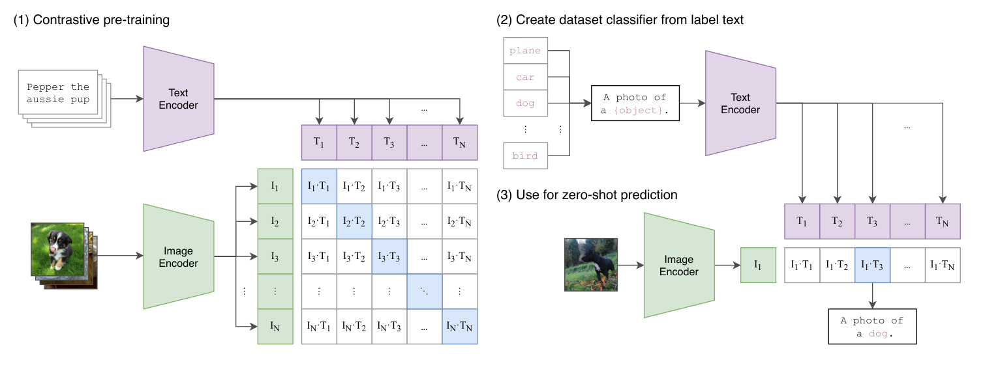
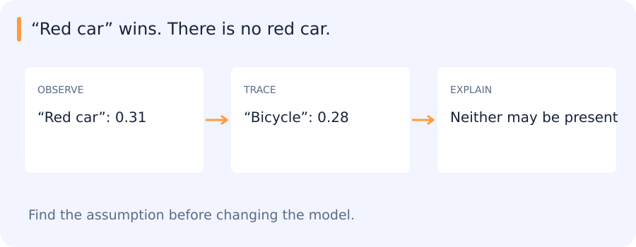

# CLIP, VLMs, open-vocabulary detection and open-model use

[All training](index.md) · [Source coverage](sources.md)

Suppose someone wants to search images using a phrase such as “red car near a roundabout.” A system may rank images by similarity to the phrase, answer a question about a selected image or return a region containing the object. These outputs require different evidence. Start with how an image and a phrase can be compared at all.

Jump to a concept

- [Two ways to connect text and images](#two-ways-to-connect-text-and-images)

- [Zero-shot labels and prompts](#zero-shot-labels-and-prompts)

- [Open-vocabulary localization](#open-vocabulary-localization)

- [VLM reasoning and uncertainty](#vlm-reasoning-and-uncertainty)

- [Using an open model responsibly in an experiment](#using-an-open-model-responsibly-in-an-experiment)

- [Comparing whole-image and region-level evidence](#comparing-whole-image-and-region-level-evidence)

## Two ways to connect text and images

### One frame, three different requests

Give a model an image of a roundabout and ask it to choose between red car, crane truck and empty road. An image–text encoder can compare the image vector with vectors for those phrases. It returns a ranking over the phrases you offered. A high relative score can still occur when all three choices are poor descriptions.

Now ask where the red car is. A whole-image score has no box coordinates. An open-vocabulary detector can take the phrase and return candidate regions with scores. You can check whether the region actually overlaps the car and whether the score changes when you crop away the background.

Finally ask whether the red car is entering the roundabout. A generative vision–language model can produce a sentence. Entering is a claim about motion, so one frame may leave it ambiguous even if the car is visible. Matching an image, locating an object and explaining an event produce different outputs and need different evidence.

A dual encoder maps an image and text into a comparable embedding space. CLIP-style training contrasts matching image/text pairs against other pairs. At inference, candidate text labels or descriptions become vectors and similarity gives a relative ranking. A generative vision-language model conditions a language model on visual information and generates tokens. A fluent generated answer and a high embedding similarity are different signals; neither is a guarantee that the described object exists.

### Use the output that matches the question

Suppose you want to find images containing red cars. A dual encoder maps images and text into comparable vectors, so you can rank an image collection by similarity to the phrase “red car.” If you want the coordinates of each car, you need region-level evidence. A text-conditioned detector can score image regions against the phrase and return candidate boxes. If you want an answer about whether a car is near a roundabout, a generative model can produce a written response using image and text inputs.

| Question | Typical output | What to check |
| --- | --- | --- |
| Which images look relevant? | Ranked images | Relevance of the returned images and missed small objects |
| Where is each car? | Candidate boxes or masks | Matches to labelled objects and duplicate or missed detections |
| Is a red car near the roundabout? | Generated answer | Whether the image supports the object, attribute and spatial relation |

The same phrase can be used across these systems, but the evidence each one returns is different. Evaluate the result the user receives. A fluent answer about a scene and a box placed on the right instance require different checks.

### Self-check

A user asks for the coordinates of every visible red car. Which output directly addresses the request?

- A. Localized candidates for the phrase

- B. One similarity score for the whole image

- C. A ranking of scene captions

- D. A yes/no response only

Show answer and explanation

**A. Localized candidates for the phrase**

Coordinates require region-level evidence. Image-level similarity or an answer about presence does not locate individual cars.

## Zero-shot labels and prompts

Zero-shot classification compares an image against text candidates without fitting a task-specific classifier on labeled examples from those classes. The candidate set, wording and context affect results. Softmax over candidate similarities normalizes relative scores within that set; adding another candidate can change probabilities without changing the image. It is not an object-presence probability calibrated for arbitrary deployment scenes.

A whole-image embedding can respond to context while missing a tiny object. Proposal crops localize the comparison but depend on proposal recall and surrounding context. Few-shot supports can provide visual prototypes, and a linear head can adapt an embedding to a known task. Distinguish novel class labels from new instances of classes already seen in pretraining or task supervision.

Original figure from [Radford et al., Learning Transferable Visual Models From Natural Language Supervision (2021), Fig. 1](https://proceedings.mlr.press/v139/radford21a.html). Open the image for full size.

Read the figure

In panel 1, identify which cells are the matched image–caption pairs. In panel 3, find what replaces the training captions when a new image is classified.

Show answer

The matched pairs lie on the diagonal. At inference, the text encoder embeds prompts built from the candidate labels. The image embedding is compared with those prompt embeddings.

## When the best text match names an absent object

An image encoder gives “red car” a higher similarity than “bicycle.” If these are the only candidates, red car wins. It may still be absent: the comparison ranks supplied descriptions rather than establishing that one must be true.

Candidate wording, scene context and crop scale can all affect the result. A whole-image score may reflect the general setting, while a detector or region-level comparison asks a more localized question. The scores are useful only in relation to the task and the way they were evaluated.

This distinction helps separate dual-encoder matching, generative VLM answers and open-vocabulary localization.

### Self-check

An image ranks red car above bicycle in a two-label similarity comparison. What does that establish?

- A. A car is present with probability 1

- B. Red car is the higher-scoring candidate in that comparison

- C. The model found the car's location

- D. There are no bicycles in the image

Show answer and explanation

**B. Red car is the higher-scoring candidate in that comparison**

Relative similarity says which candidate ranks higher. It does not establish presence, localization or calibrated probability.

## Open-vocabulary localization

An open-vocabulary detector connects region-level image evidence with text concepts and outputs localized predictions. OWL-ViT/OWL-V2-style families illustrate text-conditioned localization, with checkpoint-specific architecture and training. A grounding model can associate phrases with boxes. A promptable segmentation model can produce masks from supplied prompts, but the prompt source and semantic verification are separate steps. Combining a VLM with a segmenter does not automatically eliminate hallucination: an erroneous phrase or box can still trigger a plausible mask.

Thresholds depend on classes, prompts, scale and sensor. Evaluate positive recall and confusing negatives on independent target data. An absence of returned boxes may reflect a candidate limit, crop choice or low resolution rather than true absence. Save prompts, scores and model identity with outputs so errors can be diagnosed.

## VLM reasoning and uncertainty

A VLM can describe a scene, compare hypotheses or answer a bounded question. Ask for observable evidence and allow abstention, but verify against annotated examples. It can exploit language priors or overlook fine visual differences. A verbal confidence statement is not a measured uncertainty estimate. Test counterexamples with absent objects, misleading text and changed spatial relations.

## Using an open model responsibly in an experiment

Read the model card for intended tasks, input normalization, supported resolutions, checkpoint loading, output convention and use conditions. Freeze the chosen revision and weights, record their hash and load from an approved local path. Tokenizer/processor versions are part of the model interface. A forward method existing in a repository does not establish that a particular exported checkpoint uses it. Confirm a real loaded checkpoint and a consumed output.

Benchmark the whole path: preprocessing, tiling/cropping, GPU execution, merging and downstream decisions. In a proposal/embedding/classifier system, evaluate each stage and the end-to-end result. A verifier can improve precision while reducing recall or adding substantial latency. Decide its use from measured tradeoffs, and retain a route for uncertain examples to be reviewed.

## Comparing whole-image and region-level evidence

A useful comparison contains both a visible object and a plausible absent one, including a tiny object and a confusing category. Whole-image similarity, crop similarity and a text-conditioned detector can then disagree for understandable reasons. Inspecting their image regions helps distinguish a language prior, a scale problem and a localization failure before deciding which model to use.

Original source references and provenance

Original teaching text covering the cited topics, not a verbatim mirror. These references are provenance; no external reading is required to use this chapter.

- [https://cs231n.stanford.edu/slides/2025/lecture_16.pdf](https://cs231n.stanford.edu/slides/2025/lecture_16.pdf)

