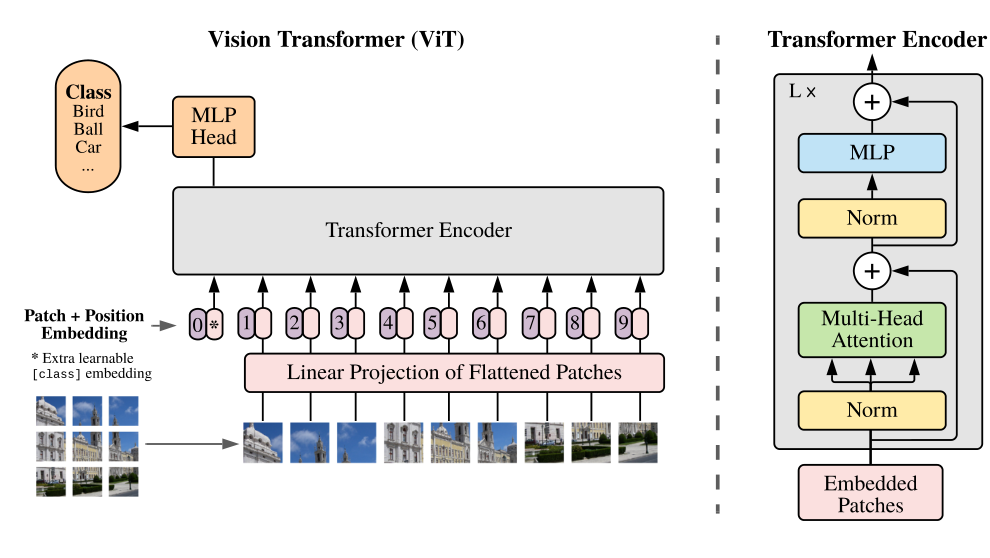

# Vision Transformers: from image patches to features

[All training](index.md) · [Source coverage](sources.md)

A Transformer encoder reads a sequence of vectors. An image is a grid of pixels. The key move in *An Image is Worth 16×16 Words* is to turn that grid into a manageable sequence while retaining enough information about where each piece came from. Start with a road image that contains a tiny car and follow it through the model.

Compare patch tokens with CNN grids in [Feature maps: what the backbone keeps](dl-feature-maps.md).

Jump to a concept

- [From pixels to a sequence](#from-pixels-to-tokens)

- [What changed from translation?](#what-changed-from-translation)

- [Why not use a token for every pixel?](#why-patches)

- [What the paper tested](#what-the-paper-tested)

## From pixels to a sequence

Cut a 224 × 224 RGB image into non-overlapping 16 × 16 patches. There are 14 rows and 14 columns of patches, or 196 in all. Each patch contains 16 × 16 × 3 = 768 pixel values. Flatten them in a consistent order and apply the same learned linear projection to each patch. The output dimension is a model choice. For ViT-B/16 it happens to be 768 too. Patch size and embedding width are separate knobs.

Flattening the *grid of patches* gives a sequence of 196 vectors. Add a learned positional embedding to each sequence position so the encoder has a way to tell a patch at the top of the scene from the same content at the bottom. The original ViT also prepends a learned classification token, often written `[CLS]`. That token starts as a learned vector shared across examples and acquires image-specific content as it attends to the patch tokens. The encoder processes 197 tokens in this example.

| Step | Shape for one example | What a row means |
| --- | --- | --- |
| Flatten patch pixels | 196 × 768 | RGB values from one patch |
| Project and add position | 196 × D | Learned patch representation with location information |
| Prepend class token and encode | 197 × D | One image summary and 196 contextualized patch vectors |
| Read class token with the classification head | K | One raw score (logit) per class in the output vector |

Original figure from [Dosovitskiy et al., An Image Is Worth 16×16 Words (2021), Fig. 1](https://arxiv.org/abs/2010.11929). Open the image for full size.

Read the figure

Follow the patch marked 4 through the figure. Which token reaches the classification head, and why is it not one of the image patches?

Show answer

Patch 4 becomes one position in the input sequence. The extra learned token marked 0 reads from the sequence through self-attention, and its final representation goes to the MLP head.

## What changed from translation?

ViT keeps the encoder idea. Self-attention exchanges information across patches, and the same feed-forward network within a block updates each token independently. The original ViT used pre-normalization and residual connections. A patch can combine evidence from another patch across the image. The class token reads the patch sequence through the same self-attention mechanism. There is no translation decoder or causal mask in this classifier, because the full image is available at once.

The RGB patch projection takes the place of text token lookup. Position information remains necessary for spatial arrangement. A classification head takes the place of the vocabulary prediction layer. During supervised pretraining it learns to classify images. During transfer to another label set, the paper replaced the classifier and fine-tuned the model. At a higher input resolution, the patch grid changes and the original work interpolated the learned position embeddings over the new two-dimensional grid.

## Why not use a token for every pixel?

A 224 × 224 image has 50,176 pixels. Full attention over one token per pixel would have over 2.5 billion pairwise entries per head per layer. At 196 patch tokens, the patch-to-patch part has 38,416 entries. Patches make global attention practical for this input size. The cost is spatial granularity. A 7-pixel car may occupy part of a patch or cross several patch boundaries. Its appearance can still affect patch vectors, but the last patch grid gives a head fewer spatial locations to work with than a fine-resolution feature map.

At 448 × 448 with the same patch size, there are 784 patches. That is four times as many tokens and about sixteen times as many pairwise entries. Smaller patches at a fixed image size have a similar cost. When localizing small objects, compare higher-resolution crops, smaller patches and multi-scale features against the memory and latency they actually cost.

## What the paper tested

The original study asked whether an architecture close to a standard Transformer could compete with convolutional models on image recognition. It compared models across pretraining data scales and then transferred them to downstream datasets. Its central result was that the approach worked particularly well with large-scale pretraining. A CNN builds in more locality and translation-related structure through shared local filters. ViT's global encoder has a different starting bias. The training results depend on the data scale and recipe, so treat the paper as evidence for a viable architecture and transfer strategy.

For downstream work, inspect which representation you have. A global embedding is useful for [image or crop classification](dl-classification-head.md). Keep the patch grid and its size metadata for [detection](dl-detection-head.md) and [segmentation](dl-segmentation-head.md). Patch tokens have spatial addresses even though their vectors contain information from elsewhere in the image.

### Self-check

You run a ViT-B/16 classifier at 448 × 448 instead of 224 × 224. What changes before the encoder?

Show answer and explanation

The grid changes from 14 × 14 to 28 × 28, so there are 784 patch tokens plus the class token. The patch projection still reads 16 × 16 × 3 numbers per patch and the model width stays the same. A learned positional grid needs to be adapted to the new size.

Primary source: [Dosovitskiy et al., An Image is Worth 16×16 Words](https://arxiv.org/abs/2010.11929), especially sections 3.1–3.2 and the pretraining-scale experiments. For the text architecture it adapts, see [the original Transformer walkthrough](dl-attention.md#original-transformer).
