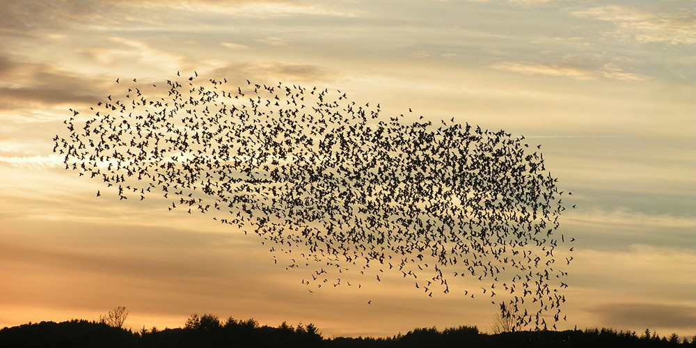
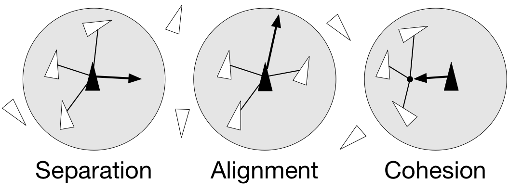

# Original Boids exercise

[Chapter index](index.md) · [Source coverage](sources.md)

**Reading is for you; page completion is optional.** If you can explain the concepts and answer the mentor's questions yourself, that is enough. Use these pages and the course videos to deepen understanding during the exercises with your approved agent. [Learning route and manual-work boundaries](index.md).

On this page

- [Boids Simulation Exercise](#boids-simulation-exercise)

- [Exercise](#exercise)

**Historical handout, preserved in full.** This records the older learner text; historical schedules and instructions to complete every reading or old assignment are superseded by the stage syllabus above. Reading links now point to local explanations. Video links retain their source destinations. The current required exercises are linked from the stage syllabus.

Credits: [https://www.labri.fr/perso/nrougier/from-python-to-numpy/#id5](arrays-data.md)

## Boids Simulation Exercise

Spatial vectorization refers to a situation where elements share the same computation but are in interaction with only a subgroup of other elements. In some situations there is an added difficulty because the subgroup is dynamic and needs to be updated at each iteration. This the case, for example, in particle systems where particles interact mostly with local neighbours. This is also the case for "boids" that simulate flocking behaviors.

~ Flocking birds are an example of self-organization in biology. Image by[Christoffer A Rasmussen](https://commons.wikimedia.org/wiki/File:Fugle,_%C3%B8rns%C3%B8_073.jpg), 2012:

### Boids

Boids is an artificial life program, developed by Craig Reynolds in 1986, which simulates the flocking behaviour of birds. The name "boid" corresponds to a shortened version of "bird-oid object", which refers to a bird-like object.

As with most artificial life simulations, Boids is an example of emergent behavior; that is, the complexity of Boids arises from the interaction of individual agents (the boids, in this case) adhering to a set of simple rules. The rules applied in the simplest Boids world are as follows:

separation: steer to avoid crowding local flock-mates

alignment: steer towards the average heading of local flock-mates

cohesion: steer to move toward the average position (center of mass) of local flock-mates

~ Boids are governed by a set of three local rules (separation, cohesion and alignment) that serve as computing velocity and acceleration:

## Exercise

Write your own Boids simulation!

Pay close attention to using vectorized operations on numpy arrays. Complete the missing parts in the file `[boid_numpy.py](https://drive.google.com/file/d/1SP8GYxUhvIi1v_lxSlI9nLEMR_1ZvBZR/view?usp=sharing)`. Do not use the solution in the source until done.

DO NOT USE LOOPS.
