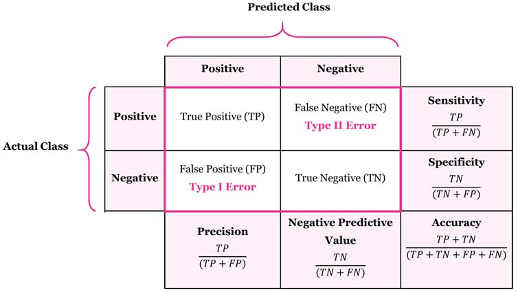
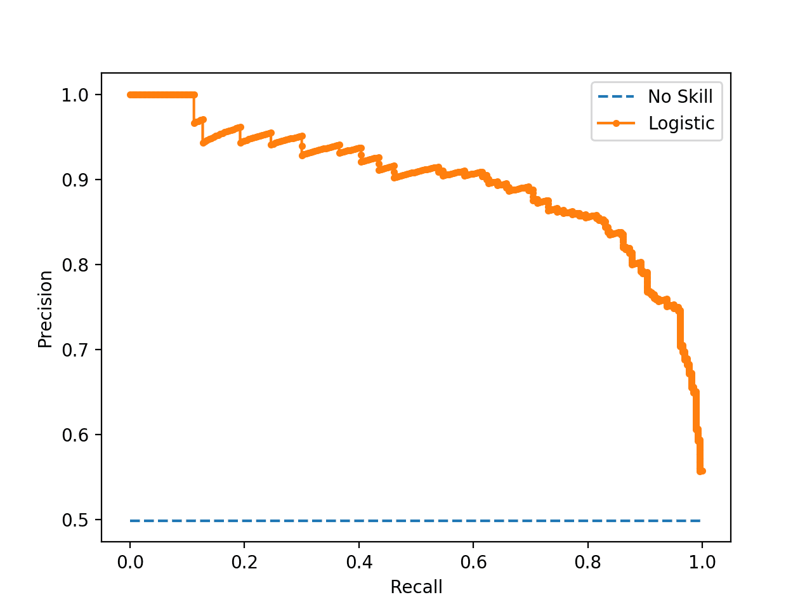
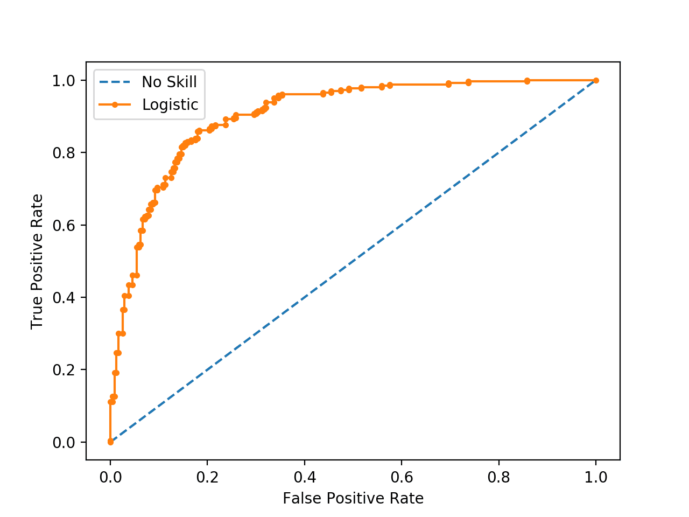
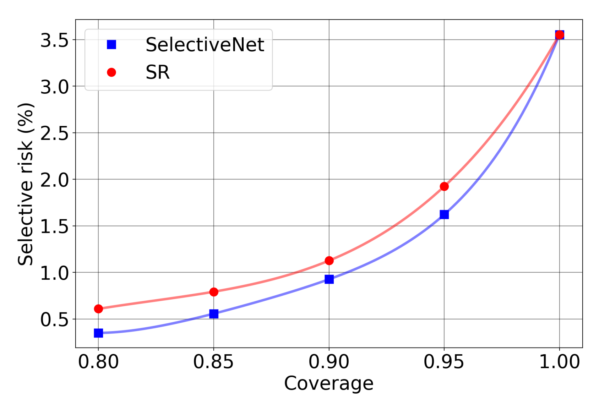
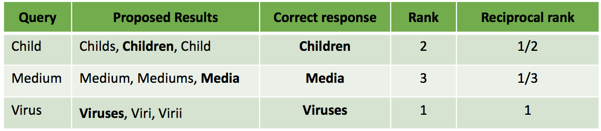

# Original team metrics notes

[Chapter index](index.md) · [Source coverage](sources.md)

**Reading is for you; page completion is optional.** If you can explain the concepts and answer the mentor's questions yourself, that is enough. Use these pages and the course videos to deepen understanding during the exercises with your approved agent. [Learning route and manual-work boundaries](index.md).

On this page

- [​Metrics to Know](#metrics-to-know)

- [Classification](#classification)

- [Multi-Class Classification:](#multi-class-classification)

- [Regression](#regression)

- [Ranking](#ranking)

**Historical handout, preserved in full.** This records the older learner text; historical schedules and instructions to complete every reading or old assignment are superseded by the stage syllabus above. Reading links now point to local explanations. Video links retain their source destinations. The current required exercises are linked from the stage syllabus.

**Corrections to the historical notes:** full-coverage risk equals error rate, zero-coverage risk is undefined, precision need not vary monotonically with threshold, and support-weighted precision is not generally micro precision. Use [the current metrics chapter](ml-metrics.md) for corrected definitions and examples.

## ​Metrics to Know

In this document we’ll be highlighting some commonly-used metrics that you should become familiar with.

TODO:

Video specific metrics

Table of contents

Classification

Accuracy

Confusion Matrix

Precision

Recall

F1-Score

AUC (PR Curve and ROC Curve)

Risk-Coverage

Multi-Class Classification:

A macro-average will compute the metric independently for each class and then take the average (hence treating all classes equally).

Regression

MAE

MSE

MAPE

Median Absolute Error

Ranking

Ranking metrics resource

Additional useful ranking metrics not covered in the resource above:

MRR (Mean Reciprocal Rank)

Hit Rate @ K

## Classification

### Accuracy

Accuracy is probably the simplest metric you’ll encounter: the proportion of correct classifications among all classifications. But, before we continue, it’s important to understand that accuracy isn’t necessarily a good metric to use.

For one, with accuracy, we’re assigning an equal cost of false positives and false negatives, which may not necessarily be the case. For example, think about the classic disease classification scenario. The two errors may not carry equal weight.

In addition, think about an unbalanced setting. Here, it’s easy to see that accuracy does not reflect the performance of your model.

But using accuracy has, perhaps, a large problem beneath the surface. Typically, we train a model to output a probability for each class. For simplicity, let’s assume we’re in a binary classification setting and our model outputs probabilities $p$ and $1-p$. By mapping these probabilities to a 0-1 classification using some predefined threshold, we are actually introducing a “bias” to our model’s outputs. Who decided that $p>0.5$ means that the sample should be predicted positive?

Depending on your problem and the meaning of this classification, we will use a different threshold to make the decision. For example, for a decision to perform invasive surgery, you will require a much higher probability for your classification. Or you might even have three different decisions although there are only two classes (sick vs. healthy): "go home and don't worry" vs. "run another test because the one we have is inconclusive" vs. "operate immediately".

Another reason that accuracy alone does not adequately reflect the performance of the model can be seen in the following example: assume that we have a binary classifier that is able to perfectly split between the positive and negative test samples. For example, all positive samples obtain a predicted probability of 0.4 and all negative samples get a predicted probability of 0.2. But let’s say that you defined your threshold as 0.4. Then, your accuracy on the positive samples is 0%. But you may not be all that interested in the actual probability, but rather the ordering of the samples (e.g., consider a ranking for a recommendation system). In the above scenario, your ranking is perfect, but this is not adequately reflected in the model’s accuracy.

### Confusion Matrix

If accuracy doesn’t tell us the entire story, perhaps the confusion matrix is one small step in the right direction. In the image above, you can see an example of the confusion matrix.

Basically, with the confusion matrix, we’re able to see where our model failed and to which direction it erred. The confusion matrix defines the following four prediction types: 

True Positive: the sample is positive and the model said it was positive.

True Negative: the sample is negative and the model said it was negative.

False Positive: the sample is negative and the model said it was positive.

False Negative: the sample is positive and the model said it was negative.

The weight of the false positives and false negatives depends on the task at hand. Think about scenarios where one error type is more important than the other.

We can then easily see that accuracy is defined as: $ACC=\frac{TP+TN}{FP+FN+TP+TN}$

The confusion matrix can be used to define various other metrics such as False Positive Rate and False Negative Rates. We’ll come back to these later on.

### Precision

Building on the confusion matrix, we just saw, two of the most commonly-used metrics used in evaluating models are Precision and Recall.

Formally, precision can be defined as:

$Precision=\frac{True Positive}{True Positive + False Positive}=\frac{True Positive}{Predicted Positive}$

In words, precision is pretty much saying “of all the samples that I predicted to be positive positive, how many are actually positive?”

When is precision very important? When the cost of a false positive is high. For example, in email spam detection, what would happen if we say something is spam, but in actuality it really is not spam? The user would miss out on a very important email :(

We’ll come back to precision in just a bit.

### Recall

Next up we have Recall. Recall is trying to answer the following question: “What percent of actual positives was identified correctly?”

Formally, this is defined as:

$Recall=\frac{True Positive}{True Positive + False Negative}=\frac{True Positive}{Positive}$

Recall is super important when we want to make sure that we’re able to capture all of the positive samples in our test data — for example, when tackling some sort of disease classification task.

Notice that in some cases, measuring the actual recall in the real-world is challenging (if not impossible). Think about a problem that we face in our research and how measuring recall there is challenging. Observe that it’s much simpler to go over the results of a model and check where the model was incorrect (i.e., compute the precision).

As you may have noticed, precision and recall have an inverse relationship — as one goes up, the other goes down since you’re choosing to either control for false positives or false negatives. To try to better understand this, check out the example in the [following blog](ml-metrics.md).

###  

### F1-Score

Formally the F-score is defined as:

${F}_{1}=\frac{2\cdot Precision\cdot Recall}{Recall+Precision}$

We can also view the F-score as the harmonic mean of precision and recall.

By using two values, we often cannot determine if one algorithm is superior to another. For example, if one algorithm has higher precision but lower recall than the other, how can you tell which algorithm is better?

This is where the F-score comes into play.

Note that the F-score doesn’t really have an intuitive meaning since it is the combination of two metrics. If you have a specific goal in your mind like “precision is the king. I don't care much about recall”, then there's no problem. Higher precision is better. But if you don't have such a strong goal, you will want a combined metric. That's where F-score helps. By using it, you will compare some of precision and some of recall.

One advantage of F-score over accuracy is that it is much more suitable when faced with imbalanced data.

There are some edge cases that make F-score a bit dangerous if you aren’t paying attention. For example, The F-score gives a larger weight to lower scores. Consider the following two binary classification scenarios:

When $Precision=100\%$ and $Recall=0\%$, we get ${F}_{1 }=0\%$ rather than $50\%$.

Consider two models. Model A obtains $P=R=80\%$ while Model B obtained $P=60\%$ and $R=100\%$. Here, Model A will obtain an F-score of $80\%$ while Model B will obtain a score of $75$%. However, it is not entirely clear which of the two models is preferable.

The following paper provides a nice overview of some other drawbacks of the F-score measure: ​​[https://adamyedidia.files.wordpress.com/2014/11/f_score.pdf](ml-metrics.md)

### AUC (PR Curve and ROC Curve)

Here we’ll begin by defining the PR and ROC curves. We’ll then move to discussing their differences and limitations.

​​

The precision-recall (PR) curve shows the tradeoff between precision and recall for different thresholds. A high area under the curve represents both high recall and high precision, where high precision relates to a low false positive rate, and high recall relates to a low false negative rate. High scores for both show that the classifier is returning accurate results (high precision), as well as returning a majority of all positive results (high recall).

Using the PR curve, we can compute the average precision, which is the weighted mean of precisions achieved at each threshold, with the increase in recall from the previous threshold used as the weight:

$AP=\sum _{n}^{}({R}_{n}-{R}_{n-1}){P}_{n}$

where ${R}_{n}$ and ${P}_{n}$ denote the precision and recall at the $n$-th threshold, respectively.

Note that PR curves are used in the binary classification setting. Extending this to a multi-class setting would require you to binarize the output. One option would also be creating a separate PR curve for each class.

The ROC curve, or the Receiver Operating Characteristic curve, plots the false positive rate (x-axis) versus the true positive rate (y-axis) for various threshold values.

Here, the true positive rate (or sensitivity) is calculated as the number of true positives divided by the sum of the number of true positives and the number of false negatives. It describes how good the model is at predicting the positive class when the actual outcome is positive.

The false positive rate is calculated as the number of false positives divided by the sum of the number of false positives and the number of true negatives. It is also called the false alarm rate as it summarizes how often a positive class is predicted when the actual outcome is negative.

Understanding when to use what is very tricky. We’ll try to clarify below.

ROC curves can sometimes be misleading in some very imbalanced applications. A ROC curve can still look pretty good (i.e., better than random) while misclassifying most or all of the minority class. ROC curves are insensitive to class imbalance. This means that if you balance your data (i.e., with resampling), the ROC curve does not change (assuming you don't re-train your model).

In contrast, PR curves are specifically tailored for the detection of rare events and are pretty useful in those scenarios. They will show that your classifier has a low performance if it is misclassifying most or all of the minority class. But they don't translate well to more balanced cases, or cases where negatives are rare.

Consider the following statement: “precision-recall curve is considered better than an ROC curve when testing a classifier on a dataset with a class imbalance.”

Is this correct? No! The PR curve plots the following parameters:

$Precision=\frac{True Positive}{True Positive + False Positive}$

$Recall=\frac{True Positive}{True Positive + False Negative}$

Notice how True Negatives (TN) are absent from the equation?

PR curves are useful when positive examples are rare. If your dataset is imbalanced with rare negatives, you should absolutely not use the PR curve.

So in the end it is up to you to choose which tool to use. Don't use PR curves just because you have an imbalance. Are positive examples rare? Are they rare specifically in your sample? Then stick with PR curves. Are they rare in the general population? Then you should consider precision and look at the PR curve too. Are negative cases rare? Then stick with the ROC curve.

Here is a another good explanation between when to use the PR and ROC curves: [https://stats.stackexchange.com/a/7210](ml-metrics.md)

### Risk-Coverage

Recently, a big part of our focus in building and comparing ML models is the idea of uncertainty: aside from the prediction returned by the model, we are often (more) interested in knowing how certain the model is in its prediction.

Quantitatively measuring uncertainty is a bit challenging since there is no ground truth label indicating if a sample should be marked certain or uncertain. However, there is a nice metric that allows us to compare the quality of the uncertainty metric you have designed.

Here, we’ll walk through this metric. If you’d like to learn more, we highly recommend reading the first chapter of the Yonatan Geifman’s thesis: [https://www.cs.technion.ac.il/users/wwwb/cgi-bin/tr-get.cgi/2019/PHD/PHD-2019-09.pdf](ml-metrics.md)

Let’s assume we have a binary classification model. In addition, let’s assume we have some sort of uncertainty model which outputs “certain” or “uncertain” for each predicted sample. For our purposes, we can think of this uncertainty model as a black box. There are various different ways to build this such a model, but this is out of the scope for our purposes.

Just as we would like to quantify the performance of our binary classifier, our goal here is to measure the quality of our uncertainty model. How can we do this?

This is where the risk-coverage metric will come into play.

Coverage: coverage represents the percent of all predicted samples that are predicted certain by our uncertainty model.

Risk: consider all samples that were predicted certain by our uncertainty model. Our risk is the percent of certain samples that were misclassified by the binary classifier.

Intuitively, there is a trade-off between risk and coverage: the more samples were predicted certain, the more likely it is that we will misclassify the samples. On one end of the spectrum, if we have a coverage of 0, we have a risk of 0 (by default). On the other end, if we have a coverage of 100% (i.e., all samples are certain), then our risk is simply the overall accuracy of our binary classifier.

Our goal here is to, of course, maximize the coverage while minimizing the risk of our model. In a similar sense, what we are looking for is the following: we would like our model to perform significantly better on the samples for which it is certain compared to the samples that it is uncertain on. For example, if we have a certain accuracy of 90% (i.e., on all samples predicted certain, we are correct 90% of the time) and an uncertain accuracy of 20% (i.e., on all samples predicted uncertain, we are correct 20% of the time), we should be happy. There is a clear dichotomy between the two sets of predictions. However, if we have a certain accuracy and an uncertain accuracy of around 80%, we shouldn’t be completely satisfied. We are correct on a bunch of samples that we marked as uncertain, which is wasteful.

If it helps, we can consider the risk-coverage curve as the precision-recall curve of our uncertainty model. We can play around with the threshold of our uncertainty model to find a nice balance between the risk and the coverage of the model. For example, consider the following risk-coverage graph, which we obtain via different uncertainty thresholds:

In the above example, we’d prefer the blue uncertainty model because at various coverage levels, we consistently get lower risk (error rates).

Observe that while we want to maximize the AUC of the PR and ROC curves, we actually want to minimize the AUC of the risk-coverage curve.

## Multi-Class Classification:

When working in a multi-class classification setting, you most likely want to average the per-class metrics. However, there are two ways to go about doing this. Here, we’ll take a dive into the two ways of performing this averaging and their interpretation when doing so.

If you take away one thing from this section is that micro- and macro-averages will compute slightly different things, and thus their interpretation differs.

### A macro-average will compute the metric independently for each class and then take the average (hence treating all classes equally).

A micro-average will aggregate the contributions of all classes to compute the average metric.

In a multi-class classification setup, micro-average is preferable if you suspect there might be class imbalance.

Let’s go through an example to understand why. Take for example precision. Let's imagine you have a One-vs-All (there is only one correct class output per example) multi-class classification system with four classes and the following numbers when tested:

Class A: 1 TP and 1 FP

Class B: 10 TP and 90 FP

Class C: 1 TP and 1 FP

Class D: 1 TP and 1 FP

We can see that here we have $P{r}_{A}=P{r}_{C}=P{r}_{D}=0.5$ and $P{r}_{B}=0.1$.

A macro-average will compute: $Pr=\frac{0.5+0.1+0.5+0.5}{4}=0.4$

A micro-average will compute $Pr=\frac{1+10+1+1}{2+100+2+2}=0.123$

These are quite different values for precision. Intuitively, in the macro-average the "good" precision (0.5) of classes A, C and D is contributing to maintain a "decent" overall precision (0.4).

While this is technically true (across classes, the average precision is 0.4), it is a bit misleading, since a large number of examples are not properly classified. These examples predominantly correspond to class B, so they only contribute 1/4 towards the average in spite of constituting 94.3% of your test data.

The micro-average will adequately capture this class imbalance, and bring the overall precision average down to 0.123 (more in line with the precision of the dominating class B (0.1)).

For computational reasons, it may sometimes be more convenient to compute class averages and then macro-average them. If class imbalance is known to be an issue, there are several ways around it. One is to report not only the macro-average, but also its standard deviation (for 3 or more classes). Another is to compute a weighted macro-average, in which each class contribution to the average is weighted by the relative number of examples available for it. In the above scenario, we obtain:

$P{r}_{macro-mean}=0.25\cdot 0.5+0.25\cdot 0.1+0.25\cdot 0.5+0.25\cdot 0.5=0.4$

$P{r}_{macro-std}=0.173$

$P{r}_{macro-weighted}=0.0189\cdot 0.5+0.943\cdot 0.1+0.0189\cdot 0.5+0.0189\cdot 0.5$

$=0.009+0.094+0.009+0.009=0.123$

The large standard deviation (0.173) already tells us that the 0.4 average does not stem from a uniform precision among classes, but it might be just easier to compute the weighted macro-average, which in essence is another way of computing the micro-average.

## Regression

In classification tasks, we are interested in picking elements from a set of discrete objects. In regression tasks, on the other hand, we are interested in predicting continuous values (such as house prices, stock movement, amount of rain etc.). Therefore, we need different metrics and we have different interpretations to our model’s performance.

While there are many available regression metrics, we will focus only on the following:

MAE (Mean absolute error)

MSE (Mean squared error)

MAPE (Mean absolute percentage error)

Median Absolute error

### MAE

[https://scikit-learn.org/stable/modules/model_evaluation.html#mean-absolute-error](ml-metrics.md)

This metric is quite intuitive, as it just averages the absolute deviations of the given examples.

### MSE

[https://scikit-learn.org/stable/modules/model_evaluation.html#mean-squared-error](ml-metrics.md)

The MSE is probably the most used regression metric and it has important statistical uses. Intuitively, this metric penalizes large deviations (>1) much more than the MAE, but discounts small deviations (<1).

### MAPE

[https://scikit-learn.org/stable/modules/model_evaluation.html#mean-absolute-percentage-error](ml-metrics.md)

MAPE penalizes our deviations based on relative values, instead of absolute deviations.

Also, take a look at the following twitter thread: [https://twitter.com/capeandcode/status/1450666977236713480](ml-metrics.md)

### Median Absolute Error

[https://scikit-learn.org/stable/modules/model_evaluation.html#median-absolute-error](ml-metrics.md)

The median absolute error is a metric that is robust to outliers - a single super-large deviation won’t change our score. Essentially, we just take the median of the absolute deviations, instead of the mean like we did with MAE.

### R-Squared

[https://scikit-learn.org/stable/modules/generated/sklearn.metrics.r2_score.html#sklearn.metrics.r2_score](ml-metrics.md)

The ${R}^{2}$ metric is a metric normalizing the

## Ranking

Sometimes we want not just to predict what class/classes an example belongs to, but to rank classes according to how likely they are for a particular example (or rank other stuff like relevant web pages etc.).

A good overview of some popular ranking metrics can be found in the following link, and you should read it thoroughly:

### Ranking metrics resource

[https://queirozf.com/entries/evaluation-metrics-for-ranking-problems-introduction-and-examples](ml-metrics.md)

This resource will teach you about:

<some metric>@K

AP/mAP (which were partially covered already in the classification section)

NDCG

### Additional useful ranking metrics not covered in the resource above:

### MRR (Mean Reciprocal Rank)

MRR is one of the simplest metrics for evaluating ranking models. MRR is essentially the average of the reciprocal ranks of “the first relevant item” for a set of queries Q, and is defined as:

$MRR = \frac{1}{|Q|}\sum _{i=1}^{|Q|}\frac{1}{ran{k}_{i}}$

To illustrate this, let’s consider the below example, in which the model is trying to predict the plural form of English words by making 3 guesses. In each case, the correct answer is also given:

The MRR of this system can be found as:

$MRR= \frac{1}{3}\cdot (\frac{1}{2}+\frac{1}{3}+\frac{1}{1})= \frac{11}{18}$

One of the limitations of MRR is that it only takes the rank of one of the items (the most relevant one) into account, and ignores other items (for example mediums as the plural form of medium is ignored). This may not be a good metric for cases where we want to browse a list of related items.

### Hit Rate @ K

This metric is possibly the simplest ranking metric one can think of, but it can be useful sometime. Simply put, it is the percentage of queries for which a correct result is found in the top K. Formally, this metric is defined as follows:

$Q =number of queries$

$Q{}_{K}^{hit} = number of queries with a correct result in the top K$

$Hit Rate @ K=\frac{|Q{}_{K}^{hit}|}{|Q|}$

While this metric is very naive and not sophisticated at all, it can be useful as it might represent the actual quantity your client is interested in, especially if K is relatively small.
