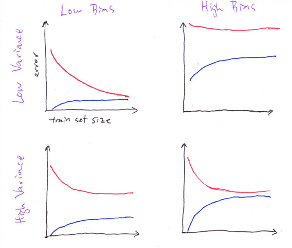

# Original earlier ML program

[All training](index.md) · [Source coverage](sources.md)

**Reading is for you; page completion is optional.** If you can explain the concepts and answer the mentor's questions yourself, that is enough. Use these pages and the course videos to deepen understanding during the exercises with your approved agent. [Learning route and manual-work boundaries](index.md).

On this page

- [Machine Learning Training Program](#machine-learning-training-program)

**Historical handout, preserved in full.** This records the older learner text; historical schedules and instructions to complete every reading or old assignment are superseded by the stage syllabus above. Reading links now point to local explanations. Video links retain their source destinations. The current required exercises are linked from the stage syllabus.

## Machine Learning Training Program

Note that document with the shampooer and not the shampooe!

Below is a detailed syllabus by topic with questions and notes for each topic.

Most topics have a complementary mini-exercise. After covering the topics in the links below, make sure to complete the necessary mini-exercise for that topic.

All exercises should be completed in the provided Jupyter notebook.

The data for all exercises can be found here: [https://drive.google.com/drive/folders/1hM7-LkPs8F97dNx1zQqpknPBnTACuoPa?usp=sharing](https://drive.google.com/drive/folders/1hM7-LkPs8F97dNx1zQqpknPBnTACuoPa?usp=sharing)

All required datasets are also provided.

Machine Learning Training Program

1. Supervised Learning and Discriminative Algorithms

Resources

Notes

Exercises

Questions

2. Model Evaluation and Selection

Resources

Notes

Exercises

Questions

3. Generative Algorithms

Resources

Notes

Exercises

Questions

4. Fundamental Algorithms

Resources

Notes

Exercises

Questions

5. Unsupervised Learning

Resources

Exercises

Questions

6. Visualizations

Supervised Learning Exercise: Kaggle Competition - Skip

Instructions

Notes

Project Expectations

### 1. Supervised Learning and Discriminative Algorithms

### Resources

Read from [CS229 Notes 1: Supervised Learning and Discriminative Algorithms](ml-foundations.md)

Supervised Learning

Part 1: Linear Regression

1. LMS Algorithm

3. Probabilistic Interpretation

Part 2: Classification and Logistic Regression

5. Logistic Regression

### Notes

Nothing special that needs to be emphasized at this point.

### Exercises

None for now

### Questions

Since we are using the logistic function to transform a linear combination of the input into a non-linear output, how can logistic regression be considered a linear classifier?

Logistic regression is linear in the sense that the predictions can be written as

$p=\frac{1}{1+\exp(-\mu )}$ where $\mu =\theta \cdot x$

Thus the prediction can be written in terms of $\mu$ which is a linear function of $x$. Also, for logistic regression, the decision boundary ${x:p=0.5}$ is linear: it is the solution to $\theta \cdot x=0$.Assume you trained a model. How would you define the importance of each feature?

They will most likely say that the coefficient measures importance.

Follow-up question: what would happen if you have correlated features?

Would correlated features affect the output of the Logistic Regression model? Why?

Yes. Let us consider the extreme case where we have two variables that are perfectly correlated.

Let’s say you want to use logistic regression to predict the probability of a car accident being fatal where one of the predictor variables will be speed, but for some reason you have two variables x = speed in km/h and y = speed in mph. Clearly, x and y are linearly dependent with x = 1.61y. In your model, you will estimate coefficients $\beta$ such that:

$\log(\frac{P(fatal)}{P(not fatal)})={\beta }_{0}+{\beta }_{x}x+{\beta }_{y}y+(other terms)$

Due to the linear dependence, the relevant term on the right hand side can be written as $(1.61{\beta }_{x }+{\beta }_{y})y$. Now let’s say for some reason the speed actually has no influence on the fatality of the crash. Then you would expect your model to find that ${\beta }_{x}={\beta }_{y}=0$. However, due to the linear dependence, the model cannot distinguish between ${\beta }_{x}={\beta }_{y}=0$ or ${\beta }_{x }=1,{\beta }_{y}=-1.61$ or ${\beta }_{x}=-100, {\beta }_{y}=161$ or any other combination where ${\beta }_{x}=-\frac{{\beta }_{y}}{1.61}$

Thus, on the one hand the model itself may become numerically unstable. On the other hand, you can no longer interpret the results correctly.

The same is true when variables are no longer linearly dependent but highly correlated (Think speed measurements in the same unit but from two distinct systems inside the car, such as x = speed in km/h measured by counting wheel rotations per second and y = speed in km/h measured using GPS. Then, due to measurement errors, we expect x and y to not be exactly the same, but very highly correlated. Let’s keep the assumption that the true coefficients should be 0. Then, again, looking at the entire input data set, the mode can hardly distinguish between any cases where ${\beta }_{x}=-{\beta }_{y}.$

### 2. Model Evaluation and Selection

### Resources

[Overfitting/Underfitting, Bias, and Variance](ml-bias-validation.md)

Another (clearer) explanation - [Chapter 8 Bias–Variance Tradeoff | R for Statistical Learning](ml-bias-validation.md)

[Holdout Validation, Resampling, Bootstrapping](ml-bias-validation.md)

[Model Selection and Cross Validation](ml-bias-validation.md)

Bonus: [Statistical Tests](ml-bias-validation.md)

Evaluation Metrics: [Lecture Slides](ml-metrics.md)

Topics: Precision, Recall, FAR, F-Score, Confusion Matrix, ROC Curve, PR Curve, AUC,  AP (mAP)

Also, take a look at the [metric summary written](legacy-metrics.md)[by the mador](legacy-metrics.md)!

[Feature Selection](ml-foundations.md) (CS229)

### Notes

Currently no notes, welcome to add

### Exercises

In the jupyter notebook, complete the sections on Linear Regression and Logistic Regression.

### Questions

Overfitting/Underfitting, Bias, and Variance

What happens to the Bias and Variance if we only have a single model?

Since we only have a single sample for every prediction - the bias expectation value is simply the prediction itself and the variance is 0.

What is the Bias-Variance tradeoff?

It means that if we have a group of models, each one trained on a different split of the train set for example, and they overfit the training set (low bias) - they do not generalize very well, so the variance that they have on a new dataset (e.g. test) would be big.

Explain the following drawings - by stating in which ones there is a high\low bias and high\low variance.

(blue = train error, red = test error)

Answer: top-left - low bias and low variance, top-right - high bias and high variance, bottom-left - low bias high variance, bottom-right - high bias low variance.

Holdout Validation, Resampling, Bootstrapping

Leakage - Assume that we want to train an ML model for the following question:

We want to predict whether a member of a certain football team can win the league, we solve the problem by building features for every group separately and we want to evaluate our train-validation performance.

How would you divide the dataset into train and test?

What could be the problem with using a simple random sampling? (i.e. on the samples s.t. Members of the same team can be in the train and test)

In k-fold cross-validation, explain the tradeoff between large and small k

Assuming we have a very uneven dataset with a lot of negative samples and very few positives, how can we split our train-validation in order to get good performance?

We want to keep as many positive samples in the test in order to avoid pessimistic bias, so we can use leave-1-out validation for the positive samples and sample the negatives in a way that will keep the original distribution ratio (not necessary).

What are the advantages of bootstrap compared to hold-out and cross validation?

[What is the difference between bootstrapping and cross-validation?](ml-bias-validation.md)

### 3. Generative Algorithms

### Resources

Read [CS229 Notes 2: Generative Algorithms](ml-generative-neighbors.md)

### Notes

Currently no notes, welcome to add

### Exercises

In the jupyter notebook, complete the section on Naive Bayes

### Questions

Currently no questions, welcome to add

### 4. Fundamental Algorithms

This chapter will overview the standard algorithms used in ML

### Resources

KNN

Read [Lecture Notes](ml-generative-neighbors.md) (University of Wisconsin STAT479)

Also touches on computational complexity, data structures, and the curse of dimensionality

SVM

Read [CS229 Lecture Notes](ml-generative-neighbors.md) (Up to Section 9)

Don’t get stuck too much on the math.

Trees and Ensembles

Read [Decision Trees](ml-trees-ensembles.md)

Read [Ensembling](ml-trees-ensembles.md) (Random Forests, Boosting, Bagging, Stacking)

### Notes

Currently no notes, welcome to add

### Exercises

In the jupyter notebook, complete the sections on KNN, SVM, Trees, and Ensembles.

### Questions

Currently no questions, welcome to add

### 5. Unsupervised Learning

### Resources

Read [Principal Component Analysis](ml-unsupervised.md)

Read [Clustering Algorithms Blog](ml-unsupervised.md)

Read on [GMM and EM](ml-unsupervised.md)

Read the following [Distill post on TSNE](ml-unsupervised.md)

Read the following [post on UMAP](ml-unsupervised.md)

Notes

Currently no notes, welcome to add

### Exercises

In the jupyter notebook, complete the sections on PCA and Clustering.

### Questions

Currently no questions, welcome to add

### 6. Visualizations

Go over the different notebooks in the following [Visualizations with Seaborn tutorial](arrays-data.md)

After completing the notebooks, complete the final exercise notebook (07-Seaborn Exercises.ipynb)

Don’t look at the solutions! :)

### Supervised Learning Exercise: Kaggle Competition - Skip

### Instructions

You will be given a few days (depending on the time constraint) to complete as much as possible in a Kaggle competition.

For the most part, you will be free to complete the task in whatever way you see fit. However, below we have listed some expectations we expect to see in your final result.

Every day we will meet with you to answer any questions that arise and discuss your progress and plan.

At the end of the project, you will be asked to present your work.

Most Kaggle competitions span several months. Therefore, we do not expect you to have a finished project after one week. Therefore, when presenting your work, discuss directions for the next steps.

The competition can be found in the following link: [Shelter Animal Outcomes](https://www.kaggle.com/c/shelter-animal-outcomes/overview)

Task: predict the outcome of the animal as they leave the Animal Center (Adoption, Died, Euthanasia, Return to owner, and Transfer.)

Problem Type: multi-class classification

Evaluation: Multi-class logarithmic loss

### Notes

All of these are kaggle competitions, meaning there are many notebooks available. You are allowed to explore these notebooks, but if you do, please do so reasonably.

You can complete the project in whatever IDE you wish (e.g., PyCharm / Jupyter Notebook).

However, keep in mind you are expected to output nice visualizations.

One of the most important skills that we will look for is creating insightful visualizations! Make sure you invest time in creating interesting visualizations!

### Project Expectations

Data Exploration

Output graphs that provide insight to your dataset, not just graphs that look nice.

Data Cleaning / Feature Extraction

Clean your data! For example, handling missing values, handling categorical data, etc.

Determine which features are relevant to solving your task and which features may/should be removed.

Model Exploration

Test various models / parameters and compare their performance on their dataset

Compare the different models. Are you able to explain why a particular model performs better than a different model?

Analyze the results / False analysis

Where is the model successful/unsuccessful?

Which features are most significant?

Future directions

What are your next steps?

What can be done to improve the model?
