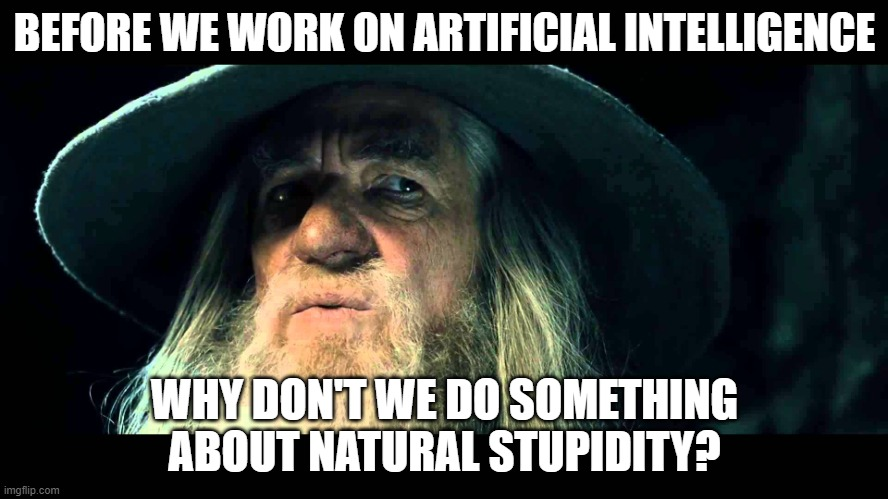

# Original 2025 program outline

[All training](index.md) · [Source coverage](sources.md)

**Reading is for you; page completion is optional.** If you can explain the concepts and answer the mentor's questions yourself, that is enough. Use these pages and the course videos to deepen understanding during the exercises with your approved agent. [Learning route and manual-work boundaries](index.md).

### On this page

- [Training Program Outline](#training-program-outline)

- [General Guidelines](#general-guidelines)

- [Program Outline](#program-outline)

**Historical handout, preserved in full.** This records the older learner text; historical schedules and instructions to complete every reading or old assignment are superseded by the stage syllabus above. Reading links now point to local explanations. Video links retain their source destinations. The current required exercises are linked from the stage syllabus.

## Training Program Outline

Python to PyTorch

## General Guidelines

Welcome to our training/shampooing Program, let’s start with a few general guidelines

For every part of the training program the shampoee will be paired with a researcher that will be in charge on helping, mentoring and monitoring his progress

Do ask him for guidelines and advice when you need it

Shampoee will keep a live document with details on their shampooing process

Each shampoee will have a weekly 15 minutes meeting with the MMM to see how the training is going so far

## Program Outline

Below is a general recommendation for the outline of the training program, note that the actual program should be changed for each trainee.

### Infrastructure: (2 days)

### Linux: (1 day)

[https://www.tutorialspoint.com/unix/index.htm](development-foundations.md)

Read all of “Unix / Linux for Beginners”

Make sure the trainee goes over exercises

Introduce him to tmux/screen (only so he knows it exists and its purpose, nothing more)

### Git: (0.5 day)

[https://www.atlassiarrently checked out commit -- it's essentially what commit you're working on top of.n.com/git/tutorials/learn-git-with-bitbucket-cloud](development-foundations.md)

Skip:

Git SSH

Why Git for your organization

Even if you are a git pro, there's always more to learn

Remember - pros use git from the CLI

### Docker: (0.5 day)

[https://www.udemy.com/course/docker-essentials/](development-foundations.md)

Enroll to the free course

The Swarm and GUI parts are nor necessary (you may learn them if you want)

### Python: (2-3 weeks)

### Basic Python: (~week, for beginners only)

[The Python Tutorial](development-foundations.md)

Read up to and including “Classes/Objects”

Important topics to emphasize:

Good coding practices

[https://docs.python-guide.org/writing/style/](development-foundations.md)

Python Environments (Recommended)

Read about the following concepts:

Virtual Environments

Pip

Anaconda

### Advanced Python: (3 days, for non-beginners only)

Complete the [Advanced Python Training.docx](legacy-python.md)

### Numpy: (2-3 days)

Read: [Python Numpy Tutorial (CS231n)](arrays-data.md)

It is recommended to open the jupyter notebook version.

Another resource: [TutorialsPoint](arrays-data.md)

Important topics:

Indexing and Slicing

Advanced Indexing

Broadcasting

Exercise: [100 Numpy Questions](arrays-data.md)

Complete the exercises using the jupyter notebook without hints/solutions.

Pay attention to efficiency: use vector operations where possible (hint: almost always)

After you finish, submit your solutions for a CR.

Focus on these questions:

Questions up to 31, without questions 2, 4, 5, 23, 27, 28, 31

From questions 32-51: 35, 37-40, 45, 46, 50

From questions 52-100: 52-55, 58, 59, 61, 64, 65, 70-72, 74, 75, 83, 89

Exercise: [Boids simulation](legacy-boids.md) (Skip)

### Pandas: (2 days)

For beginners: [Pandas Exercises](arrays-data.md)

Sections: 1 - 5 (From each section, select one exercise / dataset)

Additional resource: [TutorialsPoint](arrays-data.md)

### Final Exercise: (up to 5 days)

Before getting started on the final exercise, watch the two following videos talking about writing clean code (about 3 hours total):

[https://youtu.be/7EmboKQH8lM](https://youtu.be/7EmboKQH8lM)

[https://youtu.be/2a_ytyt9sf8](https://youtu.be/2a_ytyt9sf8) If you MUST, you can skip the 5 minutes of physics at the beginning of each video

[Shape Rendering](legacy-shape-rendering.md) - complete the exercise!

### Computer Vision: (2 weeks)

[Udacity UD810 / CS4495](cv.md) (Videos: from [Udacity](cv-filtering.md))

Units to complete: 1 (all), 2 (all), 3 (all), 4 (all) , 6 (all), 7A, 9A, 9B

All other units are optional

Exercises:

PS0 - Do

PS1 (Hough) - Skip

PS2 - Skip

PS3 - Skip

PS4 - Do

PS5 - Skip 

### Machine Learning: (2 weeks)

More details are provided in the following Google Docs:

[Machine Learning Training.docx](legacy-ml.md)

After each section, refer the trainee to the additional readings for some more in-depth details:

[ML Additional Readings.docx](legacy-ml-additional.md)

Jupyter notebooks and data:

Please make sure to make a local copy of all notebooks and datasets!

[ml_training_exercises.ipynb](https://drive.google.com/file/d/19Snas2MqzS4-o4B3NfTzv4HBhPpAIRBF/view?usp=drive_link)

[data](https://drive.google.com/drive/folders/1P1MFkVfQTT8F4g3D0ejp5ocVDMyFeZLc?usp=drive_link)

### Deep Learning: (3 weeks course)

Follow the [Deep Learning Training.docx](legacy-dl.md) document

###  

### Research Papers (1 week)

### Papers Relevant to All Teams

RCNN

Fast RCNN

Faster RCNN

SSD

### Papers Relevant to MopLe

EfficientNet + EfficientDet

DINO series (v1, v2, v3)

### Papers Relevant to CV

DINO-DeTR

OCR Related Papers

DB

TRBA

### Papers Relevant to Sherlock

ArcFace

RetinaFace

Owlv2

###   

### Additional Resources

Textbooks:

The Deep Learning Book

The Elements of Statistical Learning

An Introduction to Statistical Learning

Compute Vision: Algorithms and Applications - Richard Szeliski

[Neural Networks and Deep Learning](dl-training.md) - Michael Nielson

Courses:

Stanford CS229

UCL/DeepMind Advanced ML and RL

[Lecture Videos](https://www.youtube.com/playlist?list=PLqYmG7hTraZDNJre23vqCGIVpfZ_K2RZs)

Available online

MIT Introduction to Deep Learning

[Course Homepage](deep.md)

Other Resources:

Troubleshooting Deep Neural Networks

[Slides](dl-training.md) and [Video](https://www.youtube.com/watch?v=XtCNNwDi9xg)

[Unsupervised Feature Learning and Deep Learning](ml-foundations.md)

[Montreal AI](deep.md) - Contains links to an endless number of papers/articles/resources on a wide range of topics
