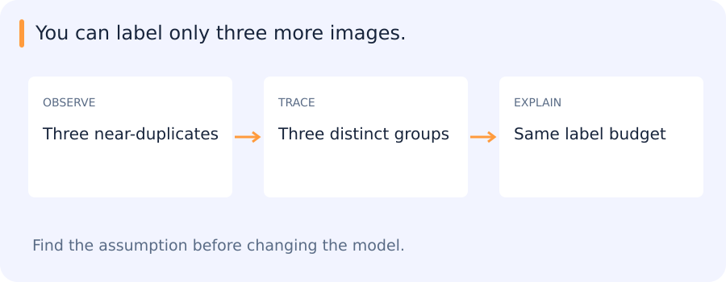

# Retained advanced topics: learning setups, ranking and recommendation

[All training](index.md) · [Source coverage](sources.md)

## You can label only three more images.

Choose three nearly identical uncertain crops, or cover three different failure groups? Active learning spends a budget; uncertainty alone need not spend it well.

| Notice | Interpret | Check |
| --- | --- | --- |
| Uncertainty can repeat itself | Diversity adds coverage | Keep a random audit |

Reveal the catch

Limited supervision changes how you collect evidence as well as how you fit a model.

**Try it in 60 seconds:** Pick a tiny candidate pool and justify your next three labels before seeing their answers.

Read for understanding, not page completion. Skip what you can already explain.

Jump to a concept

- [Choose the target structure](#choose-the-target-structure)

- [Limited supervision](#limited-supervision)

- [One-class and anomaly detection](#one-class-and-anomaly-detection)

- [Metric learning, ranking and recommendation](#metric-learning-ranking-and-recommendation)

- [Multiple inputs, outputs and losses](#multiple-inputs-outputs-and-losses)

- [How to use this extension](#how-to-use-this-extension)

## Choose the target structure

Multiclass classification chooses among mutually exclusive labels. Multilabel classification permits multiple labels per example and needs both per-label and per-example evaluation. Multiple-output regression predicts several numerical targets. A sequence-labeling system emits a label per token or time step, while sequence-to-sequence learning produces an output sequence with a potentially different length. Input/output structure determines losses, masks and metrics; replacing a final layer alone may not define the correct task.

## Limited supervision

Active learning chooses which examples to label next, often using uncertainty, diversity or expected gain. Uncertainty-only selection can oversample outliers and overlook confidently wrong regions. Evaluate label efficiency on independent data and retain random sampling as an audit. Semi-supervised learning combines labeled and unlabeled observations through assumptions such as smoothness, consistency or low-density class boundaries. Pseudo-label thresholds can reinforce existing biases; unlabeled data is not guaranteed to improve a misspecified task.

One-shot/few-shot learning uses very few labeled supports for a new task or class. Meta-learning can optimize adaptation across tasks, while pretrained embeddings with prototypes are a simpler alternative. Zero-shot learning uses semantic descriptions or other transferable supervision without task-class examples in the declared adaptation set. Clarify whether “unseen” means unseen during a small adaptation run or unseen anywhere in pretraining. Test novel categories and acquisition conditions separately.

## One-class and anomaly detection

One-class methods model accepted/normal observations and score departures. Density estimation, one-class SVMs, isolation approaches and reconstruction-based methods define normality differently. A high-dimensional Gaussian can have most of its probability mass far from its mean; density at a point is not an intuitive universal typicality score. Set thresholds against the operational false-alarm budget and a representative reference population. New legitimate conditions may look anomalous.

## Metric learning, ranking and recommendation

Metric learning shapes a space so selected relationships correspond to distance or similarity. Pair/triplet construction defines the supervision and can leak identity or acquisition context. Learning to rank optimizes ordering, with pointwise relevance, pairwise comparisons or listwise objectives. Recommendation adds user/item interaction data, exposure effects and cold-start constraints. A missing interaction is not always a negative preference: a user may never have seen an item.

Market-basket analysis finds co-occurring items. Support measures how often an itemset appears; confidence estimates a conditional frequency; lift compares that confidence to the consequent's base frequency. A high-confidence rule can merely predict a very common item. Co-occurrence is not causality, and repeated exploratory searches need independent validation. These ideas were present in the legacy primer even though they are not required current projects.

## Multiple inputs, outputs and losses

Combining image, metadata and text can improve predictions but also introduces missingness, synchronization and leakage risks. A multi-task network shares some parameters and has task-specific outputs. Loss weights, sampling frequencies and gradient scales determine which task dominates. Apparent regularization from auxiliary supervision can disappear if the auxiliary target leaks the main answer. Evaluate each output and relevant subgroups, not only a weighted training objective.

## How to use this extension

The older hundred-page syllabus listed these topics as breadth. Keep them available for explanations and mentor-selected follow-up without adding every historical notebook as a mandatory assignment. Use the present motion/rescoring/retrieval tasks to illustrate one setup. Ask the agent to compare an active-learning policy with random selection, or a pairwise ranking loss with a classifier, and identify a tiny counterexample that changes the preferred choice. Personally verify the example and explain which assumptions matter.

Original source references and provenance

Original teaching text covering the cited topics, not a verbatim mirror. These references are provenance; no external reading is required to use this chapter.

- [https://file.ai100.com.cn/files/file-code/original/cd136ebe-0e34-4e43-966b-224acff83005/100MLBOOK/The+Hundred-Page+Machine+Learning+Book.pdf](https://file.ai100.com.cn/files/file-code/original/cd136ebe-0e34-4e43-966b-224acff83005/100MLBOOK/The+Hundred-Page+Machine+Learning+Book.pdf)

