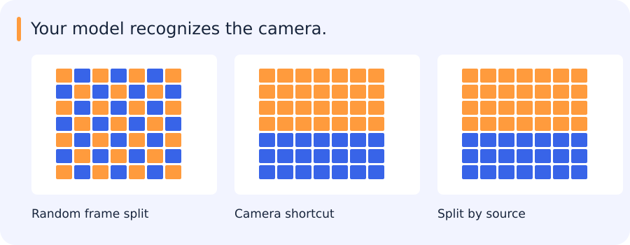

# Bias, variance, dataset shift and trustworthy validation

[All training](index.md) · [Source coverage](sources.md)

## When the test set contains a familiar background

A motion classifier performs well after frames are split randomly into training and test sets. But neighbouring frames share backgrounds, camera properties and often the same moving objects. Recognizing those details can make the task easier than recognizing motion in a new video.

A source-grouped split asks a different question: can the system handle videos it has not already encountered? A lower score on that split can reveal a limitation hidden by the random split. The appropriate split depends on what will actually be new at deployment.

This is one way data collection and evaluation shape apparent performance. It also helps separate dataset bias from the statistical bias–variance discussion.

Jump to a concept

- [Three meanings of bias](#three-meanings-of-bias)

- [Bias and variance in prediction](#bias-and-variance-in-prediction)

- [How datasets acquire bias](#how-datasets-acquire-bias)

- [Shift and drift](#shift-and-drift)

- [Split by the actual independence unit](#split-by-the-actual-independence-unit)

- [Uncertainty and comparison](#uncertainty-and-comparison)

- [What an honest comparison leaves visible](#what-an-honest-comparison-leaves-visible)

## Three meanings of bias

The word bias describes several different things in this discussion. A model can have an additive intercept called a bias. An estimator can have statistical bias, meaning its expectation differs systematically from the quantity being estimated. A dataset can also reflect biased collection, labels or human decisions. These meanings should stay separate: fitting a more flexible model may reduce approximation bias without making the collected sample more representative.

## Bias and variance in prediction

For squared-error regression, expected prediction error can be decomposed into squared bias, variance and irreducible noise under stated assumptions. A rigid model can underfit even its training set. A very flexible model can fit noise and vary strongly between training samples. More data often reduces variance; a better representation can reduce approximation bias. The familiar U-shaped curve is a teaching pattern, not a universal law for every modern model and training regime. Diagnose with learning curves and independent errors instead of assigning a model to a slogan.

## How datasets acquire bias

Reporting bias arises when recorded events differ from actual frequencies: a log of reported incidents omits unreported ones. Historical bias carries earlier inequities or policies into labels. Automation bias is undue trust in an automated suggestion; annotators accepting every SAM mask can reinforce its systematic misses.

Selection bias comes from who or what is sampled. Coverage bias leaves parts of the target population out; nonresponse bias reflects who fails to provide data; sampling bias reflects a nonrepresentative collection process. Group attribution bias generalizes properties of individuals to groups or assumes group averages describe each individual. Implicit assumptions can influence category definitions and ambiguous labels.

For imagery, imagine a vehicle dataset collected only in clear weather and labeled from detector proposals. It underrepresents clouds and occlusion, and objects missed by the proposal model may never be reviewed. Add random spatial audits rather than inspecting predictions alone. Record sensor, geography, time and annotation protocol so performance can be stratified. A balanced class count does not guarantee representative nuisance conditions or equivalent label quality.

## Shift and drift

Covariate shift changes P(x), label/prior shift changes P(y), and concept shift changes P(y|x). Their clean theoretical forms hold other distributions fixed; real deployments can combine them. Data drift describes observed distribution change over time, while performance degradation requires labels or an appropriate audit to establish. A different embedding histogram is an alert, not proof of reduced recall. Monitor input quality, scores, subgroup errors and delayed labels. Changing class prevalence can change precision even if class-conditional score behavior stays the same.

## Split by the actual independence unit

Once the intended deployment is clear, the data can be divided around it. Training fits parameters; validation guides model and policy choices; a final held-out test estimates the selected system’s performance. A new-camera deployment, a future-time deployment and a new-geography deployment can require different splits. Near-duplicate tiles and neighbouring frames are particularly easy ways to share scene information across a nominal boundary. Imputation, scaling, feature selection and calibration belong inside the training folds too. If extensive tuning consumes the available evaluation data, nested cross-validation can separate selection from performance estimation.

Stratification preserves class proportions but does not enforce group independence. A temporal split asks about future data and may legitimately expose distribution shift. The same benchmark can become an implicit validation set through repeated manual decisions. Keep an independent final check and record what influenced model selection.

## Uncertainty and comparison

A split tells us what population a result is testing; uncertainty asks how much the result might vary across samples from that population. A bootstrap approximates this by resampling observed units with replacement. For correlated frames, the relevant units may be videos or sessions rather than individual frames. Cross-validation serves a different role: estimating performance and supporting model selection under a chosen split design. Neither procedure repairs a sampling design that does not represent deployment.

For an independent Bernoulli proportion p estimated from n trials, the rough standard error is `sqrt(p(1-p)/n)`. This approximation can be poor for small n or rare events; use suitable intervals and report counts. Zero misses among n positives does not prove perfect recall. Correlation reduces effective sample size. Decide test-set size from the precision needed around the operating point, not from a fixed percentage of the whole dataset.

## What an honest comparison leaves visible

A split audit can be small: inspect the source IDs of a few examples on each side, check how preprocessing was fitted and look for overlapping scenes. The resulting evaluation may be less flattering, but its failures are more informative. They describe what the system still struggles with when familiar context no longer helps it.

Original source references and provenance

Original teaching text covering the cited topics, not a verbatim mirror. These references are provenance; no external reading is required to use this chapter.

- [http://scott.fortmann-roe.com/docs/BiasVariance.html](http://scott.fortmann-roe.com/docs/BiasVariance.html)

- [http://www.r2d3.us/visual-intro-to-machine-learning-part-1/](http://www.r2d3.us/visual-intro-to-machine-learning-part-1/)

- [http://www.r2d3.us/visual-intro-to-machine-learning-part-2/](http://www.r2d3.us/visual-intro-to-machine-learning-part-2/)

- [https://abhishek-reddy.medium.com/detecting-and-managing-data-distribution-shifts-in-the-mlops-lifecycle-for-machine-learning-models-1ea33ce84c3c](https://abhishek-reddy.medium.com/detecting-and-managing-data-distribution-shifts-in-the-mlops-lifecycle-for-machine-learning-models-1ea33ce84c3c)

- [https://datascience.stackexchange.com/questions/32264/what-is-the-difference-between-bootstrapping-and-cross-validation](https://datascience.stackexchange.com/questions/32264/what-is-the-difference-between-bootstrapping-and-cross-validation)

- [https://daviddalpiaz.github.io/r4sl/biasvariance-tradeoff.html](https://daviddalpiaz.github.io/r4sl/biasvariance-tradeoff.html)

- [https://developers.google.com/machine-learning/crash-course/fairness/types-of-bias](https://developers.google.com/machine-learning/crash-course/fairness/types-of-bias)

- [https://developers.google.com/machine-learning/crash-course/overfitting/dividing-datasets#additional_problems_with_test_sets](https://developers.google.com/machine-learning/crash-course/overfitting/dividing-datasets#additional_problems_with_test_sets)

- [https://developers.google.com/machine-learning/crash-course/overfitting/imbalanced-datasets](https://developers.google.com/machine-learning/crash-course/overfitting/imbalanced-datasets)

- [https://developers.google.com/machine-learning/crash-course/overfitting/overfitting](https://developers.google.com/machine-learning/crash-course/overfitting/overfitting)

- [https://github.com/rasbt/stat479-machine-learning-fs19/blob/master/08_model-eval-1/08-model-eval-1-intro__notes.pdf](https://github.com/rasbt/stat479-machine-learning-fs19/blob/master/08_model-eval-1/08-model-eval-1-intro__notes.pdf)

- [https://github.com/rasbt/stat479-machine-learning-fs19/blob/master/09_eval2-ci/09-eval2-ci__notes.pdf](https://github.com/rasbt/stat479-machine-learning-fs19/blob/master/09_eval2-ci/09-eval2-ci__notes.pdf)

- [https://github.com/rasbt/stat479-machine-learning-fs19/blob/master/10_eval3-cv/10-eval3-cv__notes.pdf](https://github.com/rasbt/stat479-machine-learning-fs19/blob/master/10_eval3-cv/10-eval3-cv__notes.pdf)

- [https://github.com/rasbt/stat479-machine-learning-fs19/blob/master/11_eval4-algo/11-eval4-algo__notes.pdf](https://github.com/rasbt/stat479-machine-learning-fs19/blob/master/11_eval4-algo/11-eval4-algo__notes.pdf)

- [https://medium.com/data-science/understanding-the-bias-variance-tradeoff-165e6942b229](https://medium.com/data-science/understanding-the-bias-variance-tradeoff-165e6942b229)

