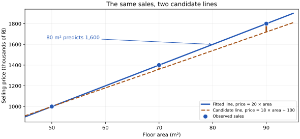
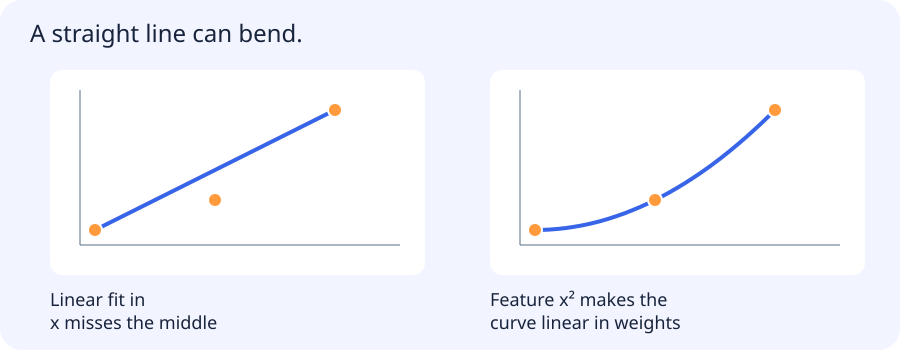

# Learning paradigms, probability, estimation and linear models

[All training](index.md) · [Source coverage](sources.md)

Suppose you want to estimate the selling price of an apartment. You have records of apartments that already sold, including their size, neighbourhood and selling price. For the next apartment you know its size and neighbourhood, and you want to estimate a price you have yet to observe. The earlier sales give you examples of the relationship you want to learn.

That setup is called supervised learning. Changing what information you have, or what you want the system to do, can turn it into a different kind of learning problem. It helps to sort out those differences before choosing a model or writing a loss function.

Jump to a concept

- [Five ways to get a learning signal](#five-ways-to-get-a-learning-signal)

- [Fit a line to apartment prices](#fit-a-line-to-apartment-prices)

- [What assumptions make a loss reasonable?](#what-assumptions-make-a-loss-reasonable)

- [From a numerical prediction to a class decision](#from-a-numerical-prediction-to-a-class-decision)

- [Decide what a new example is similar to](#decide-what-a-new-example-is-similar-to)

- [Carry the same questions into tracklet motion](#carry-the-same-questions-into-tracklet-motion)

## Five ways to get a learning signal

### Supervised learning uses answers from past examples

In the apartment dataset, each row has **features** such as size and location and a **target** such as the observed selling price. The features are what the model will receive at prediction time. The target tells it what prediction would have matched the historical outcome. During training it sees both. When it predicts for an apartment that has yet to sell, it sees only the features.

Predicting a price is **regression** because the target is numerical. Predicting whether an email is spam is **classification** because the target is a category. For supervised spam classification, the training rows contain examples already marked as spam or legitimate. In both tasks the labels can come from ordinary records or from people reviewing examples.

### Unsupervised learning looks for structure without those answers

Imagine collecting network logs with fields such as request count, the number of destinations contacted and bytes transferred. You have a month of traffic, with no label saying which sessions were attacks. You could model what a typical session looks like and flag sessions that differ sharply. A host that usually connects to three destinations and suddenly contacts a thousand might be worth investigating.

The model has learned which patterns are unusual in the data it saw. An unusual session could be a security incident, a legitimate backup job or a change in how logs are collected. A reviewer can investigate flagged sessions and provide labels for a later supervised model. The same distinction applies to email. Grouping messages by recurring patterns without spam labels is unsupervised. Learning to predict spam from manually marked messages is supervised.

### Self-supervised learning makes its targets from the data

Consider the sentence “The package arrived at the door.” A system can hide the last word and use the hidden word as a target. Nobody had to label the sentence. The original text supplied both the input and the answer.

Many large language models (LLMs) use a related task at scale. Given a prefix, they predict the next **token**, which can be a word, part of a word or punctuation. Each token in an existing text can supply another training target. Predicting these continuations gives the model a reason to learn patterns in language. A next-token model can later be used for tasks that look quite different from its pretraining objective.

The same idea works for images. A system could hide part of an image and learn to recover information about that patch. Both the task and its target come from the image. The aim is often to learn a useful representation that another model can reuse. The vision version is developed further in the self-supervision chapter. [Self-supervision and embeddings](dl-self-supervision.md)

### Semi-supervised learning combines a few labels with many unlabelled examples

Suppose a reviewer labels 500 emails, and you have 50,000 more emails without labels. A simple approach trains a classifier on the reviewed emails. It predicts labels for the rest, then uses some of the high-confidence predictions as additional training examples. These predicted targets are called **pseudo-labels**.

The extra messages can help the classifier learn what varies across ordinary email. Their pseudo-labels can also carry its original mistakes. If the first model is confidently wrong about legitimate bulk mail, adding those predictions to training can reinforce that error. Keep independently reviewed examples for evaluation.

### Reinforcement learning uses feedback from actions

Imagine a robot learning to reach a charging station. At each step it observes its surroundings and chooses a movement. Reaching the station earns a reward. Moving in a circle or getting stuck gives less useful feedback. The robot can learn a **policy**, a rule for choosing an action given its observations.

A record of apartment sales tells us the price for each past example. In the robot example, a reward can arrive several actions after the decision that helped earn it. The learner has to figure out which choices contributed to the outcome, and its choices affect what it observes next. That feedback loop is what makes the setup different.

| Learning setup | Where the feedback comes from | Example result |
| --- | --- | --- |
| Supervised | Observed targets attached to examples | Estimate a selling price or classify a labelled type of email |
| Unsupervised | Structure in observations without task labels | Identify network sessions worth investigating |
| Self-supervised | Targets derived from the input data itself | Predict a next token from existing text |
| Semi-supervised | A mix of labelled and unlabelled examples | Train a spam classifier with reviewed messages and selected pseudo-labels |
| Reinforcement learning | Rewards from actions and their consequences | Choose movements that help a robot reach a charger |

### Self-check

A model learns to predict each next token from prefixes in existing text. Where do its targets come from?

- A. The next tokens already present in the text

- B. Rewards after taking actions

- C. Human labels of document topics

- D. Clusters of unrelated documents

Show answer and explanation

**A. The next tokens already present in the text**

The text supplies both prefix and target. That derived prediction task is self-supervised.

## Fit a line to apartment prices

Return to the supervised example. Start with a deliberately small dataset where floor area is the only feature. Prices in this example are in thousands of shekels.

| Floor area in m² | Observed selling price |
| --- | --- |
| 50 | 1,000 |
| 70 | 1,400 |
| 90 | 1,800 |

On a plot, area goes along the horizontal axis and price up the vertical axis. Here every increase of 20 m² goes with an increase of 400 in price. A line with slope 20 and intercept zero goes through all three points. For an apartment of 80 m², that line predicts 1,600, or ₪1.6 million.

The line is the model. Its formula is `prediction = w × area + b`. The slope `w` tells us how much the prediction changes for one additional square metre. The intercept `b` sets the height of the line at zero area. Real sales rarely line up perfectly. **Fitting** means using the training data to choose the slope and intercept according to a specified rule.

Try a candidate line with `w = 18` and `b = 100`. It predicts 1,000, 1,360 and 1,720 on the three rows. Define the residual as observed minus predicted. The residuals are 0, 40 and 80. Their mean squared value is `(0² + 40² + 80²) / 3 = 2666.7` in squared price units. Squaring prevents positive and negative residuals from cancelling and makes a large miss contribute more heavily. A mean absolute error would instead average 0, 40 and 80 directly in price units.

**Least squares** chooses the line with the smallest sum of squared residuals. In these toy rows the line with slope 20 and intercept zero gives zero training error. That is a statement about these three rows. To learn how useful it is for future sales, evaluate it on sales kept out of the fit. A future-month split may make more sense than mixing dates randomly if the system will price future transactions.

Start the comparison with a baseline you can calculate without any fitted slope. The average price of these training sales is 1,400, so a constant predictor would give that number for every apartment. It is right at 70 m² and misses the other two prices by 400 in opposite directions. This helps make the role of the area feature concrete. On real data, compare the constant and line on the same held-out sales. A more elaborate model earns its place when it improves the decisions you care about on examples it has not seen.

### More features give the model more information

Two apartments of equal size can sell for different prices because of location or condition. A model with several features gives each numerical feature a weight. For example, it could use area and an indicator for whether the building has a lift. The indicator is 1 when a lift is present and 0 otherwise, so its weight adds a fixed amount to the prediction in this particular model.

In vector notation the same model is `prediction = wᵀx + b`. Each position in `x` holds a feature, and the corresponding position in `w` tells the model how much to weight it. For a dataset, a matrix `X` places examples in rows and features in columns. If two columns measure almost the same thing, many combinations of weights can make similar predictions. This is why individual coefficients can be unstable even when prediction is reasonably stable. Interpret an estimated association with due regard for which features the data includes.

### How an optimizer changes the line

One way to minimize the loss is to start at a candidate line and adjust it. A **gradient** tells us the local direction in which the loss increases. Gradient descent moves in the opposite direction, scaled by a learning rate.

For a one-weight example, predict `w × 2` when the target is 4. With `w = 3` the prediction is 6. Define the loss as half the squared error. Its derivative with respect to w is `(prediction − target) × 2 = 4`. At learning rate 0.1 the update is `3 − 0.1 × 4 = 2.6`. The new prediction is 5.2, with loss 0.72 instead of 2. The gradient and learning rate both matter. A sufficiently large step can cross the minimum and increase the loss.

For squared loss on many rows, the gradient with respect to the weights is proportional to `Xᵀ(Xw − y)`, taking the intercept into account separately or through a constant feature. Each residual contributes according to the features of its row. For ordinary least squares, a numerical solver based on QR or SVD is often more direct. Those solvers can handle difficult feature matrices more reliably than explicitly inverting `XᵀX`.

### A curved fit can still be linear in its weights

Now imagine observations where larger apartments command a rising price per additional square metre. A straight line uses a constant slope, so it may miss that bend. Add a feature computed from floor area squared and the model becomes `prediction = b + w₁ × area + w₂ × area²`.

For a tiny numerical illustration, use values of x equal to 0, 1 and 2 and targets 1, 3 and 9. The figure compares a straight line with the curve `1 + 2x²`. The curve fits because the feature x² changes nonlinearly with x. Once the feature is computed, the fit still chooses coefficients that multiply fixed columns. That is the sense in which the model is linear in its parameters.

The same trick works with x³ or interactions between features. It gives the model more flexibility, including more ways to follow accidental patterns in training data. High-degree curves can also behave surprisingly far outside the observed range. Check that the feature computation and any normalization are fitted using only the training portion of each split.

Scale matters for interpretation as well as fitting. If area is measured in tens of square metres, the coefficient of that feature changes even though the prediction can stay the same. For the same reason, the raw magnitude of a coefficient does not directly tell you which feature matters most. The feature definition, its units and the range it takes in the data belong alongside the estimated weight.

### Why penalize large weights?

When many features compete to explain a small dataset, fitting the training rows closely may require weights that are sensitive to tiny changes in the data. A **regularizer** adds a penalty to the training objective. **Ridge** adds a term proportional to the sum of squared weights. It tends to shrink them. **Lasso** adds a term proportional to the sum of absolute weights. Under suitable conditions some coefficients become exactly zero.

The weights and intercept are **parameters** learned by fitting. The penalty strength is a **hyperparameter** chosen as part of model selection. The intercept is often left out of the penalty. Feature units matter because changing a feature's scale changes the weight needed for the same prediction. This is one reason scaling belongs inside the fitted preprocessing pipeline.

### Self-check

A model is b + w₁x + w₂x². Why can it be fitted by linear least squares?

- A. Its computed columns x and x² enter linearly in the unknown weights

- B. Squaring the feature removes the residuals

- C. Its graph is always a straight line in x

- D. The coefficient w₂ is fixed by the input

Show answer and explanation

**A. Its computed columns x and x² enter linearly in the unknown weights**

Once x² is computed, the coefficients multiply fixed feature columns. The fit is linear in those coefficients even though the prediction curves as x varies.

## What assumptions make a loss reasonable?

The sale price for two apparently similar apartments can differ because of details the features do not capture. A **random variable** describes outcomes and their probabilities. Here we can describe a distribution of prices `y` given features `x`, written `P(y|x)`. The reverse expression `P(x|y)` asks a different question, such as what sizes are common among apartments sold at a given price.

Suppose prices fluctuate independently around the fitted line with Gaussian noise of fixed variance. Small residuals are then more probable than large residuals. The **likelihood** asks how probable the observed prices would be under a candidate set of weights. Under these assumptions, maximizing the likelihood gives the same weights as minimizing squared error. A different noise model can motivate a different loss. The squared loss is therefore both a computational objective and, in this example, a consequence of assumptions about observations.

**Maximum likelihood** picks the parameters that make the observed data most probable under the model. **Maximum a posteriori estimation**, or MAP, also accounts for a prior on those parameters. Bayes' rule combines likelihood and prior to form a posterior distribution. Maximizing the posterior can be written as maximizing `log likelihood + log prior`. With a Gaussian likelihood and suitable priors on the weights, a Gaussian prior leads to an L2 penalty and a Laplace prior leads to an L1 penalty. MAP returns a point estimate. The full posterior also describes how plausible other parameters are under the assumptions.

Imagine collecting many independent datasets from the same population and fitting a slope to each. If the mean of those fitted slopes equals the true slope, the estimator is statistically unbiased for that quantity. The slopes can still vary a lot. A penalty can introduce some bias while reducing variance enough to improve mean squared error. Dataset bias is a separate question about what examples and labels were collected. [Bias, variance and validation](ml-bias-validation.md)

## From a numerical prediction to a class decision

For spam filtering, a useful output is the chance that a message belongs to the spam class. Start with a linear score formed from features such as link count and sender history. Map that score through a **sigmoid**, a function that turns any real-valued score into a number between 0 and 1. A score of zero gives 0.5. Larger scores move the output toward 1, and smaller ones move it toward 0.

This is binary **logistic regression**. With observed labels of 0 or 1, the negative log likelihood is binary cross entropy. It assigns a much larger loss when a model confidently gives the actual class a very small probability. Implementations typically work from the raw score, or **logit**, for numerical stability.

Training the score and choosing how to act on it are separate decisions. A mailbox might quarantine messages only above a high threshold because incorrectly blocking an important message is expensive. Choose the threshold using validation data and evaluate the final choice on held-out data. If the application interprets a score as a probability, check calibration independently. A strong ranking or large margin alone does not establish that an output of 0.8 corresponds to an 80% observed frequency.

When exactly one of several classes applies, a softmax can turn their scores into a distribution and multiclass cross entropy can train the model. When several labels can apply to one input, independent sigmoid outputs can represent them separately. A video clip, for example, can show both a road and an outdoor scene. Treating those as mutually exclusive classes would encode the wrong task.

## Decide what a new example is similar to

Fitting a line is one way to use past sales. Another is to keep the records and predict from nearby apartments. You could choose the three sales most similar in size and location and average their prices. That is an instance-based approach such as K-nearest neighbours. A model-based approach such as linear regression instead stores fitted parameters summarizing the observations. The two approaches use the same supervision, with different representations of what they learned.

Similarity gets harder to define as features accumulate. With a fixed number of examples in a high-dimensional space, observations can be sparse. Irrelevant columns can dominate distances, and features with large numerical scales can outweigh smaller ones. Scaling, meaningful domain features, regularization, more representative observations and learned embeddings are different ways to address parts of the problem. If you use labels to select features, make that selection inside the training folds. Selecting on the full dataset leaks information even if the final fit uses only training rows. [Nearest neighbours, probabilistic classifiers and SVMs](ml-generative-neighbors.md)

## Carry the same questions into tracklet motion

A tracklet collects positions and shapes for one tracked object over time. You might turn those observations into features such as average speed and change in direction, then train a model to distinguish moving and stationary objects. The target should match the decision you want to make. If you need to decide after five frames, features computed from later frames are unavailable at that decision point.

Apparent size can be useful, but it may also identify the camera instead of the motion. Evaluate on separated video sources to see how much of the prediction survives a change of scene. This brings the apartment example back to a practical research question. First define the input and target. Then choose the representation, fit a model and check whether the result transfers to the examples you actually care about.

Original source references and provenance

Original teaching text covering the cited topics, not a verbatim mirror. These references are provenance; no external reading is required to use this chapter.

- [http://cs.stanford.edu/people/karpathy/convnetjs/demo/classify2d.html](http://cs.stanford.edu/people/karpathy/convnetjs/demo/classify2d.html)

- [http://cs229.stanford.edu/notes2019fall/cs229-notes1.pdf](http://cs229.stanford.edu/notes2019fall/cs229-notes1.pdf)

- [http://deeplearning.stanford.edu/tutorial/](http://deeplearning.stanford.edu/tutorial/)

- [http://www.ai.mit.edu/courses/6.867-f04/lectures/lecture-2.pdf](http://www.ai.mit.edu/courses/6.867-f04/lectures/lecture-2.pdf)

- [http://www.ai.mit.edu/courses/6.867-f04/lectures/lecture-3.pdf](http://www.ai.mit.edu/courses/6.867-f04/lectures/lecture-3.pdf)

- [http://www.ai.mit.edu/courses/6.867-f04/lectures/lecture-5.pdf](http://www.ai.mit.edu/courses/6.867-f04/lectures/lecture-5.pdf)

- [https://bjlkeng.github.io/posts/probabilistic-interpretation-of-regularization/](https://bjlkeng.github.io/posts/probabilistic-interpretation-of-regularization/)

- [https://cs231n.github.io/classification/](https://cs231n.github.io/classification/)

- [https://cs231n.github.io/linear-classify/](https://cs231n.github.io/linear-classify/)

- [https://cs231n.stanford.edu/slides/2025/lecture_2.pdf](https://cs231n.stanford.edu/slides/2025/lecture_2.pdf)

- [https://developers.google.com/machine-learning/crash-course/linear-regression/gradient-descent-exercise](https://developers.google.com/machine-learning/crash-course/linear-regression/gradient-descent-exercise)

- [https://developers.google.com/machine-learning/crash-course/linear-regression/quiz](https://developers.google.com/machine-learning/crash-course/linear-regression/quiz)

- [https://developers.google.com/machine-learning/intro-to-ml/what-is-ml](https://developers.google.com/machine-learning/intro-to-ml/what-is-ml)

- [https://drive.google.com/file/d/13_HENQfNwAG1dOlZHsy4De7wJbm9vNYx/view](https://drive.google.com/file/d/13_HENQfNwAG1dOlZHsy4De7wJbm9vNYx/view)

- [https://medium.com/datadriveninvestor/l1-l2-regularization-7f1b4fe948f2](https://medium.com/datadriveninvestor/l1-l2-regularization-7f1b4fe948f2)

- [https://see.stanford.edu/materials/aimlcs229/cs229-notes5.pdf](https://see.stanford.edu/materials/aimlcs229/cs229-notes5.pdf)

- [https://www.cs.cmu.edu/~hn1/documents/machine-learning/notes.pdf](https://www.cs.cmu.edu/~hn1/documents/machine-learning/notes.pdf)

- [https://www.geeksforgeeks.org/machine-learning/curse-of-dimensionality-in-machine-learning/](https://www.geeksforgeeks.org/machine-learning/curse-of-dimensionality-in-machine-learning/)

- [https://www.geeksforgeeks.org/machine-learning/difference-between-supervised-and-unsupervised-learning/](https://www.geeksforgeeks.org/machine-learning/difference-between-supervised-and-unsupervised-learning/)

- [https://www.ibm.com/think/topics/machine-learning-types](https://www.ibm.com/think/topics/machine-learning-types)

