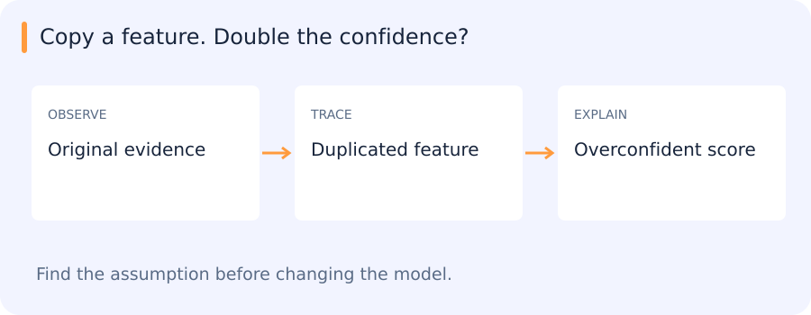
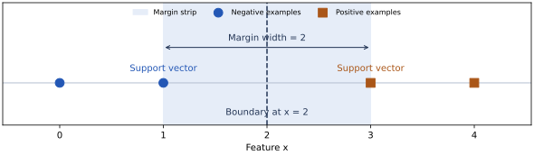

# Naive Bayes, Gaussian discriminants, KNN and kernels

[All training](index.md) · [Source coverage](sources.md)

Suppose a vehicle record contains a measured size and a few shape features, and we want to assign it a class. We could model what measurements each class tends to produce, look up nearby labelled examples or learn a boundary between classes. These approaches answer the same prediction question using different information from the training data. Review features, labels and fitting in the foundations chapter if those terms are new. [ML foundations](ml-foundations.md)

Jump to a concept

- [Modeling a class versus modeling its boundary](#modeling-a-class-versus-modeling-its-boundary)

- [Gaussian discriminant analysis](#gaussian-discriminant-analysis)

- [Naive Bayes](#naive-bayes)

- [K-nearest neighbors](#k-nearest-neighbors)

- [Kernel regression and the kernel trick](#kernel-regression-and-the-kernel-trick)

- [Support vector machines](#support-vector-machines)

- [Comparing models on the same motion task](#comparing-models-on-the-same-motion-task)

## Modeling a class versus modeling its boundary

A discriminative classifier models P(y|x) or directly learns a decision boundary. A generative classifier models P(x|y) and P(y), then applies Bayes' rule. Here “generative” describes a statistical model of the observations; it does not require a modern image generator. With limited data, a strong distributional assumption can reduce estimation variance. If the assumption is badly wrong, more optimization will not remove its bias.

## Gaussian discriminant analysis

Suppose features within each class follow a multivariate Gaussian. Estimate class priors, means and covariance matrices from training data. A shared covariance produces a linear discriminant boundary; class-specific covariances produce a quadratic boundary. In high dimensions, a covariance estimate can be unstable or singular. Shrinkage toward a diagonal or isotropic matrix trades flexibility for stability. Fit this choice within the validation design. A large likelihood under one class is not equivalent to a large posterior probability unless the other classes and priors are considered.

### From a class distribution to a prediction

Imagine two vehicle classes, cars and trucks, and use length as the only feature. In training, cars have mean length 4 m and trucks have mean length 8 m. Assume both distributions are Gaussian with the same spread and both classes are equally common. At 6 m the observation is equally far from both means, so it has equal density under the two class models. Lengths above 6 m are closer to the truck mean and favour that class. This produces a boundary at 6 m.

Change the assumptions and the boundary can move. If trucks are uncommon, the car prior gives cars more weight before length is observed. If truck lengths vary much more, a very large measurement may fit the truck distribution even when the mean is far away. In several dimensions a covariance describes which features tend to move together. Estimating one shared covariance gives a linear decision boundary in the usual Gaussian model. Separate covariances can produce curved boundaries. An unstable covariance estimate can erase the apparent benefit of a more flexible model.

## Naive Bayes

The naive assumption is conditional independence of features given the class: $P(x\mid y)=\prod_jP(x_j\mid y)$. It is not an assumption that features are independent unconditionally. Gaussian Naive Bayes uses a Gaussian for each continuous feature/class pair; Bernoulli uses binary observations; multinomial uses count-like observations. The model family's observation assumptions matter.

Compute scores in log space: $\log P(y)+\sum_j\log P(x_j\mid y)$. Smoothing prevents unseen categorical events from assigning zero likelihood to a whole class. For two binary features and two classes, manually compute a posterior from class counts and likelihoods, then duplicate one feature. The naive model now double-counts correlated evidence, often becoming overconfident. Classification can still be useful even when its probabilities are poorly calibrated. Compare it to logistic regression and inspect disagreement cases.

### See the independence assumption change a probability

Suppose one in four vehicles in the training sample is a truck. Three out of four trucks have a “large” feature, compared with one out of four cars. For a vehicle observed to be large, multiply each class prior by the likelihood of that feature. The truck weight is 0.25 × 0.75 and the car weight is 0.75 × 0.25. Both equal 0.1875, so after normalization the truck probability is 0.5.

Copy the feature into a second column and a Naive Bayes model can multiply by the same likelihood a second time. The weights become 0.25 × 0.75² and 0.75 × 0.25². Normalizing now gives a truck probability of 0.75. The observation did not change. The model treated the two columns as separate pieces of evidence, which shows why its class decisions and the calibration of its probabilities deserve separate checks.

## What happens when the same evidence appears twice

A classifier uses one feature indicating that a vehicle is large. Someone adds a second column containing exactly the same feature. The dataset now has two columns, but it has gained no new observation.

A Naive Bayes model may nevertheless count both likelihood contributions because it assumes feature independence conditional on the class. Its confidence can change even though the evidence did not. KNN and SVM are affected by representation changes too, through their distances and margins.

Comparing these methods is easier when their assumptions are attached to concrete feature choices rather than only to model names.

### Self-check

An input column is copied exactly into a second column. Why might Naive Bayes become more confident?

- A. The model automatically drops both columns

- B. The class prior is always doubled

- C. The two columns create new labelled examples

- D. It can count the same likelihood contribution twice

Show answer and explanation

**D. It can count the same likelihood contribution twice**

The conditional-independence assumption makes the likelihood factor across features. Duplicate columns violate the intended interpretation of separate evidence.

## K-nearest neighbors

KNN stores training observations and predicts from their neighbors. Classification can use uniform or distance-weighted votes; regression averages nearby target values. Feature representation and distance define “near.” Standardizing features changes the neighborhood; standardize with training statistics only. A high-dimensional irrelevant feature block can overwhelm a genuinely informative direction. Small K yields a flexible boundary sensitive to noise; larger K smooths but may erase rare local structure.

A straightforward query costs roughly N distance computations over D features and stores the training vectors. Trees can accelerate suitable low-dimensional geometry; approximate indices trade exactness for speed and memory at scale. An approximate search miss and a classifier error are different events. Benchmark both if a model depends on approximate neighbors. A label tie needs a deterministic policy. Detect a query that is unlike all training observations rather than assuming its nearest neighbor is close in an absolute sense.

### Walk through one nearest-neighbour prediction

Suppose labelled training lengths are 4 m and 5 m for cars, and 7 m and 9 m for trucks. A new measurement is 6.4 m. The three closest lengths are 7, 5 and 4, so an unweighted three-neighbour vote predicts car. With one neighbour it predicts truck. Both predictions follow their rules correctly. A small k lets the closest observation have more influence, while a larger k smooths the decision over a larger local region.

If you add weight in kilograms alongside length in metres, a distance measured directly in those units may mostly reflect weight. One remedy is to scale each feature with statistics learned from training data. A deliberate feature weight can also express how relevant the measurement should be. Select the scaling, metric and k together on held-out data. The nearest training example is only meaningful in the representation and distance you chose.

## Kernel regression and the kernel trick

Kernel regression predicts a locally weighted average with weights set by a similarity function and bandwidth. A narrow bandwidth fits local fluctuations; a wide one smooths aggressively. It gives a continuous alternative to choosing exactly K neighbors. Boundary regions and sparse support require particular care. A kernel used for an SVM plays a related but different role: it specifies inner products in an implicit feature space. A valid positive-semidefinite kernel permits the corresponding optimization formulation without explicitly constructing the feature vector.

## Support vector machines

### Move the boundary without changing a single training label

Suppose one feature measures how much a track moved. Your stationary examples have values 0 and 1. Your moving examples have values 3 and 4. A cutoff anywhere between 1 and 3 fits all four labels. A cutoff at 2 leaves the most room on either side before a training point changes class. The closest examples, at 1 and 3, determine that choice. These are the support vectors in this simple hard-margin example.

In two dimensions the cutoff becomes a line. Think of drawing two parallel lines through the closest examples on either side, then looking for the widest strip between them. Points far from the strip matter less to this particular choice. You can move the example at 4 to 40 without changing the answer in the one-feature case.

If you add a mislabeled stationary example at 3.5, no cutoff can perfectly separate the two classes in the expected order. A soft-margin SVM can accept points inside the strip or on the wrong side, at a cost. The parameter C sets how much the optimization penalizes those violations relative to keeping a wider margin. Compare C on validation scenes and check the feature scales first. Changing meters to centimeters can change which distances dominate the fit.

### When a straight boundary needs a different view

Imagine plotting two features for each proposal. Correct proposals form a small cluster near the origin, and false proposals form a ring around it. A straight line cannot enclose the central cluster. If you add a feature equal to the squared distance from the origin, a threshold on that single new feature can separate an idealized version of the two classes. The separation looks straight in the expanded feature space and circular in the original plot.

A kernel gives the SVM a way to compute how pairs of inputs relate in a feature space. In the usual kernel formulation, the score of a new point is a weighted sum of its kernel values against support vectors, plus an offset. With an RBF kernel, a nearby support vector has a larger kernel value than a distant one. Its signed coefficient determines which way it pulls the decision score.

For an RBF kernel, gamma sets how quickly the kernel value drops with squared distance. With a larger gamma, each support vector affects a smaller neighborhood and the boundary can follow isolated examples more closely. With a smaller gamma, their effects extend farther and the decision tends to vary more slowly. Feature scaling changes what counts as nearby, so fit the scaler on the training split and keep it in the same pipeline as the SVM.

For a first comparison, fit a linear SVM and an RBF SVM on the same train scenes. Select C and, where applicable, gamma using held-out validation scenes. Inspect which examples move across the boundary, then check whether those gains hold on a separate test set. If the SVM is rescoring boxes from a frozen detector, neither kernel can recover a truck that was missing from the candidate list.

A support vector machine, or SVM, can learn a boundary between labelled classes. Its starting idea is to choose a boundary with room between it and the nearest examples. A line of measured values is enough to see how this works.

### The widest gap between labelled points

Use one feature first. Place negative examples at x = 0 and 1, and positives at x = 3 and 4. Any threshold between 1 and 3 separates these points. A threshold at 1.1 is close to a negative example. At 2, the closest points of both classes are one unit away. The latter threshold gives the widest empty strip around the decision boundary. The points at 1 and 3 touch that strip. They are the **support vectors** in this hard-margin example.

In more dimensions a linear score is $f(x)=w^\top x+b$. Its zero level is the boundary. Let labels be −1 and +1. Multiplying the score by the label makes correct sides have positive values. We can rescale w and b so the closest training points on the two sides have signed scores equal to 1. The two parallel supporting planes then have scores −1 and +1.

The perpendicular distance between those planes is `2 / ||w||`. You can see why by moving one unit in the direction of w. The score changes by `||w||`. Going from score −1 to +1 therefore takes `2 / ||w||` units of distance. Maximizing that width is equivalent to minimizing $\frac12\lVert w\rVert^2$ subject to `yᵢf(xᵢ) ≥ 1` for every training example. This gives the geometry of the optimization without needing its dual derivation.

### What happens when the classes overlap?

Now put one labelled car on the truck side of the gap. It could be a measurement error or a genuinely difficult example. The hard-margin constraints may be impossible. A soft-margin SVM assigns each example a **hinge loss**, `max(0, 1 − yᵢf(xᵢ))`. Points at or beyond the intended margin have zero loss. A correctly classified point with signed score 0.6 has loss 0.4. A misclassified point with signed score −0.5 has loss 1.5. Training balances a small weight norm with these penalties.

| Signed score | Hinge loss | What the model did |
| --- | --- | --- |
| 1.4 | 0 | Correct side and beyond the margin |
| 0.6 | 0.4 | Correct side but inside the margin |
| −0.5 | 1.5 | Wrong side of the boundary |

With binary labels *y* encoded as −1 and +1, the soft-margin objective is $\frac12\lVert w\rVert^2+C\sum_i\max(0,1-y_i f(x_i))$. A larger C makes violations more expensive relative to the norm penalty. This can help fit real exceptions, and it can also make the boundary chase noisy labels. A smaller C permits more violations in exchange for stronger regularization. Tune C on held-out groups under the same preprocessing pipeline used for inference. An SVM score measures position relative to its decision function. A probability requires a separately assessed calibration step.

### What a kernel changes

Imagine one class near the centre of a two-dimensional plot and the other around its outside. A straight line cannot separate them. Adding the feature $x_1^2+x_2^2$ gives a linear model a way to separate small and large radii. A kernel generalizes this idea by computing the similarity that an inner product in another feature space would give. The solver can work with that similarity without explicitly constructing every feature in the new space.

The RBF kernel $\exp(-\gamma\lVert x-z\rVert^2)$ assigns higher similarity to nearby points. With small gamma, influence extends farther. With large gamma, the influence of an example falls off quickly, which can give a complicated boundary that follows local training detail. C still controls the penalty for violating the margin. Because gamma depends on distances, feature scaling changes what a numerical value of gamma means.

For tracklet motion, start with a simple scaled linear classifier. Compare an RBF SVM if the errors suggest a curved boundary in the chosen features. Fit scaling inside each training fold and split by video source. Inspect predictions on new sources as well as a validation score. The comparison should establish whether the added flexibility helps the intended decision, including the cost of scoring against support vectors.

Training a kernel SVM can require a large matrix of pairwise similarities. Prediction can depend on how many support vectors the model retains, because each new example must be compared with them. A linear classifier on frozen embeddings can be cheaper. Expressiveness, whether from a kernel or a neural network, is one factor in the choice alongside sample efficiency, optimization, generalization and measured compute.

### Self-check

In the usual soft-margin objective with a fixed weight penalty, what changes when C increases?

- A. The RBF length scale is fixed by C

- B. The model outputs calibrated probabilities

- C. Violations become more expensive relative to the weight penalty

- D. Violations become cheaper

Show answer and explanation

**C. Violations become more expensive relative to the weight penalty**

C multiplies the training violation cost. Larger values put more emphasis on satisfying the margin constraints on the training set.

## Comparing models on the same motion task

A scaled linear model, KNN and an SVM provide three different views of the tracklet features. Keeping the grouped split and evaluation policy fixed makes their disagreements interpretable. Saving preprocessing with the fitted model is equally important: otherwise a change in feature scaling can be mistaken for a change in model quality.

Original source references and provenance

Original teaching text covering the cited topics, not a verbatim mirror. These references are provenance; no external reading is required to use this chapter.

- [http://cs229.stanford.edu/notes/cs229-notes3.pdf](http://cs229.stanford.edu/notes/cs229-notes3.pdf)

- [http://cs229.stanford.edu/notes2019fall/cs229-notes2.pdf](http://cs229.stanford.edu/notes2019fall/cs229-notes2.pdf)

- [http://cs229.stanford.edu/notes2021fall/cs229-notes3.pdf](http://cs229.stanford.edu/notes2021fall/cs229-notes3.pdf)

- [http://www.ai.mit.edu/courses/6.867-f04/lectures/lecture-6.pdf](http://www.ai.mit.edu/courses/6.867-f04/lectures/lecture-6.pdf)

- [http://www.ai.mit.edu/courses/6.867-f04/lectures/lecture-7.pdf](http://www.ai.mit.edu/courses/6.867-f04/lectures/lecture-7.pdf)

- [https://ocw.mit.edu/courses/sloan-school-of-management/15-097-prediction-machine-learning-and-statistics-spring-2012/lecture-notes/MIT15_097S12_lec07.pdf](https://ocw.mit.edu/courses/sloan-school-of-management/15-097-prediction-machine-learning-and-statistics-spring-2012/lecture-notes/MIT15_097S12_lec07.pdf)

- [https://sebastianraschka.com/pdf/lecture-notes/stat479fs18/02_knn_notes.pdf](https://sebastianraschka.com/pdf/lecture-notes/stat479fs18/02_knn_notes.pdf)

