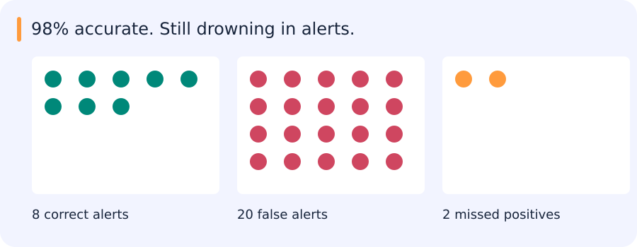

# Classification, detection, regression, ranking and selective prediction

[Chapter index](index.md) · [Source coverage](sources.md)

An evaluation starts with decisions a system makes on examples whose outcomes we can check. An inbox filter decides which messages to flag. A detector returns boxes, which first have to be matched to objects. A price model gives a number, which we can compare with a sale. A useful metric summarizes the errors relevant to the decision.

<details>
<summary>Jump to a concept</summary>

- [Begin with the decision unit](#begin-with-the-decision-unit)

- [Confusion counts and operating points](#confusion-counts-and-operating-points)

- [Curves, prevalence and aggregation](#curves-prevalence-and-aggregation)

- [Detection and segmentation](#detection-and-segmentation)

- [Selective prediction and calibration](#selective-prediction-and-calibration)

- [Regression](#regression)

- [Ranking and retrieval](#ranking-and-retrieval)

- [One hand calculation](#one-hand-calculation)

</details>

## Begin with the decision unit

The alert example treats each case as one binary decision. Detection changes that unit: one image may contain many objects and many proposed boxes. Video can change it again, because the useful output may be a track or an event rather than a frame. Before comparing numbers, the evaluation needs to say which of these decisions it counts, how predictions match labels and which cases are excluded. Failed samples matter too: silently dropping them can make a broken pipeline look better.

## Confusion counts and operating points

### Work through one page of alerts

Imagine a reviewer receives 20 camera events. Five really show a vehicle entering a restricted area. At your current threshold the system flags six events. Four are real violations and two are false alarms. One real violation stays below the threshold. The remaining thirteen events are correctly ignored.

Precision asks what fraction of the six alerts the reviewer can use. Here it is 4/6. Recall asks what fraction of the five violations reached the reviewer. Here it is 4/5. Accuracy is 17/20 because it includes the thirteen correctly ignored events. Each denominator comes from a different question.

Suppose lowering the threshold sends the missed violation and four other events to the reviewer. You now catch all five violations but send eleven alerts, so precision falls to 5/11. This is an operating point. The right choice depends on how costly missed events are and how many alerts a reviewer can check. Repeating the count across thresholds gives the points behind a precision–recall curve.

TP and TN are correct positive and negative predictions; FP and FN are the two errors. Let *N* be the number of evaluated examples.

$$
\mathrm{Accuracy}=\frac{TP+TN}{N},\qquad\mathrm{Precision}=\frac{TP}{TP+FP},\qquad\mathrm{Recall}=\frac{TP}{TP+FN}
$$

$$
\mathrm{Specificity}=\frac{TN}{TN+FP},\qquad\mathrm{FPR}=\frac{FP}{FP+TN}
$$

Recall is also called sensitivity. FPR is the false positive rate. False alarm rate is ambiguous in practice: it can mean FPR or a count per image/hour/area. State which is meant. Undefined ratios need an explicit convention rather than an unnoticed default.

If there are 10 positives among 1,000 cases and a model reports 8 TP and 20 FP, recall is 0.8, precision is 8/28≈0.286 and FPR is 20/990≈0.0202. Accuracy is 0.978, which hides the poor yield among alerts. F1 is the harmonic mean 2PR/(P+R); F-beta weights recall by beta squared. These summaries omit true negatives and do not encode every operational cost. Select a threshold against a stated target, such as minimum recall with an acceptable number of alerts.

## What 97.8% accuracy looks like in an alert inbox

Imagine 1,000 cases containing ten real positives. The system finds eight, misses two and raises twenty false alarms. It makes 978 correct decisions overall, so its accuracy is 97.8%.



Someone reviewing its 28 alerts sees a different picture: only eight are useful. Precision is about 29%, while recall is 80%. Both describe this system correctly; they answer different operational questions. A reviewer may care about alert workload, while an analyst searching for rare objects may care more about misses.

```python
tp, fp, fn = 8, 20, 2
precision = tp / (tp + fp)
recall = tp / (tp + fn)
print(round(precision, 3))
print(round(recall, 3))
```

This prints:

```text
0.286
0.8
```

The denominators encode two different questions: how useful are the alerts, and how many real positives did we find? These toy denominators are nonzero.

Choosing a metric starts with deciding which decisions and costs the evaluation should represent.

### Self-check

A system emits 20 alerts, of which 5 are correct. There are 10 real positives in total. What is its precision?

- A. 50%

- B. 20%

- C. 25%

- D. 75%

<details>
<summary>Show answer and explanation</summary>

**C. 25%**

Precision divides correct alerts by all alerts, so 5/20 = 25%. The denominator of 10 real positives is used for recall.

</details>

## Curves, prevalence and aggregation

One threshold gives one operating point, like the 28 alerts in the example. Sweeping the threshold gives a broader picture. A ROC curve plots true-positive rate against false-positive rate; ROC AUC summarizes ranking across positive/negative pairs. It does not describe probability calibration or guarantee a useful point at the required false-alarm budget. A precision–recall curve focuses on the yield and coverage of positive predictions. Its baseline depends on positive prevalence, so PR scores from different populations need care when compared.

Lowering a threshold cannot reduce recall for a fixed score list, while precision need not change monotonically at every step. Average precision sums precision weighted by recall increments under one common convention. Trapezoidal PR area, interpolated AP and detection benchmark AP may differ. Record the implementation and tie handling. Macro averaging gives each class equal weight, micro averaging aggregates counts and support weighting weights class metrics. Support-weighted precision is generally not equal to micro precision. Show per-class counts as well as averages.

### Calculate two points on the same precision–recall curve

Take five predictions sorted by descending score. Their labels in that order are positive, negative, positive, negative, positive. There are three positives in total. A threshold accepting only the highest score gets precision 1 and recall 1/3. A threshold accepting the top three gets two true positives and one false positive, so precision is 2/3 and recall is 2/3. Accepting all five gets precision 3/5 and recall 1. A threshold changes which predictions count as decisions while the ordering stays fixed.

| Accepted predictions | True positives | False positives | Precision | Recall |
| --- | --- | --- | --- | --- |
| Top 1 | 1 | 0 | 1 | 1/3 |
| Top 3 | 2 | 1 | 2/3 | 2/3 |
| All 5 | 3 | 2 | 3/5 | 1 |

Each additional positive increases recall by 1/3 here. Average precision with the step-wise convention is therefore `(1 + 2/3 + 3/5) / 3 ≈ 0.756`. Interpolated AP definitions used by detection benchmarks can differ. Reporting a number without its convention makes comparisons hard to reproduce.

## Detection and segmentation

Intersection over union measures the overlap between predicted region *A* and labeled region *B*.

$$
\mathrm{IoU}(A,B)=\frac{|A\cap B|}{|A\cup B|}
$$

Match detections to ground truth using a declared class and overlap rule, generally one-to-one, then accumulate TP/FP as confidence decreases. A second prediction of an already matched object is normally a duplicate FP. Detection has no obvious count of all background TN boxes, so generic binary FPR is not automatically meaningful. AP at IoU 0.5 and AP averaged over several IoUs answer different localization questions. Horizontal boxes, oriented boxes and masks require the appropriate overlap geometry.

For segmentation, pixel IoU and Dice summarize set overlap; boundary metrics and object-level recall reveal other failure modes. A large background or large object can dominate a pooled metric. State whether averaging is per pixel, per image, per class or per instance. Incomplete annotation complicates FP counts and may need ignored regions or audited subsets.

### One object can produce two detections

Suppose an image has one labelled truck and two predictions of that truck. The first has score 0.9 and overlaps the label well. The second has score 0.8 and also overlaps it well. Under the usual one-to-one matching rule the first can claim the object and become a true positive. The second is a duplicate and counts as a false positive. Accepting both therefore gives precision 1/2 and recall 1 on this image. The geometry of the boxes and the ranking of their scores both affect the evaluation.

Changing the overlap threshold can turn a candidate match into a miss. Changing the score threshold can remove the duplicate without changing overlap at all. These are two different knobs. When comparing a localization change, hold the matching rule fixed. When comparing rescoring, hold the detector outputs and matching geometry fixed and examine what the changed ordering does.

### Self-check

Two high-overlap predictions refer to the same single labelled truck. Both pass the score threshold. Under score-ordered one-to-one matching, how are they counted?

- A. Two false positives

- B. Two true positives

- C. One true positive and one false positive

- D. One true positive and one false negative

<details>
<summary>Show answer and explanation</summary>

**C. One true positive and one false positive**

The first eligible prediction claims the object. The second is a duplicate prediction, so it counts as a false positive.

</details>

## Selective prediction and calibration

Sometimes the right output is to abstain and send a difficult case for review. An uncertainty score can rank cases for that policy. Coverage measures the fraction accepted; risk measures average loss on those accepted cases. At full coverage, classification risk is the overall error rate. At zero coverage there are no accepted cases, so conditional error is undefined even if a plot uses zero as a display convention. Varying the acceptance threshold gives a risk–coverage curve; whether rejecting more cases helps depends on how well the score orders actual errors.

If a downstream decision uses a score as a probability, ranking is only part of the story. Calibration asks whether predicted probabilities agree with observed frequencies. Reliability plots compare the two directly, while Brier score and log loss assess related aspects of probability predictions. Binning affects reliability diagrams and expected calibration error. A model can rank every positive above every negative while still assigning poor probabilities, so calibration needs separate or cross-fitted data and another check after distribution shift.

## Regression

MAE averages absolute residuals; MSE averages squared residuals and penalizes large errors strongly; RMSE restores target units. Median absolute error is resistant to a few extreme residuals. MAPE divides absolute error by target magnitude and is problematic near zero. R-squared compares squared error with predicting the evaluation-set mean and can be negative. Constant targets need a defined convention. Report units, residual distributions and relevant slices alongside a scalar.

## Ranking and retrieval

Precision@K is relevant results among K returned, while recall@K divides retrieved relevant results by all relevant results for that query. AP averages precision at relevant ranks under its declared denominator, and mAP averages over queries. MRR averages the reciprocal rank of the first relevant result; it ignores later relevant results. Hit rate@K asks whether at least one relevant item appears. DCG discounts graded relevance by rank, commonly using (2^rel−1)/log2(rank+1); NDCG divides by the ideal ranking's DCG. Specify how queries with no relevant results and tied scores are handled.

## One hand calculation

For relevance [1,0,1,0] with two relevant items in total, precision@2=1/2, recall@2=1/2, AP=(1+2/3)/2=5/6 and reciprocal rank=1. Now insert an irrelevant first result and recompute. Use such a tiny case to verify the evaluator before trusting thousands of boxes or retrieval results. In the rescorer task, show both the full PR comparison and the actual alert policy chosen on validation data.

<details>
<summary>Original source references and provenance</summary>

Original teaching text covering the cited topics, not a verbatim mirror. These references are provenance; no external reading is required to use this chapter.

- [https://adamyedidia.files.wordpress.com/2014/11/f_score.pdf](https://adamyedidia.files.wordpress.com/2014/11/f_score.pdf)

- [https://developers.google.com/machine-learning/crash-course/classification/accuracy-precision-recall](https://developers.google.com/machine-learning/crash-course/classification/accuracy-precision-recall)

- [https://developers.google.com/machine-learning/crash-course/classification/precision-and-recall#:~:text=all%20malignant%20tumors.-,Precision%20and%20Recall%3A%20A%20Tug%20of%20War,-To%20fully%20evaluate](https://developers.google.com/machine-learning/crash-course/classification/precision-and-recall#:~:text=all%20malignant%20tumors.-,Precision%20and%20Recall%3A%20A%20Tug%20of%20War,-To%20fully%20evaluate)

- [https://developers.google.com/machine-learning/crash-course/classification/roc-and-auc](https://developers.google.com/machine-learning/crash-course/classification/roc-and-auc)

- [https://developers.google.com/machine-learning/crash-course/classification/thresholding](https://developers.google.com/machine-learning/crash-course/classification/thresholding)

- [https://github.com/rasbt/stat479-machine-learning-fs19/blob/master/12_eval5-metrics/12_eval5-metrics__slides.pdf](https://github.com/rasbt/stat479-machine-learning-fs19/blob/master/12_eval5-metrics/12_eval5-metrics__slides.pdf)

- [https://queirozf.com/entries/evaluation-metrics-for-ranking-problems-introduction-and-examples](https://queirozf.com/entries/evaluation-metrics-for-ranking-problems-introduction-and-examples)

- [https://scikit-learn.org/stable/modules/generated/sklearn.metrics.r2_score.html#sklearn.metrics.r2_score](https://scikit-learn.org/stable/modules/generated/sklearn.metrics.r2_score.html#sklearn.metrics.r2_score)

- [https://scikit-learn.org/stable/modules/model_evaluation.html#mean-absolute-error](https://scikit-learn.org/stable/modules/model_evaluation.html#mean-absolute-error)

- [https://scikit-learn.org/stable/modules/model_evaluation.html#mean-absolute-percentage-error](https://scikit-learn.org/stable/modules/model_evaluation.html#mean-absolute-percentage-error)

- [https://scikit-learn.org/stable/modules/model_evaluation.html#mean-squared-error](https://scikit-learn.org/stable/modules/model_evaluation.html#mean-squared-error)

- [https://scikit-learn.org/stable/modules/model_evaluation.html#median-absolute-error](https://scikit-learn.org/stable/modules/model_evaluation.html#median-absolute-error)

- [https://stats.stackexchange.com/a/7210](https://stats.stackexchange.com/a/7210)

- [https://twitter.com/capeandcode/status/1450666977236713480](https://twitter.com/capeandcode/status/1450666977236713480)

- [https://www.cs.technion.ac.il/users/wwwb/cgi-bin/tr-get.cgi/2019/PHD/PHD-2019-09.pdf](https://www.cs.technion.ac.il/users/wwwb/cgi-bin/tr-get.cgi/2019/PHD/PHD-2019-09.pdf)

</details>
