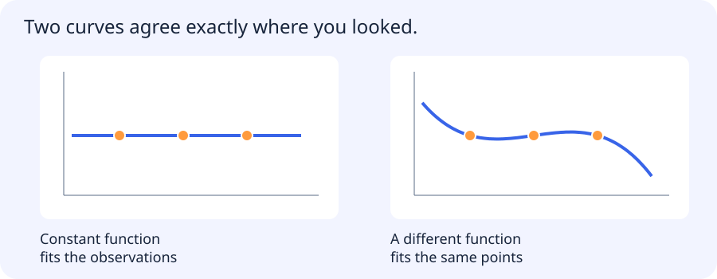

# Retained survey: GLMs, Gaussian processes, graphical models and other learning

[All training](index.md) · [Source coverage](sources.md)

## What a model assumes between observations

Three observations can be consistent with more than one function. The figure shows two functions that pass through the same points but behave differently elsewhere. Fitting those points alone does not choose how the prediction should continue.

A prior or covariance kernel expresses preferences over the unobserved behaviour. Predictive uncertainty is then conditional on those assumptions as well as the observations. This is a useful way to approach probabilistic models: ask what distribution they describe and which dependencies they assume.

The following survey introduces several ways to express those choices and perform inference under them.

Jump to a concept

- [Generalized linear models](#generalized-linear-models)

- [Gaussian processes](#gaussian-processes)

- [Graphical models](#graphical-models)

- [MCMC and approximate inference](#mcmc-and-approximate-inference)

- [Topic modeling and latent factors](#topic-modeling-and-latent-factors)

- [Reinforcement and evolutionary learning](#reinforcement-and-evolutionary-learning)

- [Appropriate depth](#appropriate-depth)

## Generalized linear models

A GLM combines a linear predictor, a link function and a response distribution from an exponential family. Linear Gaussian regression and logistic Bernoulli regression are familiar examples; Poisson regression models count-like responses under suitable assumptions. Link and distribution are separate choices. A linear predictor does not mean the expected response must be a straight line in raw input space. Overdispersion and zero inflation can invalidate a simple count model.

## Gaussian processes

A Gaussian process defines a distribution over functions through a mean and covariance kernel. Finite collections of function values have a joint Gaussian distribution. In regression, conditioning on observed inputs/targets yields a predictive mean and uncertainty under the chosen kernel/noise model. Kernel length scale encodes smoothness and relevance assumptions. Standard exact inference can require cubic-time matrix factorization and quadratic storage in observation count; sparse/approximate methods change this tradeoff. A narrow posterior from a misspecified kernel is not a universal guarantee of confidence.

## Graphical models

Probabilistic graphical models express a joint distribution through factorization and conditional-independence structure. A directed graph can represent a Bayesian network; an undirected factorization can represent a Markov random field. A conditional random field models structured outputs given inputs, useful for sequence labeling or spatial dependencies. An edge in a statistical model does not automatically establish a causal relationship. Inference computes marginals, conditionals or likely configurations, while learning estimates parameters or structure.

## MCMC and approximate inference

When a posterior is hard to normalize or integrate, Monte Carlo methods approximate expectations from samples. Markov chain Monte Carlo constructs dependent samples whose stationary distribution is the target under appropriate conditions. Burn-in, mixing, autocorrelation, multiple chains and effective sample size matter. A long chain stuck in one region is not equivalent to many independent posterior samples. Convergence diagnostics can identify some problems but cannot prove every aspect of inference is correct.

## Topic modeling and latent factors

A topic model represents documents using latent themes and themes using word distributions. LDA uses a mixture-style probabilistic construction with priors over topic proportions and topic-word probabilities. Topics are statistical patterns, not guaranteed human concepts. Stop-word handling, vocabulary and document length influence results. Matrix factorization provides another latent-factor perspective and appears in recommendation and dimensionality reduction. Interpret a factor by inspecting representative examples and stability under data changes.

## Reinforcement and evolutionary learning

Reinforcement learning models states, actions, transitions, rewards and often a discount factor. A policy chooses actions; a value estimates expected future return. Exploration changes what data is collected, and off-policy evaluation requires assumptions beyond ordinary supervised random splits. A reward proxy can be optimized while failing the actual user goal. This program retains the idea as a survey; it does not require building a control agent.

Genetic/evolutionary algorithms maintain candidate solutions and use selection, variation and evaluation to search a space. They can work when differentiable gradients are unavailable, but evaluation may be expensive and population search can overfit a reused benchmark. Fitness design, mutation/crossover and stopping conditions define the experiment. They are not guaranteed to find a global optimum.

## Appropriate depth

These topics come from the legacy broad-reading checklist and are extensions beyond the current project core. For each, be able to state the problem it solves, its main assumptions, one computation or inference idea and a failure case. A learner taking a role-specific extension can deepen the selected section with the mentor. Do not claim these paragraphs replace a full specialist course; they keep the previously named subjects visible and give a self-contained starting explanation.
