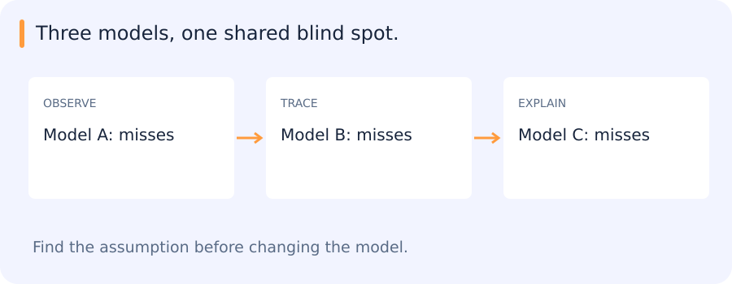

# Trees, forests, AdaBoost, gradient boosting and model combination

[All training](index.md) · [Source coverage](sources.md)

## What an ensemble can learn from disagreement

Three truck classifiers agree on most easy examples. They also all miss cement trucks. Combining their votes does not recover a category that none of them recognizes.

An ensemble is more useful when its members make different, informative errors. For example, a model that handles unusual truck shapes may correct mistakes made by a model that is otherwise stronger. The gain depends on those particular disagreements and their frequency in the target data.

Bagging, random forests and boosting create and combine predictors in different ways. Their value becomes clearer when we examine what each member contributes.

Jump to a concept

- [A tree partitions feature space](#a-tree-partitions-feature-space)

- [Bagging and random forests](#bagging-and-random-forests)

- [Boosting](#boosting)

- [XGBoost and LightGBM](#xgboost-and-lightgbm)

- [Voting, blending and stacking](#voting-blending-and-stacking)

- [What a useful comparison shows](#what-a-useful-comparison-shows)

## A tree partitions feature space

A decision tree recursively chooses a feature and threshold to split observations into more homogeneous subsets. Classification commonly reduces Gini impurity or entropy; regression reduces squared-error variation. A leaf stores a prediction or class distribution. Greedy local split selection does not guarantee a globally optimal tree. Restrict depth, minimum leaf size or pruning to control variance. Threshold rules can capture interactions without explicit polynomial features, but extrapolation beyond observed values is limited.

A deep tree can memorize small data changes. Missing-value routing and categorical-feature handling depend on the implementation and must match inference. Impurity-based importance can favor high-cardinality features and does not establish causality. Permutation importance on independent data asks how predictions suffer when a feature is disrupted, but correlated features can share or hide their importance. Feature selection and importance-driven redesign can leak validation information if repeated without a fresh evaluation plan.

## Bagging and random forests

Bagging trains models on bootstrap samples and averages their predictions. Averaging reduces variance when errors are not perfectly correlated. A random forest additionally samples candidate features at splits to diversify trees. More trees often stabilize the average but increase memory and inference cost. Out-of-bag predictions use trees that did not train on a given row, providing an internal diagnostic; they do not repair leakage between correlated rows or a mismatch with the deployment population.

For independent estimators of variance sigma squared, averaging M estimators would give variance sigma squared/M. Correlation adds a nonvanishing term, which explains why identical trees give little gain. Ensemble quality depends on both useful members and complementary errors, not diversity alone.

## Boosting

Boosting adds weak predictors sequentially, each addressing shortcomings of the current combined model. AdaBoost reweights observations so misclassified cases receive more attention. For binary labels in {-1,+1}, a common weak-learner weight is `alpha = 0.5 log((1-error)/error)`, with a corresponding exponential reweighting. A learner at chance provides little useful weight; mislabeled outliers can attract excessive attention. The formula assumes its stated setup and needs numerical handling at zero error.

Gradient boosting fits each new learner to a negative gradient of the chosen loss with respect to current predictions. For squared loss this resembles fitting residuals. For logistic classification, the gradient is computed in score space and is not simply a hard-label mistake indicator. Learning rate, tree complexity and number of rounds jointly control capacity. Early stopping chooses a round using validation data, making that validation set part of model selection.

## XGBoost and LightGBM

XGBoost combines regularized tree boosting with efficient split search, missing-value handling and first/second-order loss information in common objectives. LightGBM emphasizes histogram-based training and leaf-wise tree growth, with techniques intended to reduce work on large datasets. Leaf-wise growth can expand a highly profitable branch deeply, so limiting leaves, depth and minimum data per leaf matters on small datasets. These are different implementations of related ideas, not universal speed or accuracy rankings.

Compare wall time and memory under your data size and hardware, using consistent stopping criteria and search effort. Record whether a run uses CPU or GPU and which representation is measured. A newer boosting library does not compensate for a weak split design. Trees often work well on tabular engineered features, while a frozen image encoder can provide features a tree cannot invent from a few raw pixels.

## Voting, blending and stacking

Hard voting combines class decisions; soft voting averages scores/probabilities whose interpretation and calibration need attention. Blending fits a combination on a held-out subset. Stacking learns a meta-model from out-of-fold base-model predictions so it sees predictions made without training on those same targets. Training a meta-model on in-sample base predictions encourages it to trust overfit behavior. Group boundaries apply to the folds of every layer.

Measure the cost of the whole ensemble, including all feature extractors, preprocessing, model loads and output merging. A second model is worthwhile only if its gain at the relevant operating point justifies the latency, memory and maintenance. In detection rescoring, distinguish changing scores from adding proposals: a rescorer cannot recover an object absent from the frozen detector's candidate set.

## What a useful comparison shows

For the rescorer, a small comparison can include a shallow tree, a forest and one boosted model. Their operating points, runtime and disagreement examples explain more than a single winner. The frozen detector also sets a boundary on the experiment: changing scores may improve which candidates survive, but cannot recover an object that never entered the candidate set.

Original source references and provenance

Original teaching text covering the cited topics, not a verbatim mirror. These references are provenance; no external reading is required to use this chapter.

- [http://www.ai.mit.edu/courses/6.867-f04/lectures/lecture-10.pdf](http://www.ai.mit.edu/courses/6.867-f04/lectures/lecture-10.pdf)

- [http://www.ai.mit.edu/courses/6.867-f04/lectures/lecture-9.pdf](http://www.ai.mit.edu/courses/6.867-f04/lectures/lecture-9.pdf)

- [https://claude.ai/public/artifacts/c94c29e8-23f4-43ee-9fcd-092c46957aab](https://claude.ai/public/artifacts/c94c29e8-23f4-43ee-9fcd-092c46957aab)

- [https://developers.google.com/machine-learning/decision-forests](https://developers.google.com/machine-learning/decision-forests)

- [https://github.com/rasbt/stat479-machine-learning-fs19/blob/master/06_trees/06-trees__notes.pdf](https://github.com/rasbt/stat479-machine-learning-fs19/blob/master/06_trees/06-trees__notes.pdf)

- [https://github.com/rasbt/stat479-machine-learning-fs19/blob/master/07_ensembles/07-ensembles__notes.pdf](https://github.com/rasbt/stat479-machine-learning-fs19/blob/master/07_ensembles/07-ensembles__notes.pdf)

- [https://medium.com/@abhaysingh71711/lightgbm-explained-faster-and-smarter-gradient-boosting-4ab549629925](https://medium.com/@abhaysingh71711/lightgbm-explained-faster-and-smarter-gradient-boosting-4ab549629925)

- [https://medium.com/@abhishekjainindore24/different-types-of-ensemble-techniques-bagging-boosting-stacking-voting-blending-b04355a03c93](https://medium.com/@abhishekjainindore24/different-types-of-ensemble-techniques-bagging-boosting-stacking-voting-blending-b04355a03c93)

- [https://www.nvidia.com/en-eu/glossary/xgboost/](https://www.nvidia.com/en-eu/glossary/xgboost/)

