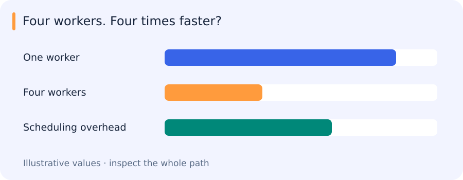

# Types, decorators, concurrency and interactive experiments

[All training](index.md) · [Source coverage](sources.md)

## Choosing workers for the work you actually have

Suppose a batch has four images to fetch and four CPU-heavy Python calculations to perform. Both contain four independent tasks, but they spend their time differently. The downloads wait for I/O; the calculations keep the interpreter busy.

Threads can overlap those waits. In a standard GIL-enabled CPython build, processes are usually the more relevant option for parallel CPU-heavy Python work. They also introduce startup and data-transfer costs, which can outweigh the benefit for small tasks.

A useful comparison therefore measures the same outputs across several task sizes. That distinction also explains why caching, decorators and queues need clear contracts rather than just convenient syntax.

Jump to a concept

- [Type information is a contract to check](#type-information-is-a-contract-to-check)

- [Decorators and descriptors](#decorators-and-descriptors)

- [Concurrency starts with the bottleneck](#concurrency-starts-with-the-bottleneck)

- [Queues and failure](#queues-and-failure)

- [Streamlit and clear experiment controls](#streamlit-and-clear-experiment-controls)

- [Making a concurrency comparison useful](#making-a-concurrency-comparison-useful)

## Type information is a contract to check

Annotate parameters and returned values to communicate intended objects. A type such as `dict[str, list[float]]` conveys more than `dict`. An annotation does not automatically reject a runtime value; a type checker and explicit boundary validation play different roles. Use an Enum when values represent a closed vocabulary, such as processing states, to prevent silently accepting misspelled strings. A dataclass expresses a record and can generate initialization and comparison methods. A frozen dataclass prevents assignment to fields but does not recursively freeze a list stored in a field.

## Decorators and descriptors

A decorator takes a function or class and returns its replacement. For a timing decorator, capture the start time, invoke the wrapped function and report elapsed time in a finally block, preserving its result and exception. Use `functools.wraps` so names and documentation remain inspectable. A decorator that consumes an iterator before returning it can change behavior even if its printed output looks useful.

`lru_cache` stores return values for recently used hashable arguments. It suits deterministic computations whose results fit in memory. It can produce stale results when the function reads a changing file or model behind an unchanged path, and cached mutable return values can be modified by callers. Include artifact identity in a cache key when relevant.

A property exposes computed or validated attribute access. A static method is a namespaced function without implicit instance/class input; a class method receives the class and is useful for alternate constructors. Single dispatch chooses an implementation by the first argument's runtime type. Use these for an actual design need, not to make simple code look advanced.

## Concurrency starts with the bottleneck

Concurrency means tasks can make progress over overlapping time; parallelism means work executes simultaneously. In a standard GIL-enabled CPython build, multiple threads do not usually accelerate CPU-heavy Python bytecode. They can overlap blocking I/O. Native numerical code may release the GIL and run its own threads, so a Python thread benchmark does not characterize every NumPy workload. Separate processes have independent interpreters and can parallelize Python computation, but require startup, serialization and data-transfer costs.

Compare a loop, map, a process pool and a thread pool on three workloads: squaring many numbers, a substantial numerical approximation, and reading/writing independent temporary files. Map alone is an iteration interface, not a promise of parallel execution. Make the jobs large enough to amortize scheduling costs; very small squares often run faster serially. Warm up where needed, repeat runs, check identical outputs and report workload size and worker count. Do not credit a faster function that did less work.

## Queues and failure

A queue separates task production from consumption. Bound its size to prevent an overloaded producer from consuming all memory. A thread queue and an interprocess queue cross different boundaries; the latter generally serializes objects. A thread-safe queue does not make a multi-step sequence of application operations atomic. Define who owns a task, how errors are reported, how workers stop and whether a failed task can be retried safely. Avoid the pattern “queue was empty once, therefore all producers are finished.”

For the later RabbitMQ exercise, a broker acknowledgment says which delivery can be retired. A worker that acknowledges before saving its output can lose work on a crash. Saving before acknowledging can cause redelivery, so make output identity and writes idempotent. Concurrency also changes reproducibility: unordered results should be joined by sample ID rather than positional assumptions.

## Streamlit and clear experiment controls

An interactive app should expose the workload, input size and worker count, then display outputs and timing together. Streamlit commonly reruns an app script when a widget changes; persistent session state and caching need deliberate choices. Separate the benchmark function from UI code so it can be called from a script and checked independently. Plot timing against workload size and label the axis as latency or total elapsed time. Keep a long computation from silently rerunning on every UI edit. This legacy exercise remains a learning option; it does not replace the current required capstone.

## Making a concurrency comparison useful

A bounded image-processing pipeline makes a useful comparison because its costs can be separated: reading files, transferring data and doing computation. Timing only the worker function misses the cost of feeding it. Comparing several task sizes, with identical checked outputs, shows where concurrency begins to pay for itself.

Original source references and provenance

Original teaching text covering the cited topics, not a verbatim mirror. These references are provenance; no external reading is required to use this chapter.

- [https://docs.python.org/3.11/howto/enum.html](https://docs.python.org/3.11/howto/enum.html)

- [https://docs.python.org/3/library/dataclasses.html](https://docs.python.org/3/library/dataclasses.html)

- [https://docs.python.org/3/library/functools.html#functools.lru_cache](https://docs.python.org/3/library/functools.html#functools.lru_cache)

- [https://docs.python.org/3/library/functools.html#functools.singledispatch](https://docs.python.org/3/library/functools.html#functools.singledispatch)

- [https://docs.python.org/3/library/queue.html](https://docs.python.org/3/library/queue.html)

- [https://docs.python.org/3/library/typing.html](https://docs.python.org/3/library/typing.html)

- [https://docs.streamlit.io/](https://docs.streamlit.io/)

- [https://docs.streamlit.io/library/get-started](https://docs.streamlit.io/library/get-started)

- [https://medium.com/data-science/10-fabulous-python-decorators-ab674a732871](https://medium.com/data-science/10-fabulous-python-decorators-ab674a732871)

- [https://mypy.readthedocs.io/en/stable/cheat_sheet_py3.html](https://mypy.readthedocs.io/en/stable/cheat_sheet_py3.html)

- [https://stackoverflow.com/a/12179752](https://stackoverflow.com/a/12179752)

- [https://towardsdatascience.com/10-fabulous-python-decorators-ab674a732871](https://towardsdatascience.com/10-fabulous-python-decorators-ab674a732871)

- [https://towardsdatascience.com/type-hints-in-python-everything-you-need-to-know-in-5-minutes-24e0bad06d0b](https://towardsdatascience.com/type-hints-in-python-everything-you-need-to-know-in-5-minutes-24e0bad06d0b)

- [https://www.programiz.com/python-programming/decorator](https://www.programiz.com/python-programming/decorator)

- [https://www.programiz.com/python-programming/property](https://www.programiz.com/python-programming/property)

